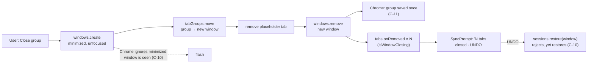

# SPEC-06 — Closing a tab group

|                |                                                                                                                                                                                                                                         |
| -------------- | --------------------------------------------------------------------------------------------------------------------------------------------------------------------------------------------------------------------------------------- |
| **Spec ID**    | SPEC-06                                                                                                                                                                                                                                 |
| **Date**       | 2026-10-14                                                                                                                                                                                                                              |
| **Module**     | `tab-list` (`src/lib/Tabs/TabsGroup/`, `src/lib/Tabs/actions.ts`, `src/lib/Tabs/undo/`) — with edges into `ui-shell` (`src/lib/surfaces.ts`) and `views` (`src/views/SearchView/`)                                                    |
| **Status**     | **draft — ready for approval** (2026-10-14). All nine clarifications are closed (§13). NC-6 was settled by two probe runs in real Chrome (§1.6, §15). **Option B ships**: the X stays a delete and is named so. Close group is blocked on Chrome (C-10). Approval is the user's to give. |
| **Supersedes** | —                                                                                                                                                                                                                                       |

---

## 1. Problem

### 1.1 What the group row's X does today

A group row carries a close button. Its handler, `handleDelete` in
`src/lib/Tabs/TabsGroup/GroupListItem.tsx:115-124`, collects the ids of `group.tabs` and calls
`chrome.tabs.remove(tabIds)` inside an empty `catch {}`. Its accessible name is
`` `Close every tab in group ${group.title || ""}`.trim() `` (`GroupListItem.tsx:157`), so an
untitled group's button is named `Close every tab in group`, with no subject at all
(`GroupDisplay.test.tsx:760` pins exactly that string). The group's ⋮ menu, named
`Actions for group <title>` (`:148`), offers "Ungroup all tabs" and "Change group" (`:336-341`).
There is no tooltip on the X, and no tooltip on any other row control either.

### 1.2 What Chrome means by those words

Chrome's own tab-group menu distinguishes two actions:

- **Close group** hides the group. Its tabs close, and Chrome keeps the group as a *saved* tab
  group, with its title and colour, under ⋮ → Tab groups and on the bookmarks bar, from where it
  can be reopened.
- **Delete group** closes the tabs and removes the saved group. Chrome's own UI asks for
  confirmation first.

**Today the X does Delete, under a name that says neither.** Someone who knows Chrome's menu and
reads "close" will expect the first, and loses the saved group.

### 1.3 What is proven in real Chrome

The test harness cannot answer any of this: its `chrome.*` is a shim (C-8). C-1…C-4 were measured
in Chrome 155 on 2026-10-14 and are recorded in `discovery/2026-10-14-keeping-tabs-for-later.md` on
branch `discovery/keeping-tabs-for-later` (commit `eaef31c` for Q3, `23bb011` for the closing
note), using `discovery/probes/sessions-probe.js` on that branch. C-10…C-12 come from this spec's
own probes, `discovery/probes/close-group-probe.js` and `discovery/probes/close-group-probe-2.js`
(§15).

| #    | Constraint                                                                                                                                                                                                                                                                                                               | Source                                                                                      |
| ---- | ------------------------------------------------------------------------------------------------------------------------------------------------------------------------------------------------------------------------------------------------------------------------------------------------------------------------- | ------------------------------------------------------------------------------------------- |
| C-1  | **`chrome.tabs.remove` on a group's tabs leaves no saved group.** "CT probe 3" appeared in neither ⋮ → Tab groups nor the bookmarks bar. Strictly the probe cannot tell "deleted" from "never saved", but the same menu lists unnamed groups such as "4 tabs", so Chrome 155 saves a group as it is made.                    | Discovery Q3                                                                                |
| C-2  | **`chrome.windows.remove` on the group's window keeps it saved**, with its title and colour, in both places.                                                                                                                                                                                                              | Discovery Q3 ("CT probe 1")                                                                 |
| C-3  | **`chrome.sessions.restore()` of a closed window brings its group back with title and colour** (and a pinned tab pinned). The catch: before the restore, the closed window's session record reported `groupId: 0` on every tab, so the record alone cannot say which tabs were grouped or what the group was called.        | Discovery Q1                                                                                |
| C-4  | **No extension API lists, saves, hides or reopens a saved group.** Closing the window is the only lever there is.                                                                                                                                                                                                         | Discovery, "Ruled out"                                                                      |
| C-5  | `chrome.tabGroups.move` can move a group only to and from windows of type `"normal"`, and a group moved **between** windows is, in the typings' words, "removed from one window and created in another" (no `onMoved` for it). **Measured since: the id and title survive the move and the group is saved once** — C-11.     | `@types/chrome` 0.0.263, `chrome.tabGroups` (`MoveProperties.windowId`, `onMoved` doc comment) |
| C-6  | `chrome.windows.create()` cannot set `alwaysOnTop`, which is how the float is told apart (`src/lib/surfaces.ts:44-57`). Any window this extension creates is therefore a *browsing* window, and `useTabsStructure.ts:165` lists its tabs like any other.                                                                     | `surfaces.ts`, `useTabsStructure.ts`                                                        |
| C-7  | `chrome.sidePanel.open()` needs a live user gesture, and the first await spends it (`surfaces.ts:34-42`). Nothing in this spec opens a side panel.                                                                                                                                                                        | `surfaces.ts`, SPEC-05 C-1/C-8                                                              |
| C-8  | **Only real Chrome can prove what this spec is about.** `src/test/chromeStub.ts:130-135` has no `tabGroups.move`; `harness/fakeChrome.ts:333-334` answers `windows.create` with `{ id: 99 }` and models no windows. Saved groups, window visibility, OS focus and what `sessions.restore` brings back exist only in Chrome.  | Read 2026-10-14                                                                             |
| C-9  | Chrome fires `tabs.onRemoved` once per tab, with unbounded gaps between them. `SyncPrompt` absorbs that by merging bursts into the prompt still on screen (`src/lib/Tabs/undo/SyncPrompt.tsx:23-44`).                                                                                                                       | `SyncPrompt.tsx`                                                                            |
| C-10 | **Close group is blocked on Chrome.** Three findings, each enough on its own to fail option A's gate: **(1)** `windows.create({ state: "minimized", focused: false })` came back `state: "normal"` — Chrome ignored "minimized" in that combination — and the user saw the window appear. **(2)** `windows.create({ focused: false })` followed at once by `windows.update({ state: "minimized" })` did minimize it, but focus moved to another window (`focusedWindowUnchanged: false`) and the window was visible for a few seconds. **(3)** `sessions.restore()` of the closed window's session rejected with `Invalid session id: "…"` — in both runs — **and restored the window anyway**; the entry then vanished from `getRecentlyClosed`. So the call's result cannot be trusted and Chrome does not hand back the restored window. **Untested:** `windows.create({ state: "minimized" })` with `focused` omitted, and whether a restored group can be moved back home. Those are the next two things to try if Close is revisited (PI-7). | Probe runs 1 and 2, Chrome/155.0.0.0, Windows 11, 2026-10-14 — §15 |
| C-11 | **Moving a group to another window keeps it one saved group.** `tabGroups.move` returned the same id (`groupIdUnchanged: true`) with the title intact; "CT close A", "CT close B" and "CT close F1" were each listed once under ⋮ → Tab groups after their window closed. C-5's duplicate risk did not happen.          | Probe runs 1 and 2 — §15                                                                    |
| C-12 | **Deleting a group, then today's Undo, brings it back whole.** `tabs.remove` on a 2-tab group produced 2 closed-*tab* entries; `sessions.restore` on each, oldest first (what `restore.ts` does), put both back **in the source window, grouped, as "CT delete C", orange**.                                                     | Probe run 1, P4 — §15                                                                       |

### 1.4 Undo is not bypassed — `run()` is

The first guess was that the group X skips Undo. **It does not.** `SyncPrompt` subscribes to
`chrome.tabs.onRemoved` globally (`SyncPrompt.tsx:145`), filtered only by `wasListedTab`
(`:135`, defined at `useTabsStructure.ts:190`). Any removal of listed tabs — this one included —
raises "N tabs closed · UNDO", and UNDO calls `restoreSessions` (`src/lib/Tabs/undo/restore.ts:175-198`):
`chrome.sessions.restore` per entry, oldest first, then focus back to `resolveUserWindow()`.

What the group X does bypass is `run()` in `src/lib/Tabs/actions.ts:9-15`, which every other close
goes through (`closeTab`, `closeTabs`, `closeWindow`, `:17-24`). A failure there raises
"Couldn't close tabs"; a failure in `handleDelete` is swallowed by `catch {}` and the user is told
nothing. `handleUngroup` (`:125-135`) and `handleUpdateGroup` (`:56-68`) swallow theirs the same way.

Whether today's UNDO brings a deleted group's tabs back *as a group, with title and colour* was
unknown when this spec was drafted. **It does** — C-12.

### 1.5 The group X is the odd one out

| Control                                        | Chrome call                                    | Saved group afterwards       |
| ---------------------------------------------- | ---------------------------------------------- | ---------------------------- |
| Window row X (`WindowListItem.tsx:88-92` → `closeWindow`) | `chrome.windows.remove`             | **kept** — every group in it (C-2) |
| Group row X (`GroupListItem.tsx:115-124`)      | `chrome.tabs.remove(group tabs)`               | **deleted** (C-1)            |
| Selection toolbar "Close" (`SelectionToolbar.tsx:72-73` → `closeTabs`) with all of a group's tabs selected | `chrome.tabs.remove(selected)` | **deleted** (C-1) — out of scope, NG-8 |

So closing a whole *window* already keeps its groups the way Chrome does, and closing a *group*,
the smaller and more deliberate act, does not. **Under option B that stays true**: the group X
keeps deleting, and now says so (§1.7).

### 1.6 The candidate for "Close group", and what the probe found

C-4 leaves one lever: make Chrome see a window close. The candidate, written as a probe at
`discovery/probes/close-group-probe.js`:

1. create a new window for the group, minimized and unfocused
   (`chrome.windows.create({ state: "minimized", focused: false })`);
2. `chrome.tabGroups.move(groupId, { windowId, index: -1 })` into it;
3. remove that window's starting placeholder tab;
4. `chrome.windows.remove` that window.

A second probe, `discovery/probes/close-group-probe-2.js`, tried step 1 the other way round —
create unfocused, then `windows.update({ state: "minimized" })` at once (F1) — and retried the Undo
with the closed entry re-read before restoring (F2).

Both runs: Chrome/155.0.0.0, Windows 11, 2026-10-14, run by the user. Full record in §15; what
each result decides is §13.1.

| #   | Question                                                                                                                                                                       | Result                                                                                                                                                                                                                                                                       | Verdict       |
| --- | ------------------------------------------------------------------------------------------------------------------------------------------------------------------------------ | ---------------------------------------------------------------------------------------------------------------------------------------------------------------------------------------------------------------------------------------------------------------------------- | ------------- |
| P1  | Does any window flash on screen or in the taskbar? Afterwards, is the group under ⋮ → Tab groups with title and colour, **exactly once**?                                       | **A window appeared**, in both variants: run 1's came back `state: "normal"`; F1's was minimized after create but still visible for a few seconds. Saved-once **held**: "CT close A", "CT close B", "CT close F1" each listed once (C-11).                                          | **fails** (flash) |
| P2  | Does focus stay in the window the user was in, and does that window's active tab stay put?                                                                                    | Run 1: `focusedWindowUnchanged: true`, `sourceActiveTabIsLooseTab: true`. F1 (minimize after create): `focusedWindowUnchanged: false`.                                                                                                                                       | **passes** in run 1; **fails** in the only variant that minimized |
| P3  | What does the recently-closed entry contain if the placeholder is kept, and if it is removed?                                                                                  | Kept: `about:blank` plus the 2 group tabs. Removed: the 2 group tabs only.                                                                                                                                                                                                   | recorded (not a gate) |
| P4  | Today's delete, then today's Undo: do the tabs come back **grouped**, with title and colour?                                                                                   | 2 closed-tab entries; both restored into the source window, grouped, "CT delete C", orange (C-12).                                                                                                                                                                             | **passes**    |
| P5  | Undo of the candidate close: can the restored group be moved back into the original window with title and colour, and does the restored window then close itself?              | `sessions.restore(windowSessionId)` **rejected** with `Invalid session id`, in both runs. In F2 the entry was found twice with the same id, 2 tabs; after the rejection it was gone, and the user's screenshot showed the window **restored anyway**: "CT close F2", green, 2 tabs, in its own window. Run 1 left 2 probe windows open, closed by the user before their contents were confirmed. The move home was never reached. | **fails** (unreliable) |
| P6  | After that Undo, is the saved group listed **once**, and shown as open?                                                                                                        | "CT close D" listed once, shown as open (run 1, the user's answer).                                                                                                                                                                                                          | passes, but moot after P5 |

### 1.7 The options

| Option | The X                          | The ⋮ menu gains                   | Matches Chrome's words | Default on the X | Needs the probe to pass | Cost and risk |
| ------ | ------------------------------ | ---------------------------------- | ---------------------- | ---------------- | ----------------------- | ------------- |
| **A**  | **Close group** (hide, saved)  | **Delete group**                   | Yes                    | Non-destructive  | **Yes** — P1, P2, P5, P6 | The only option that makes the quick control the safe one. Pays for a four-step close with a temporary window, its failure modes (E-11) and an Undo that is not today's (DEC-9). |
| **B**  | **Delete group**, renamed      | nothing                            | Yes, for one action    | Destructive      | No                      | Cheapest. Fixes the lie in the name, not the gap: Close is not offered at all. P4 decides whether Delete needs a confirm. |
| **C**  | Delete group (today's action)  | **Close group**                    | Yes                    | Destructive      | Yes — for the menu item  | Both offered; the one-press control is the one that loses data, and the safe one costs two presses. The inverse of Chrome's own weighting. |
| **D**  | removed                        | **Close group** and **Delete group** | Yes                  | — (two presses for either) | Yes — for Close   | Matches Chrome's menu exactly. Removes a control SPEC-04 counts (§1.4a, AC-22's 88.3px reservation) and makes every group close two presses. |

**Decided 2026-10-14: A, gated on the probe passing P1, P2, P5 and P6; B if it does not (DEC-6).
The gate failed — P1 in both variants, P2 in the variant that minimized, P5 in both runs — so
option B ships.** The X stays a delete and is named `Delete group <title>`; the ⋮ menu is
unchanged; nothing offers Close group. P4 passed, so Delete does not confirm (DEC-8).

---

## 2. Goals

- **G-1** The group row's controls do what Chrome's controls of the same name do. "Delete" is
  called Delete, and nothing is called "close" that deletes a saved group.
- **G-2** _Not met — blocked on Chrome._ The quick, one-press control on a group row was to be the
  least destructive one, Close group. C-10 blocks it; DEC-14 says what would reopen it.
- **G-3** A group delete fails out loud, the way every other close already does through `run()`.
- **G-4** Deleting a group never closes this extension's own pages, never moves the user to another
  window, and never leaves a window behind that the user did not have.
- **G-5** Undo keeps working for a deleted group, counts what the user closed and nothing else, and
  brings the group back whole (C-12).

## 3. Non-goals

- **NG-1** Listing, reopening or managing Chrome's saved groups from inside the extension. There is
  no API for it (C-4). Reopening a closed group is Chrome's ⋮ → Tab groups or the bookmarks bar.
- **NG-2** Any storage. SPEC-01 **AC-23** forbids `chrome.storage`, `localStorage`,
  `sessionStorage`, IndexedDB and cookies; `src/test/manifest.test.ts` enforces it. A record of
  "groups we closed" would need storage, and is not wanted.
- **NG-3** Any new manifest permission. The array stays exactly
  `["sidePanel", "tabs", "tabGroups", "sessions", "favicon"]` (SPEC-03 AC-6), with no
  `host_permissions` and no `content_scripts` (SPEC-01 NG-3).
- **NG-4** Changing the window row's X. It already keeps groups saved (§1.5, C-2). Closing a whole
  window remains the way to keep its groups.
- **NG-5** Detecting whether the user's Chrome saves groups at all. There is no API for it.
- **NG-6** A "Recently closed" list, devices, bookmarks or any other idea from the discovery
  document. Those are separate specs.
- **NG-7** Changing the Undo prompt's merge window, its duration, or how it chooses which surface
  speaks (SPEC-01 AC-42). This spec only requires that a group delete be counted correctly by it.
- **NG-8** Multi-select close (the selection toolbar's Close covering all of a group's tabs) and
  closing a group's last tabs one by one. Both keep deleting the saved group, as today (§1.5). A
  selection is a set of tabs, not a group, and Chrome's own strip closes tabs one at a time the same
  way. Decided 2026-10-14 (DEC-10); PI-3 keeps the idea.
- **NG-9** **Close group — hiding a group and keeping it saved — from any control.** Blocked on
  Chrome (C-10), not declined on taste. Its criteria are kept, set apart, in §5.10; DEC-14 and PI-7
  say how it would be revisited.

## 4. User stories

- **US-1** _Not served — blocked on Chrome (C-10)._ As someone who knows Chrome's tab-group menu, I
  want the group's X to close the group the way Chrome does, so that I can reopen it from ⋮ → Tab
  groups next week with its name and colour.
- **US-2** As someone tidying for good, I want a clearly named way to delete a group, so that it
  does not linger in Chrome's saved groups.
- **US-3** As a screen-reader user, I want the button's name to say that it deletes, and which
  group, so that I know before I press it — including for a group with no title.
- **US-4** As someone working in the float or the side panel, I want a group delete not to move me,
  flash a window at me, or close the panel I am working in.
- **US-5** As someone who pressed the wrong thing, I want UNDO to put the group back where it was,
  as it was.

---

## 5. Acceptance criteria

Each is one testable statement. Ids are stable — never renumber; append `AC-N+1` for new ones.
Priority uses MoSCoW. **Real Chrome only** marks a criterion that no unit test, jsdom run or
harness pass can prove (C-8). AC-27…AC-30 were added after the rest and sit where they belong.

**Option B ships (DEC-6, §13.1).** The criteria in §5.2…§5.9 apply. **AC-1…AC-5, AC-10, AC-17,
AC-18 and AC-22 do not apply under B**: they describe Close group, or the ⋮ menu item option A
would have added. They are kept, unchanged and set apart, in §5.10 — ids are never reused, and
they are what a revisit of Close starts from. (§5.1, "Close group", became §5.10; the other
section numbers are unchanged.)

### 5.2 Delete group  *(the X, under option B)*

- **AC-6** _(Must)_ WHEN the user activates Delete group, the system SHALL close every tab of that
  group other than this extension's own pages, and Chrome SHALL keep no saved group for it.
  **Verify:** unit (shim) — `chrome.tabs.remove` receives exactly the group's tabs as Chrome reports
  them when the action runs, own pages excluded — in search results too, where the row shows fewer
  (AC-29, E-4, E-10); manual, **real Chrome only** — the group is absent from ⋮ → Tab groups
  afterwards (C-1).
- **AC-7** _(Must)_ WHEN the user activates Delete group, the system SHALL NOT ask for
  confirmation; UNDO is the way back (DEC-8 — P4 passed, C-12).
  **Verify:** unit — activate Delete group and assert `tabs.remove` is called with no dialog
  rendered. _(Had P4 failed, this criterion required a confirmation naming the group and its count,
  defaulting to the non-destructive choice. If a later Chrome stops regrouping on Undo, that is the
  form to return to.)_

### 5.3 This extension's own pages

- **AC-8** _(Must)_ WHEN Delete group runs on a group that contains one of this extension's own
  pages (`isOwnPage`, `surfaces.ts:14-15` — the anchor tab or the extension page in a plain tab),
  that page SHALL stay open in its window, SHALL NOT be part of the group afterwards, and a float
  held by it SHALL stay open.
  **Verify:** unit (shim) — a fixture whose raw `chrome.tabs.query` puts the anchor tab inside the
  group (the list never shows it, `useTabsStructure.ts:165`); assert it is never passed to
  `tabs.remove` and ends ungrouped. Manual, **real Chrome only** — with a float up, drag the anchor
  tab into a group, delete the group from the float, and confirm the float survives and the group
  is gone from ⋮ → Tab groups. _(Today's X leaves the anchor behind **inside** the group, so the
  Chrome group survives holding only it, invisible in the list — and is therefore not deleted at
  all. Closing the anchor would kill the float — SPEC-01 AC-12.)_

### 5.4 Failure

- **AC-9** _(Must)_ IF any Chrome call made by Delete group rejects, THEN the system SHALL show an
  error snackbar, "Couldn't delete group", the way `run()` does for every other close
  (`actions.ts:9-15`), and SHALL NOT swallow it.
  **Verify:** unit — make each call reject in turn and assert the snackbar text; assert no
  `catch {}` that discards the error remains on this path. _(Close group's half, "Couldn't close
  group", is kept with §5.10.)_
- **AC-27** _(Must)_ WHEN the user activates Delete group again on the same group while the first
  is still running, the system SHALL perform it once.
  **Verify:** unit — two activations in one tick produce one `tabs.remove`. _(The Close half — one
  `windows.create` — is kept with §5.10.)_

### 5.5 Focus and surfaces

- **AC-11** _(Must)_ Delete group SHALL NOT change which browser window is focused, nor the active
  tab of the group's window unless that tab was in the group (E-7).
  **Verify:** manual, **real Chrome only** — the AC-24 sweep; unit (shim) — no
  `windows.update({ focused })` and no `tabs.update({ active })` is issued by the action.
- **AC-12** _(Must)_ Delete group SHALL NOT close the side panel, except where the panel's own
  window closes because the group was every tab in it (E-1).
  **Verify:** manual, **real Chrome only** — delete a group in the panel's window that does not
  fill it, and in another window; the panel stays. Unit — the action calls no `sidePanel.*` and no
  `bringPanelAlong`.
- **AC-13** _(Must)_ WHEN the focused group row disappears because its group was deleted, keyboard
  focus SHALL land on a real, named element that is still in the document — never on
  `document.body` and never on a removed node. That element SHALL be the first control of the row
  that now follows where the group was; IF there is none, THEN the first control of the row before
  it; IF the list is empty, THEN the search field (DEC-12).
  **Verify:** unit — focus the X, activate it, let the store refresh, assert
  `document.activeElement` is connected, is not `body`, and is: the next row's first control; with
  the group last in the list, the previous row's; with the group the only row, the search field.
  Manual with NVDA — the user does not hear "Conscious Tabs, document" (SPEC-04 §13.5 heard exactly
  that when a focused row unmounted). _(SPEC-05 E-8's "never on a detached or removed node" is the
  rule extended. Under B the delete is on the X only, so SPEC-04 E-15's menu case does not arise
  here.)_
- **AC-14** _(Must)_ Delete group SHALL behave identically in the side panel, the anchor tab and
  the float, apart from what AC-12 says about the panel's own window.
  **Verify:** unit — the same action under each host; manual — the AC-24 sweep on all three.

### 5.6 Undo

- **AC-15** _(Must)_ WHEN a group is deleted, the existing Undo prompt SHALL appear once, in the one
  surface the user is looking at (SPEC-01 AC-42), reading the number of tabs the action closed —
  never counting an own page or a tab twice.
  **Verify:** unit — fire `tabs.onRemoved` for the group's tabs, spaced and interleaved, with
  `isWindowClosing: true` for the E-1 case; assert one prompt reading "N tabs closed", N the number
  of the group's tabs, own pages excluded.
- **AC-16** _(Must)_ WHEN the user presses UNDO after a Delete, every closed tab SHALL come back,
  into the window it was deleted from, as a group with its title and colour.
  **Verify:** manual, **real Chrome only** — measured as P4 (C-12); repeated on the build in the
  AC-24 sweep. Unit — the restore asks for exactly the entries the delete produced.

### 5.7 Names and words

- **AC-19** _(Must)_ The group row's X SHALL be named `Delete group <title>`; for an untitled group,
  `Delete untitled group, N tabs`, N the number of tabs in the group (DEC-7). In search results the
  name also carries the count (AC-29). The X SHALL have no visible tooltip.
  **Verify:** unit — the accessible name for a titled group and an untitled one, and no `title`
  attribute or tooltip on the X; update the strings `GroupDisplay.test.tsx:278`, `:495`, `:698` and
  `:760` pin today. _(The Close names of DEC-7 — `Close group <title>`, `Close untitled group,
  N tabs` — are kept for a revisit; nothing uses them under B.)_
- **AC-20** _(Must)_ No group-row control SHALL have an empty name or a name that is only a verb
  phrase with no subject. An untitled group's delete control SHALL call it "untitled group" and
  give its count, per AC-19.
  **Verify:** unit — the untitled-group test (`GroupDisplay.test.tsx:750-764`) asserts every name
  identifies the group. _(SPEC-04 AC-6. Today's `Close every tab in group` meets the letter of
  "non-empty" and says nothing about which group.)_
- **AC-21** _(Must)_ The X's name, the menu button's name and the toolbar's name SHALL be distinct
  from one another on the same row.
  **Verify:** unit — collect the three for a titled and an untitled group; assert distinct.
  _(SPEC-04 AC-29; the toolbar is `"<title or Untitled>, group, N tabs"`, `GroupDisplay.tsx:36-39`.
  For an untitled group the X says `Delete untitled group, 3 tabs` and the toolbar
  `Untitled, group, 3 tabs` — distinct, but close; AC-23 is where that is heard.)_
- **AC-23** _(Must)_ The wording of AC-19…AC-21 and AC-29 SHALL be heard with NVDA + Chrome before
  it ships, in the side panel at least, with the result recorded in this file: NVDA version, Chrome
  version, surface, date, tester, and what was said for a titled group, an untitled group and a
  search-result group.
  **Verify:** manual — a result block here, in the style of SPEC-04 AC-27. _(SPEC-04's names were
  decided by ear — §13.3, §13.5 — and one reviewed wording fix was built and removed after ten
  minutes with NVDA. A name that reads well on paper is not yet known to sound well.)_

### 5.8 Nothing else regresses, and the real-Chrome sweep

- **AC-24** _(Must)_ A manual pass in **real Chrome** SHALL be recorded in this file before it may
  reach `implemented`, deleting with the built X and pressing UNDO each time, covering: a titled,
  coloured group (gone from ⋮ → Tab groups; back grouped after UNDO — C-12 on the build); a
  collapsed group (E-6); a group holding the window's active tab (E-7); a group that is every tab of
  its window, with the side panel in that window (E-1); a group holding the anchor tab with a float
  up (AC-8); a group row in search results (E-4, AC-29); and a shared group (AC-28) if the profile
  can make one. Each with Chrome version, OS, date and result.
  **Verify:** the result block. _(P1–P6 are already recorded in §1.6 and §15 and are not repeated.)_
- **AC-25** _(Must)_ The feature SHALL write nothing to `chrome.storage`, `localStorage`,
  `sessionStorage`, IndexedDB or cookies, and the manifest's `permissions` SHALL remain exactly the
  five of SPEC-03 AC-6.
  **Verify:** unit — `src/test/manifest.test.ts`, unmodified.
- **AC-26** _(Must)_ The window row's close button and the selection toolbar's Close SHALL behave
  exactly as today (NG-4, NG-8).
  **Verify:** existing `WindowListItem` and `SelectionToolbar` tests pass unmodified.
- **AC-30** _(Must)_ Under option B the group's ⋮ menu SHALL offer exactly what it offers today,
  "Ungroup all tabs" and "Change group", and SHALL NOT gain a Close group or Delete group item.
  **Verify:** unit — the menu's items by role and name, for a plain and a shared group.

### 5.9 Shared groups and search results  *(added with the 2026-10-14 answers)*

- **AC-28** _(Must)_ WHERE a group is shared (`TabGroup.shared === true`), the system SHALL NOT
  offer Delete group for it: under option B its row SHALL have no X. WHERE `shared` is `undefined`
  or absent, the group SHALL be treated as not shared (DEC-13, E-8, E-19).
  **Verify:** unit — a fixture group with `shared: true` renders no X; the same group with `shared`
  absent renders it. Manual, **real Chrome only** — AC-24, where a shared group is available.
  _(The extension cannot tell whether `tabs.remove` on a shared group's tabs deletes it for every
  collaborator, so it does not offer the action that might. A shared group row keeps four controls,
  which still clears APG's three-control threshold for a toolbar — SPEC-04 §1.4a. Had option A
  shipped, Close group would have been offered on it as on any group.)_
- **AC-29** _(Must)_ WHEN Delete group is activated on a group row in search results, the action
  SHALL apply to the **whole** Chrome group, including tabs the row does not show, and the X's
  accessible name on that row SHALL carry the group's full tab count: `Delete group <title>,
  N tabs`, or `Delete untitled group, N tabs`, N counted over the whole group, not the matches
  (DEC-11).
  **Verify:** unit — in `SearchView` with a filter matching 2 of a 5-tab group, the X is named
  `Delete group Reading, 5 tabs` and the action reaches all 5 tabs. Manual — AC-24's search item.

### 5.10 Close group — blocked on Chrome  *(not applicable under option B)*

Kept as written when option A was still open, so a revisit starts from them rather than from a
blank page (DEC-14, PI-7). **None of these is required by this spec.** Where they say "either
action", read "Close group".

- ~~**AC-1**~~ _(Must, under A only)_ WHEN the user activates Close group on a group row, the system
  SHALL close every tab of that Chrome group, other than this extension's own pages (AC-8), in a way
  that leaves Chrome holding the group as a saved tab group with its title and colour.
  **Verify:** manual, **real Chrome only** — close a titled, coloured group and find it under
  ⋮ → Tab groups and on the bookmarks bar with both. Unit (shim) — the group's tabs are never
  passed to `chrome.tabs.remove`, and the window that is finally passed to `chrome.windows.remove`
  holds the group's tabs and nothing of the user's besides (C-1, C-2).
- ~~**AC-2**~~ _(Must, under A only)_ WHEN Close group completes, Chrome SHALL list the group under
  ⋮ → Tab groups **exactly once**.
  **Verify:** manual, **real Chrome only** — P1. _(Held in both probe runs — C-11.)_
- ~~**AC-3**~~ _(Must, under A only)_ WHILE Close group runs, no window SHALL become visible on
  screen or in the taskbar.
  **Verify:** manual, **real Chrome only** — P1, watched, on Windows; unit (shim) — any window the
  action creates is created minimized and unfocused, and no call focuses or restores it.
  _(**Failed in both probe variants** — C-10 (1), (2).)_
- ~~**AC-4**~~ _(Must, under A only)_ WHERE the group is every listed tab of its window, Close group
  SHALL close that window and SHALL leave the group saved (E-1).
  **Verify:** manual, **real Chrome only** — a window holding one group and nothing else; unit
  (shim) — the source window ends up passed to `chrome.windows.remove`, or emptied, and no other
  window is left. _(Closing the source window directly is the route C-2 proves, and needs no
  temporary window — so this one case of Close is not blocked by C-10. Offering Close only there
  was not asked for; PI-7.)_
- ~~**AC-5**~~ _(Should, under A only)_ WHILE Close group runs, any window it creates, and that
  window's starting tab, SHALL NOT appear as a row in the list on any surface.
  **Verify:** unit — in the harness, fire `windows.onCreated`, `tabs.onCreated`, `tabs.onAttached`
  and `tabs.onRemoved` in the order Chrome would, and assert no window row or `about:blank` row is
  ever rendered. _(C-6.)_
- ~~**AC-10**~~ _(Must, under A only)_ IF Close group fails after the group has left its window,
  THEN the end state SHALL be either the completed close or the group back in its original window,
  at its original position, with its title and colour — never a window the user did not have, and
  never the group in another window. IF neither can be reached, THEN the window holding the group
  SHALL be left visible and not minimized, and the snackbar SHALL say the group was left in a
  separate window.
  **Verify:** unit (shim) — reject the placeholder removal, then the window close, then the move
  back, each in turn; assert no window is left minimized holding the user's tabs, and assert the
  snackbar.
- ~~**AC-17**~~ _(Must, under A only)_ WHEN the user presses UNDO after a Close, the group SHALL
  come back into the window it was closed from, at the position it had, with its title and colour;
  the window Chrome restored it into SHALL be closed; and focus SHALL return to the user's window as
  `restore.ts` already does. No window the user did not have SHALL be left open, and none SHALL be
  left minimized (DEC-9).
  **Verify:** manual, **real Chrome only** — P5; unit (shim) — after UNDO, a `tabGroups.move` into
  the original window at the original index, the restored window closed, and
  `windows.update({ focused: true })` on the user's window. _(**P5 failed**: the restore rejects
  and does not hand back the window it restored — C-10 (3).)_
- ~~**AC-18**~~ _(Must, under A only)_ WHEN UNDO after a Close completes, Chrome SHALL list the
  saved group exactly once, as open.
  **Verify:** manual, **real Chrome only** — P6.
- ~~**AC-22**~~ _(Must, under A only)_ WHERE the ⋮ menu offers Delete group (option A), the item's
  visible text and accessible name SHALL be "Delete group", Chrome's words. The menu is already
  named for its group (`Actions for group <title>`), so the item does not repeat the title.
  **Verify:** unit — the menu's items by role and name. _(Under B the menu gains nothing — AC-30.)_

---

## 6. Edge cases

Rows marked _(Close only)_ do not arise under option B and are kept for a revisit.

| #        | Case                                                                                                 | Expected                                                                                                                                                                                                                                                                                                      |
| -------- | ---------------------------------------------------------------------------------------------------- | ------------------------------------------------------------------------------------------------------------------------------------------------------------------------------------------------------------------------------------------------------------------------------------------------------------- |
| **E-1**  | The group is every listed tab of its window                                                          | Deleting it closes the window, **as it does today**: Chrome closes a window whose last tab closes. If the side panel lives there, it closes with it, and its Undo prompt goes with it; another visible surface may still raise one. UNDO then restores the tabs per their closed entries. AC-12, AC-15.        |
| **E-2**  | The window holds the group and the anchor tab, nothing else                                          | The anchor tab stays, ungrouped (AC-8), so the window stays open. Not E-1.                                                                                                                                                                                                                                       |
| **E-3**  | The anchor tab is inside the group                                                                   | `group.tabs` never contains it (filtered at `useTabsStructure.ts:165`), but Chrome's group does. AC-8: it stays open and leaves the group, so the group is really deleted. Today's X leaves it **in** the group, so the Chrome group outlives the delete, unseen in the list.                                    |
| **E-4**  | A group row in search results (SPEC-04 E-3, E-17)                                                    | It carries the X and the ⋮ menu too, but its `group.tabs` holds only the **matching** tabs (`getTabsTree` filters before grouping, `useTabsStructure.ts:46-48`). Today's X there removes the matches and leaves the rest of the group open. **Decided (DEC-11): the delete acts on the whole group**, and the X's name carries the full count (AC-29). **Consequence, accepted:** under option B the X is a one-press Delete with no confirmation (DEC-8), so from a search row it removes tabs the row does not show; its name says how many before it is pressed, and UNDO brings them all back grouped (C-12). |
| **E-5**  | Untitled group                                                                                        | Today the X is named `Close every tab in group` and the toolbar `Untitled, group, N tabs`; Chrome calls it by its count ("4 tabs"). **Decided (DEC-7):** `Delete untitled group, N tabs`. AC-19, AC-20.                                                                                                       |
| **E-6**  | A collapsed group                                                                                     | Delete works the same. Whether UNDO restores it collapsed is unmeasured — AC-24. Not a requirement either way.                                                                                                                                                                                                  |
| **E-7**  | The group holds its window's active tab                                                               | Chrome must make another tab active in that window; which one is Chrome's choice and is not overridden. AC-11 exempts this case.                                                                                                                                                                              |
| **E-8**  | A shared tab group (`TabGroup.shared`, Chrome 137+ per the brief)                                     | What Delete means for collaborators is unknown and is not researched here; the installed `@types/chrome` 0.0.263 does not declare `shared`. **Decided (DEC-13):** Delete is not offered — under B, the row has no X (AC-28). The selection toolbar's Close can still remove all of its tabs (NG-8); see §16 item 3. |
| **E-9**  | A Chrome version or setting that does not save groups                                                 | Delete behaves the same; there is simply no saved group to remove. Not detectable (NG-5).                                                                                                                                                                                                                       |
| **E-10** | The group changes between render and action (a tab added or removed)                                  | Delete acts on the group's tabs as Chrome reports them when the action runs, own pages excluded, not on a stale render, so a tab added a moment ago is not left behind holding the group open.                                                                                                                  |
| **E-11** | _(Close only)_ A close that fails half-way                                                            | AC-10 (§5.10). Possible stops: window created but move refused; moved but placeholder not removed; moved but window not closed; move back refused.                                                                                                                                                              |
| **E-12** | The selection contains some or all of the group's tabs                                               | Deleting the group removes them from Chrome; the selection drops ids that no longer exist, as it does for any closed tab. Nothing else is required. Multi-select close of a whole group stays a delete (NG-8).                                                                                                  |
| **E-13** | The X is focused when the row disappears                                                              | AC-13.                                                                                                                                                                                                                                                                                                        |
| **E-14** | The Undo prompt is already up for an earlier close                                                    | `SyncPrompt` merges a burst into the prompt still on screen (C-9). A group delete joins it like any other close. NG-7.                                                                                                                                                                                        |
| **E-15** | _(Close only)_ The user presses Ctrl+Shift+T after a Close                                            | Chrome would reopen the temporary window, so the group would come back in a **new window** (C-3).                                                                                                                                                                                                             |
| **E-16** | _(Close only)_ Chrome's History → Recently closed after a Close                                       | Would show a closed window the user never opened. P3: with the placeholder removed, it holds only the group's tabs.                                                                                                                                                                                          |
| **E-17** | _(Close only)_ Chrome's own reopen of a saved group, next to this extension's UNDO                     | Reopening from ⋮ → Tab groups is Chrome's (NG-1). P6 found the saved group listed once, as open, after a restore.                                                                                                                                                                                             |
| **E-18** | A title containing markup, quotes or a right-to-left override                                         | Names are built as text (SPEC-04 AC-24).                                                                                                                                                                                                                                                                      |
| **E-19** | `shared` is `undefined` — a Chrome older than shared groups, or typings that do not declare it (0.0.263 does not) | Treated as **not shared**: the X is offered as for any group (AC-28). Only `shared === true` withholds it. |
| **E-20** | After Delete and UNDO, is the group a saved group again?                                              | Unmeasured. Chrome 155 saves a group as it is made (C-1), so the restored group may reappear under ⋮ → Tab groups as a new saved group. Not a requirement either way; noted so it is not reported as a defect.                                                                                                 |

---

## 7. Assumptions and dependencies

- **A-1** Chrome keeps saving groups as they are made, as Chrome 155 does (C-1).
- **A-2** Chrome closes a window when its last tab closes (E-1). Today's behaviour, unchanged.
- **A-3** _(Close only.)_ `chrome.tabGroups.move` into a newly created window is permitted. **Held**
  in both runs (C-11).
- **A-4** The probe ran on one Chrome version, one profile, one OS (Windows 11). C-10's findings
  about window state and focus may differ on macOS or Linux window managers. Under B nothing
  depends on them.
- **A-5** C-12 (Undo regroups a deleted group) is one measurement of a 2-tab group. AC-24 repeats it
  on the build, with a collapsed group as well.
- **D-1** Depends on SPEC-01 (surfaces; AC-12, AC-23, AC-42), SPEC-03 (AC-6), SPEC-04 (AC-6, AC-24,
  AC-29, E-3, E-15, E-17) and SPEC-05 (E-8).

## 8. Non-functional requirements

- **NFR-1 Accessibility.** WCAG 2.1 **4.1.2 Name, Role, Value** (AC-19…AC-21), **2.4.3 Focus
  Order** (AC-13). **3.3.4 Error Prevention** is met by reversal rather than confirmation: UNDO
  restores the group whole (AC-7, AC-16, C-12).
- **NFR-2 No visible side effects.** No window shown, no focus moved, no panel closed, beyond what
  the user asked for (AC-11, AC-12).
- **NFR-3 Privacy.** No storage, no new permission (AC-25).
- **NFR-4 Internationalisation.** Names stay English string templates built as text, as SPEC-04
  NFR-5 says.

## 9. Cross-module impact

| Area                                                  | Impact                                                                                                                                                                                                                                                                  |
| ----------------------------------------------------- | ----------------------------------------------------------------------------------------------------------------------------------------------------------------------------------------------------------------------------------------------------------------------- |
| `tab-list` — `TabsGroup/GroupListItem.tsx`            | The X's name (AC-19, AC-29) and its handler: through `run()` (AC-9), on the group as Chrome has it (E-10), protecting own pages (AC-8), once (AC-27), absent for shared groups (AC-28). The ⋮ menu is unchanged (AC-30).                                                 |
| `tab-list` — `TabsGroup/GroupDisplay.tsx`             | The toolbar name stays; AC-21 checks the X's name against it. The control count is unchanged, so SPEC-04 AC-22's 88.3px chip reservation holds — except on a shared group, which has no X (AC-28) and so reserves more than it needs.                                     |
| `tab-list` — `actions.ts`                             | `run()` is where "Couldn't delete group" comes from (AC-9).                                                                                                                                                                                                             |
| `tab-list` — `undo/` (`SyncPrompt.tsx`, `restore.ts`) | No change required: a delete is already counted and restored correctly per C-12. AC-15 and AC-16 pin that. §16 item 2 is a separate possible defect in window Undo.                                                                                                       |
| `tab-list` — `useTabsStructure.ts`                    | The whole group's tab count for a search row's name (AC-29), from the unfiltered snapshot.                                                                                                                                                                              |
| `ui-shell` — `surfaces.ts`                            | `isOwnPage` decides what AC-8 protects; `bringPanelAlong` must not be reached (AC-12).                                                                                                                                                                                  |
| `views` — `SearchView`                                | Search-result group rows carry the X with a filtered `group.tabs`; the delete reaches the whole group and the name carries its full count (E-4, AC-29).                                                                                                                  |
| `tab-list` — `selection/SelectionToolbar.tsx`         | Unchanged (NG-8, AC-26).                                                                                                                                                                                                                                                |
| SPEC-04                                               | AC-6, AC-29 constrain the names. The strings pinned in `GroupDisplay.test.tsx` change (AC-19). E-15 is untouched under B, because the ⋮ menu gains no item that removes its own row. Nothing is superseded.                                                               |
| SPEC-05                                               | E-8's "never on a detached or removed node" is extended to a deleted group (AC-13).                                                                                                                                                                                     |
| SPEC-01                                               | AC-12 (closing the anchor kills the float) is why AC-8 exists; AC-23 and AC-42 are carried forward (AC-25, AC-15).                                                                                                                                                       |
| Test suite                                            | `GroupDisplay.test.tsx` names change. `src/test/chromeStub.ts` has no `tabs.ungroup` (the harness fake has one, `harness/fakeChrome.ts:297`), which AC-8's Verify needs; fixtures need `shared` for AC-28.                                                               |
| `README.md`, `store-listing.md`                       | No permission change, no wording change required.                                                                                                                                                                                                                       |

## 10. Inputs

| Input                                                            | Provenance                                                                                              |
| ---------------------------------------------------------------- | --------------------------------------------------------------------------------------------------------- |
| `chrome.tabGroups.TabGroup.id`, `.title`, `.color`, `.collapsed`, `.windowId` | [reused] — already drive the group row.                                                    |
| `GroupItem.tabs` (`src/lib/Tabs/types.ts`)                        | [reused] — the listed tabs of a group; filtered in search (E-4).                                         |
| `chrome.tabs.query({ groupId })`                                  | [new use of a held API] — the group's tabs as Chrome has them now, own pages included (AC-8, E-10).        |
| `chrome.tabs.ungroup`                                             | [reused API, new caller] — taking an own page out of the group before the delete (AC-8).                   |
| `chrome.sessions.getRecentlyClosed`, `.restore`                   | [reused] — today's Undo.                                                                                  |
| `chrome.tabGroups.TabGroup.shared`                                | [new] — read only to withhold the X (AC-28); `undefined` means not shared (E-19).                          |
| The whole group's tab count in search results                     | [new, derived] — from the unfiltered snapshot, for AC-29's name.                                           |
| Probe runs 1 and 2                                                | [external, recorded] — §15; `discovery/probes/close-group-probe.js`, `discovery/probes/close-group-probe-2.js`. |
| Discovery Q1, Q3                                                  | [reused] — `discovery/2026-10-14-keeping-tabs-for-later.md` on `discovery/keeping-tabs-for-later`.          |

## 11. Untrusted inputs

- **A group's title is user-controlled and arbitrary**, and is interpolated into the X's name, the
  menu button's name and the toolbar's name. Text only, never markup, never an id or a selector
  (SPEC-04 AC-24, E-18).
- **A tab's URL decides what is protected** (`isOwnPage`). It is compared against
  `chrome.runtime.getURL("")` by prefix; a page cannot make its URL begin with this extension's
  origin, so it cannot opt itself into AC-8's protection.
- Nothing here executes or evaluates a title or URL.

## 12. Proposed improvements (not required)

- **PI-1** _Withdrawn 2026-10-14: the probes are committed with this spec, so they can be re-run
  when Chrome changes._
- **PI-2** Route `handleUngroup` and `handleUpdateGroup` (`GroupListItem.tsx:56-68`, `:125-135`)
  through `run()` as well. They swallow failures the same way the X does. Out of scope here only
  because they are not closes.
- **PI-3** Multi-select close is out of scope (NG-8). A later spec could treat a fully selected
  group as a group — including withholding it when the group is shared (§16 item 3).
- **PI-4** Apply AC-13's focus rule to tab rows and window rows, and to "Ungroup all tabs", which
  also removes the focused group row. Closing a focused tab row today drops focus to the document,
  by the same mechanism; no spec names a target for it.
- **PI-5** _Closed 2026-10-14: P4 passed (C-12) — today's Undo already regroups a deleted group, so
  there is nothing to regroup from memory._
- **PI-6** Check the Undo of a **window** close against C-10 (3). If `sessions.restore` of a window
  session rejects while succeeding in ordinary use too, then `restoreSessions` would show "Couldn't
  restore those tabs" after restoring them (`SyncPrompt.tsx:99-107`), and its loop would stop at
  that entry and skip any older ones in the same burst (`restore.ts:185-190`). Only the
  temporary-window case was measured here; the window row's X was not.
- **PI-7** If Close group is revisited: first try `windows.create({ state: "minimized" })` with
  `focused` **omitted** (C-10's untested variant), watched for a flash and checked for focus; then
  check whether a group restored by `sessions.restore` can be moved back into its original window
  with its title and colour, given that the restore does not report the window it made. Separately,
  Close for a group that is every tab of its window needs no temporary window at all
  (`windows.remove` on the source window, C-2) and is not blocked by C-10.

## 13. Decided here, and why

| #         | Decision                                                                                                                                                                                                                                                                       |
| --------- | ------------------------------------------------------------------------------------------------------------------------------------------------------------------------------------------------------------------------------------------------------------------------------ |
| **DEC-1** | **Close is defined by its outcome in Chrome, not by its mechanism.** AC-1 asks that Chrome keep the group saved. The move-then-close of §1.6 was the candidate because C-4 leaves no other lever. Kept for a revisit (DEC-14).                                                   |
| **DEC-2** | **Group closes fail out loud, through the same `run()`-style snackbar as every other close** (AC-9). The empty `catch {}` was the only close path that told the user nothing.                                                                                                |
| **DEC-3** | **This extension's own pages are never closed by a group action, and never left inside the group** (AC-8). Closing the anchor kills the float (SPEC-01 AC-12); leaving it inside makes the group survive a delete without the list showing it.                              |
| **DEC-4** | **Undo is the existing prompt, not a new one.** It already fires for this close (§1.4). This spec only asks that it count correctly (AC-15) and restore well (AC-16).                                                                                                        |
| **DEC-5** | **The window row's X is not touched** (NG-4). It already keeps groups saved.                                                                                                                                                                                                |
| **DEC-6** (was NC-1) | **Option A, gated on the probe; option B if the gate fails** (answered 2026-10-14). **Settled by NC-6, 2026-10-14: the gate failed — option B ships.** P1 failed in both variants (a window was seen); P2 failed in the one variant that did minimize; P5 failed in both runs (the restore rejects). The X stays a delete, named `Delete group <title>`; the ⋮ menu gains nothing (AC-30); Close group is offered nowhere (NG-9). |
| **DEC-7** (was NC-2) | **Chrome's words, and a count where there is no title.** Under B: `Delete group <title>`, `Delete untitled group, N tabs`, and the full count on search rows (AC-29). No tooltip — no row control has one. The Close names (`Close group <title>`, `Close untitled group, N tabs`) and the menu item "Delete group" were decided for option A and are kept for a revisit. Heard with NVDA before it ships, AC-23. Answered 2026-10-14. |
| **DEC-8** (was NC-3) | **Delete confirms only if Undo cannot regroup** (answered 2026-10-14). **Settled by P4, which passed (C-12): no confirmation.** AC-7. |
| **DEC-9** (was NC-4) | **UNDO of a Close puts the group back in its window and position**, closes the window Chrome restored it into, and returns focus to the user's window (answered 2026-10-14). **Moot under B.** Kept with AC-17 in §5.10. The answered fallback — accept the new window, visible and unfocused — is kept too; C-10 (3) shows the restore does not even report which window it made, which any revisit has to solve first. |
| **DEC-10** (was NC-5) | **Multi-select close and one-by-one closes are out of scope** (NG-8, AC-26). PI-3 keeps the idea. Answered 2026-10-14. |
| **DEC-11** (was NC-7) | **On a search row, the delete acts on the whole group, and the X's name carries the full tab count** (AC-29). The consequence is in E-4. Answered 2026-10-14. |
| **DEC-12** (was NC-8) | **Focus goes to the next row's first control, else the previous row's, else the search field** (AC-13). Answered 2026-10-14. |
| **DEC-13** (was NC-9) | **Delete is not offered for shared groups** (AC-28); under B that means no X on a shared group's row. The extension cannot confirm that `tabs.remove` does not delete the group for every collaborator, so it does not offer the action that might. `shared` undefined counts as not shared (E-19). Answered 2026-10-14. |
| **DEC-14** (was NC-6) | **Close group is blocked on Chrome, not abandoned.** The probe answered NC-6 on 2026-10-14 (§1.6, §15). Its criteria are kept in §5.10 and its reasons in C-10. Revisiting needs a new probe of C-10's untested variant and of moving a restored group home (PI-7), then a superseding spec or an amendment here. |

### 13.1 What the probe settled

Field names are the probe's JSON; "lookFor" lines are its questions for the person watching.

| P   | Passes when                                                                                                                                                                                       | Result (§15)                                                                                     | Decided                                  |
| --- | ------------------------------------------------------------------------------------------------------------------------------------------------------------------------------------------------- | ------------------------------------------------------------------------------------------------ | ---------------------------------------- |
| P1  | `p1p2Watched` has no `error` and `steps` has no `moveError`; lookFor 1 is "none" (no window, no taskbar button); lookFor 2: "CT close A" is listed, purple, **exactly once**.                       | **Fail.** A window was seen in run 1 and in F1. Listed once: pass.                               | Gate fails → **option B** (DEC-6).        |
| P2  | `p1p2Watched.focusedWindowUnchanged` is `true` **and** `p1p2Watched.sourceActiveTabIsLooseTab` is `true`.                                                                                          | Pass in run 1; **fail** in F1, the only variant in which the window was really minimized.        | Gate fails → **option B**.               |
| P3  | Not a gate. Read `p3KeepPlaceholder.newestClosed.tabs` against `p1p2Watched.newestClosed.tabs`, and lookFor 3.                                                                                     | Kept: `about:blank` + 2 group tabs. Removed: 2 group tabs.                                       | Nothing (Close only).                    |
| P4  | `p4DeleteThenUndo.groupsAfterUndo` contains a group titled "CT delete C" with colour `orange`.                                                                                                       | **Pass.** Restored into the source window, grouped, "CT delete C", orange.                        | **No confirmation** on Delete (DEC-8).    |
| P5  | `p5p6CloseThenUndo` has no `undo` failure text, and `backInSourceWindow` is `{ title: "CT close D", color: "green" }`.                                                                                | **Fail.** `sessions.restore` rejected "Invalid session id" in run 1 and F2; F2's window was restored anyway. Move home not reached. | Gate fails → **option B**.               |
| P6  | lookFor 4: "CT close D" is listed **once** and shown as open.                                                                                                                                      | Pass.                                                                                            | Moot once P5 failed.                     |

## 14. Traceability

| AC                         | Where it lands                                                                                          |
| -------------------------- | ------------------------------------------------------------------------------------------------------- |
| AC-6, AC-7, AC-27          | `TabsGroup/GroupListItem.tsx`, `actions.ts`                                                              |
| AC-8                       | `surfaces.ts` (`isOwnPage`), the delete action                                                          |
| AC-9                       | `actions.ts` (`run`)                                                                                     |
| AC-11, AC-12, AC-14        | The delete action; `surfaces.ts`                                                                        |
| AC-13                      | `TabsGroup/GroupListItem.tsx`, the list containers (`Tabs.tsx`, `TabsView`, `SearchView`)               |
| AC-15, AC-16               | `undo/SyncPrompt.tsx`, `undo/restore.ts`, `useTabsStructure.ts` (`wasListedTab`) — pinned, not changed  |
| AC-19 … AC-21, AC-23       | `TabsGroup/GroupListItem.tsx`, `TabsGroup/GroupDisplay.test.tsx`; a result block in this file           |
| AC-24                      | A result block in this file                                                                              |
| AC-25, AC-26, AC-30        | `src/test/manifest.test.ts`; existing window-row and selection-toolbar tests; the ⋮ menu                |
| AC-28                      | `TabsGroup/GroupListItem.tsx` — the X, keyed on `group.shared`                                           |
| AC-29                      | `TabsGroup/GroupListItem.tsx`, `views/SearchView/index.tsx`, `useTabsStructure.ts` (the unfiltered count) |
| AC-1 … AC-5, AC-10, AC-17, AC-18, AC-22 | Not applicable under B (§5.10)                                                             |

## 15. Measurement log

Read on **2026-10-14** in this worktree (branch `claude/priceless-cannon-052bb7`, at `25e518c`, the
same as `main`):

- `GroupListItem.tsx:115-124` (`handleDelete`, `chrome.tabs.remove`, empty `catch`), `:148` (menu
  button name), `:157` (X name), `:336-341` (menu items).
- `actions.ts:9-15` (`run`), `:20-24` (`closeTabs`, `closeWindow`).
- `SyncPrompt.tsx:131-138` (`handleRemove`, `wasListedTab`), `:145` (global `onRemoved`);
  `restore.ts:175-198`.
- `useTabsStructure.ts:46-48` (filter applied before grouping), `:165` (own pages and the float's
  window excluded), `:190` (`wasListedTab`).
- `GroupDisplay.tsx:36-39` (toolbar name, "Untitled" fallback); `GroupDisplay.test.tsx:278`, `:495`,
  `:698`, `:760` pin the X's name.
- `SelectionToolbar.tsx:72-73` (`closeTabs(selected)`); `WindowListItem.tsx:88-92` (`closeWindow`).
- `@types/chrome` 0.0.263: `tabGroups.move` and its notes as quoted in C-5; no `shared` on `TabGroup`.
- `src/test/chromeStub.ts:130-135` (no `tabGroups.move`; no `tabs.ungroup`); `harness/fakeChrome.ts:297`
  (`ungroup`), `:333-334`.

**Probe run 1** — `discovery/probes/close-group-probe.js`. Chrome/155.0.0.0, Windows 11, 2026-10-14,
run by the user. Temporary window created with `{ state: "minimized", focused: false }`.

- The window came back `state: "normal"`: Chrome ignored "minimized" at create. The user saw a
  window appear. **P1 fails on the flash.**
- "CT close A" and "CT close B" each listed once under ⋮ → Tab groups. `groupIdUnchanged: true`,
  title kept after `tabGroups.move`. Saved-once passes; C-5's duplicate risk did not occur.
- `focusedWindowUnchanged: true`, `sourceActiveTabIsLooseTab: true`. **P2 passes.**
- P3: placeholder kept → the closed window entry holds `about:blank` plus the 2 group tabs; removed →
  the 2 group tabs only.
- P4: the delete produced 2 closed-tab entries; Undo restored both into the source window, grouped,
  "CT delete C", orange. **P4 passes.**
- P5: `sessions.restore(windowSessionId)` rejected with `Invalid session id: "…"`. The user later
  found 2 probe windows open and closed them before confirming their contents. **P5 fails.**
- P6: "CT close D" listed once and shown as open (the user's answer).

**Probe run 2** — `discovery/probes/close-group-probe-2.js`. Same Chrome, OS, date and tester.
Temporary window created with `{ focused: false }`, then `windows.update({ state: "minimized" })`
at once.

- F1: `state: "normal"` at create, `"minimized"` after the update and still minimized before the
  close. `focusedWindowUnchanged: false` — minimizing moved focus to another window. The user saw a
  window for a few seconds. "CT close F1" listed once. **Fails the flash check and P2.**
- F2 (Undo): the closed window entry was found with the same `sessionId` at first sight and 1.5 s
  later, 2 tabs. `sessions.restore` rejected with `Invalid session id`; on re-reading, the entry was
  gone. The user's screenshot then showed the window **restored anyway**: "CT close F2", green,
  2 tabs, in its own window beside the source window with its loose tab. **Restore works but
  reports an error**; its return value cannot be trusted and it does not hand back the window. The
  move home was not tested — the probe stopped at the error.

---

## 16. Before approving — worth a look

Not open questions; things the approver should see before saying yes.

1. **US-1 is not served.** The spec's original motivation — the X should *close*, not delete — is
   blocked on Chrome. What ships is honesty (the X says "Delete group") plus the fixes that come
   with it (AC-8, AC-9, AC-13, AC-28, AC-29). G-2 is recorded as not met.
2. **A possible existing defect in window Undo** (PI-6). The window row's X closes a window, and its
   Undo restores a window session. If C-10 (3) holds there too, the user sees "Couldn't restore
   those tabs" after the tabs came back, and older entries in the same burst are skipped. Measured
   only for the temporary window; not part of this spec.
3. **Shared groups lose the X, but not the delete.** AC-28 removes the X from a shared group's row,
   yet selecting all of its tabs and pressing the selection toolbar's Close still runs `tabs.remove`
   on them (NG-8 keeps that unchanged). The protection is partial.
4. **Search-row delete is one press, with no confirmation, of tabs the row does not show** (E-4).
   The name says the full count and UNDO restores the group whole; the approver may still prefer a
   confirmation on search rows only.
5. **Untitled names sit close to the toolbar's**: `Delete untitled group, 3 tabs` against
   `Untitled, group, 3 tabs`. Distinct as AC-21 requires; AC-23's NVDA pass is where to judge it.
