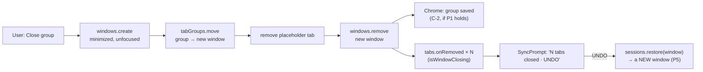

# SPEC-06 — Closing a tab group

|                |                                                                                                                                                                                                                                         |
| -------------- | --------------------------------------------------------------------------------------------------------------------------------------------------------------------------------------------------------------------------------------- |
| **Spec ID**    | SPEC-06                                                                                                                                                                                                                                 |
| **Date**       | 2026-10-14                                                                                                                                                                                                                              |
| **Module**     | `tab-list` (`src/lib/Tabs/TabsGroup/`, `src/lib/Tabs/actions.ts`, `src/lib/Tabs/undo/`) — with edges into `ui-shell` (`src/lib/surfaces.ts`) and `views` (`src/views/SearchView/`)                                                    |
| **Status**     | **draft** — eight of nine clarifications closed 2026-10-14 (§13). **NC-6 stays open**: one run of the probe in real Chrome, which settles every conditional decision (§13.1). Not to be planned against until it is recorded.            |
| **Supersedes** | —                                                                                                                                                                                                                                       |

---

## 1. Problem

### 1.1 What the group row's X does today

A group row carries a close button. Its handler, `handleDelete` in
`src/lib/Tabs/TabsGroup/GroupListItem.tsx:115-124`, collects the ids of `group.tabs` and calls
`chrome.tabs.remove(tabIds)` inside an empty `catch {}`. Its accessible name is
`` `Close every tab in group ${group.title || ""}`.trim() `` (`GroupListItem.tsx:157`), so an
untitled group's button is named `Close every tab in group`, with no subject at all
(`GroupDisplay.test.tsx:760` pins exactly that string). The group's ⋮ menu, named
`Actions for group <title>` (`:148`), offers "Ungroup all tabs" and "Change group" (`:336-341`).
There is no tooltip on the X, and no tooltip on any other row control either.

### 1.2 What Chrome means by those words

Chrome's own tab-group menu distinguishes two actions:

- **Close group** hides the group. Its tabs close, and Chrome keeps the group as a *saved* tab
  group, with its title and colour, under ⋮ → Tab groups and on the bookmarks bar, from where it
  can be reopened.
- **Delete group** closes the tabs and removes the saved group. Chrome's own UI asks for
  confirmation first.

**Today the X does Delete, under a name that says neither.** Someone who knows Chrome's menu and
reads "close" will expect the first, and loses the saved group.

### 1.3 What is already proven in real Chrome

The test harness cannot answer any of this: its `chrome.*` is a shim (C-8). These were measured in
Chrome 155 on 2026-10-14 and are recorded in `discovery/2026-10-14-keeping-tabs-for-later.md` on
branch `discovery/keeping-tabs-for-later` (commit `eaef31c` for Q3, `23bb011` for the closing
note), using `discovery/probes/sessions-probe.js` on that branch.

| #   | Constraint                                                                                                                                                                                                                                                                                                               | Source                                                                                      |
| --- | ------------------------------------------------------------------------------------------------------------------------------------------------------------------------------------------------------------------------------------------------------------------------------------------------------------------------- | ------------------------------------------------------------------------------------------- |
| C-1 | **`chrome.tabs.remove` on a group's tabs leaves no saved group.** "CT probe 3" appeared in neither ⋮ → Tab groups nor the bookmarks bar. Strictly the probe cannot tell "deleted" from "never saved", but the same menu lists unnamed groups such as "4 tabs", so Chrome 155 saves a group as it is made.                    | Discovery Q3                                                                                |
| C-2 | **`chrome.windows.remove` on the group's window keeps it saved**, with its title and colour, in both places.                                                                                                                                                                                                              | Discovery Q3 ("CT probe 1")                                                                 |
| C-3 | **`chrome.sessions.restore()` of a closed window brings its group back with title and colour** (and a pinned tab pinned). The catch: before the restore, the closed window's session record reported `groupId: 0` on every tab, so the record alone cannot say which tabs were grouped or what the group was called.        | Discovery Q1                                                                                |
| C-4 | **No extension API lists, saves, hides or reopens a saved group.** Closing the window is the only lever there is.                                                                                                                                                                                                         | Discovery, "Ruled out"                                                                      |
| C-5 | `chrome.tabGroups.move` can move a group only to and from windows of type `"normal"`, and a group moved **between** windows is, in the typings' words, "removed from one window and created in another" (no `onMoved` for it). Whether Chrome then treats it as the *same* saved group is not documented — P1.                | `@types/chrome` 0.0.263, `chrome.tabGroups` (`MoveProperties.windowId`, `onMoved` doc comment) |
| C-6 | `chrome.windows.create()` cannot set `alwaysOnTop`, which is how the float is told apart (`src/lib/surfaces.ts:44-57`). Any window this feature creates is therefore a *browsing* window, and `useTabsStructure.ts:165` lists its tabs like any other.                                                                       | `surfaces.ts`, `useTabsStructure.ts`                                                        |
| C-7 | `chrome.sidePanel.open()` needs a live user gesture, and the first await spends it (`surfaces.ts:34-42`). Nothing in this spec opens a side panel.                                                                                                                                                                        | `surfaces.ts`, SPEC-05 C-1/C-8                                                              |
| C-8 | **Only real Chrome can prove what this spec is about.** `src/test/chromeStub.ts:130-135` has no `tabGroups.move`; `harness/fakeChrome.ts:333-334` answers `windows.create` with `{ id: 99 }` and models no windows. Saved groups, window visibility, OS focus and what `sessions.restore` brings back exist only in Chrome.  | Read 2026-10-14                                                                             |
| C-9 | Chrome fires `tabs.onRemoved` once per tab, with unbounded gaps between them. `SyncPrompt` absorbs that by merging bursts into the prompt still on screen (`src/lib/Tabs/undo/SyncPrompt.tsx:23-44`).                                                                                                                       | `SyncPrompt.tsx`                                                                            |

### 1.4 Undo is not bypassed — `run()` is

The first guess was that the group X skips Undo. **It does not.** `SyncPrompt` subscribes to
`chrome.tabs.onRemoved` globally (`SyncPrompt.tsx:145`), filtered only by `wasListedTab`
(`:135`, defined at `useTabsStructure.ts:190`). Any removal of listed tabs — this one included —
raises "N tabs closed · UNDO", and UNDO calls `restoreSessions` (`src/lib/Tabs/undo/restore.ts:175-198`):
`chrome.sessions.restore` per entry, oldest first, then focus back to `resolveUserWindow()`.

What the group X does bypass is `run()` in `src/lib/Tabs/actions.ts:9-15`, which every other close
goes through (`closeTab`, `closeTabs`, `closeWindow`, `:17-24`). A failure there raises
"Couldn't close tabs"; a failure in `handleDelete` is swallowed by `catch {}` and the user is told
nothing. `handleUngroup` (`:125-135`) and `handleUpdateGroup` (`:56-68`) swallow theirs the same way.

**Unknown:** whether today's UNDO brings a deleted group's tabs back *as a group, with title and
colour*. C-3 is about a closed *window*; a delete produces one closed-*tab* entry per tab. P4.

### 1.5 The group X is the odd one out

| Control                                        | Chrome call                                    | Saved group afterwards       |
| ---------------------------------------------- | ---------------------------------------------- | ---------------------------- |
| Window row X (`WindowListItem.tsx:88-92` → `closeWindow`) | `chrome.windows.remove`             | **kept** — every group in it (C-2) |
| Group row X (`GroupListItem.tsx:115-124`)      | `chrome.tabs.remove(group tabs)`               | **deleted** (C-1)            |
| Selection toolbar "Close" (`SelectionToolbar.tsx:72-73` → `closeTabs`) with all of a group's tabs selected | `chrome.tabs.remove(selected)` | **deleted** (C-1) — out of scope, NG-8 |

So closing a whole *window* already keeps its groups the way Chrome does, and closing a *group*,
the smaller and more deliberate act, does not.

### 1.6 The candidate for "Close group", and what is not yet known about it

C-4 leaves one lever: make Chrome see a window close. The candidate, written as a probe at
`discovery/probes/close-group-probe.js`:

1. create a new window for the group, minimized and unfocused
   (`chrome.windows.create({ state: "minimized", focused: false })`);
2. `chrome.tabGroups.move(groupId, { windowId, index: -1 })` into it;
3. remove that window's starting placeholder tab;
4. `chrome.windows.remove` that window.

It is **unverified in real Chrome**. These are the questions the probe answers. All are pending.
What each result decides, field by field, is §13.1.

| #   | Question                                                                                                                                                                       | Why it matters                                                                                       | Status      | How it is answered                                       |
| --- | ------------------------------------------------------------------------------------------------------------------------------------------------------------------------------ | ---------------------------------------------------------------------------------------------------- | ----------- | -------------------------------------------------------- |
| P1  | Does any window flash on screen or in the taskbar, though minimized and unfocused? Afterwards, is the group under ⋮ → Tab groups with title and colour, **exactly once** — not duplicated by the move (C-5)? | A visible flash or a duplicate saved group sinks the candidate.                                        | **pending** | `close-group-probe.js`, `watched()`, plus the "lookFor" lines |
| P2  | Does focus stay in the window the user was in, and does that window's active tab stay put?                                                                                    | AC-11. A close that drags the user to another window is worse than today's delete.                   | **pending** | `watched()`: `focusedWindowUnchanged`, `sourceActiveTabIsLooseTab` |
| P3  | What does the recently-closed entry contain if the placeholder is kept, and if it is removed?                                                                                  | The Undo prompt counts and restores from that entry (AC-15).                                         | **pending** | `keepPlaceholder()` vs `watched()`: `newestClosed`        |
| P4  | Today's delete, then today's Undo: do the tabs come back **grouped**, with title and colour?                                                                                   | Decides whether Delete confirms (DEC-8, AC-7) and what AC-16 can promise.                            | **pending** | `deleteThenUndo()`                                       |
| P5  | Undo of the candidate close: `sessions.restore` reopens the group in a **new** window (`restore.ts` moves nothing back). Can it be moved back into the original window with title and colour, and does the restored window then close itself? | Gates option A (DEC-6) and decides Undo of a Close (DEC-9).                                          | **pending** | `closeThenUndo()`                                        |
| P6  | After that Undo, is the saved group listed **once**, and shown as open?                                                                                                        | A duplicate saved group on every Undo would be a slow leak into the user's ⋮ → Tab groups.            | **pending** | `closeThenUndo()` + the "lookFor" line                   |

Not covered by the probe, and owed by the manual sweep (AC-24): a **collapsed** group (E-6), a
group holding the window's **active tab** (E-7), and a group that is **every tab of its window**
(E-1).

### 1.7 The options

| Option | The X                          | The ⋮ menu gains                   | Matches Chrome's words | Default on the X | Needs the probe to pass | Cost and risk |
| ------ | ------------------------------ | ---------------------------------- | ---------------------- | ---------------- | ----------------------- | ------------- |
| **A**  | **Close group** (hide, saved)  | **Delete group**                   | Yes                    | Non-destructive  | **Yes** — P1, P2, P5, P6 | The only option that makes the quick control the safe one. Pays for a four-step close with a temporary window, its failure modes (E-11) and an Undo that is not today's (DEC-9). |
| **B**  | **Delete group**, renamed      | nothing                            | Yes, for one action    | Destructive      | No                      | Cheapest. Fixes the lie in the name, not the gap: Close is not offered at all. P4 still decides whether Delete needs a confirm. |
| **C**  | Delete group (today's action)  | **Close group**                    | Yes                    | Destructive      | Yes — for the menu item  | Both offered; the one-press control is the one that loses data, and the safe one costs two presses. The inverse of Chrome's own weighting. |
| **D**  | removed                        | **Close group** and **Delete group** | Yes                  | — (two presses for either) | Yes — for Close   | Matches Chrome's menu exactly. Removes a control SPEC-04 counts (§1.4a, AC-22's 88.3px reservation) and makes every group close two presses. |

**Decided 2026-10-14: A, gated on the probe passing P1, P2, P5 and P6; B if it does not.** DEC-6,
with the exact pass conditions in §13.1.

---

## 2. Goals

- **G-1** The group row's controls do what Chrome's controls of the same name do. "Close" never
  deletes a saved group; "Delete" is called Delete.
- **G-2** The quick, one-press control on a group row is the least destructive one that can be
  offered — Close group, under option A (DEC-6), once the probe's gate is passed.
- **G-3** A group close fails out loud, the way every other close already does through `run()`.
- **G-4** Closing a group never closes this extension's own pages, never moves the user to another
  window, and never leaves a window behind that the user did not have.
- **G-5** Undo keeps working for every way a group is closed, counts what the user closed and
  nothing else, and puts the user back where they were.

## 3. Non-goals

- **NG-1** Listing, reopening or managing Chrome's saved groups from inside the extension. There is
  no API for it (C-4). Reopening a closed group is Chrome's ⋮ → Tab groups or the bookmarks bar.
- **NG-2** Any storage. SPEC-01 **AC-23** forbids `chrome.storage`, `localStorage`,
  `sessionStorage`, IndexedDB and cookies; `src/test/manifest.test.ts` enforces it. A record of
  "groups we closed" would need storage, and is not wanted.
- **NG-3** Any new manifest permission. The array stays exactly
  `["sidePanel", "tabs", "tabGroups", "sessions", "favicon"]` (SPEC-03 AC-6), with no
  `host_permissions` and no `content_scripts` (SPEC-01 NG-3). `tabGroups.move`, `windows.create`
  and `windows.remove` need nothing more than what is held.
- **NG-4** Changing the window row's X. It already keeps groups saved (§1.5).
- **NG-5** Detecting whether the user's Chrome saves groups at all. There is no API for it; where
  it does not, Close and Delete converge (E-9), and that is accepted.
- **NG-6** A "Recently closed" list, devices, bookmarks or any other idea from the discovery
  document. Those are separate specs.
- **NG-7** Changing the Undo prompt's merge window, its duration, or how it chooses which surface
  speaks (SPEC-01 AC-42). This spec only requires that a group close be counted correctly by it.
- **NG-8** Multi-select close (the selection toolbar's Close covering all of a group's tabs) and
  closing a group's last tabs one by one. Both keep deleting the saved group, as today (§1.5). A
  selection is a set of tabs, not a group, and Chrome's own strip closes tabs one at a time the same
  way. Decided 2026-10-14 (DEC-10); PI-3 keeps the idea.

## 4. User stories

- **US-1** As someone who knows Chrome's tab-group menu, I want the group's X to close the group
  the way Chrome does, so that I can reopen it from ⋮ → Tab groups next week with its name and
  colour.
- **US-2** As someone tidying for good, I want a clearly named way to delete a group, so that it
  does not linger in Chrome's saved groups.
- **US-3** As a screen-reader user, I want the button's name to say whether it closes or deletes,
  and which group, so that I know before I press it — including for a group with no title.
- **US-4** As someone working in the float or the side panel, I want a group close not to move me,
  flash a window at me, or close the panel I am working in.
- **US-5** As someone who pressed the wrong thing, I want UNDO to put the group back where it was,
  as it was.

---

## 5. Acceptance criteria

Each is one testable statement. Ids are stable — never renumber; append `AC-N+1` for new ones.
Priority uses MoSCoW. **Real Chrome only** marks a criterion that no unit test, jsdom run or
harness pass can prove (C-8). AC-27…AC-29 were added after the rest and sit where they belong.

**Which criteria apply depends on the probe (DEC-6, §13.1).** If the gate passes, option A ships:
the X is Close group and the ⋮ menu gains Delete group, and every criterion below applies. If it
fails, option B ships: the X is Delete group, Close group is not offered, and **AC-1…AC-5, AC-10,
AC-17 and AC-18 do not apply**. "WHERE Close group is offered" below means "under option A".
Delete group is offered under both.

### 5.1 Close group  *(WHERE Close group is offered — option A, DEC-6)*

- **AC-1** _(Must)_ WHEN the user activates Close group on a group row, the system SHALL close every
  tab of that Chrome group, other than this extension's own pages (AC-8), in a way that leaves
  Chrome holding the group as a saved tab group with its title and colour.
  **Verify:** manual, **real Chrome only** — close a titled, coloured group and find it under
  ⋮ → Tab groups and on the bookmarks bar with both. Unit (shim) — the group's tabs are never
  passed to `chrome.tabs.remove`, and the window that is finally passed to `chrome.windows.remove`
  holds the group's tabs and nothing of the user's besides (C-1, C-2).
- **AC-2** _(Must)_ WHEN Close group completes, Chrome SHALL list the group under ⋮ → Tab groups
  **exactly once**.
  **Verify:** manual, **real Chrome only** — P1, then the sweep in AC-24.
- **AC-3** _(Must)_ WHILE Close group runs, no window SHALL become visible on screen or in the
  taskbar.
  **Verify:** manual, **real Chrome only** — P1, watched, on Windows; unit (shim) — any window the
  action creates is created minimized and unfocused, and no call focuses or restores it.
- **AC-4** _(Must)_ WHERE the group is every listed tab of its window, Close group SHALL close that
  window and SHALL leave the group saved (E-1).
  **Verify:** manual, **real Chrome only** — a window holding one group and nothing else; unit
  (shim) — the source window ends up passed to `chrome.windows.remove`, or emptied, and no other
  window is left. _(Closing the source window directly is the route C-2 already proves; which route
  is taken is the plan's.)_
- **AC-5** _(Should)_ WHILE Close group runs, any window it creates, and that window's starting
  tab, SHALL NOT appear as a row in the list on any surface.
  **Verify:** unit — in the harness, fire `windows.onCreated`, `tabs.onCreated`, `tabs.onAttached`
  and `tabs.onRemoved` in the order Chrome would, and assert no window row or `about:blank` row is
  ever rendered. _(C-6: such a window is a browsing window and its tabs are listed today.)_

### 5.2 Delete group  *(under option A in the ⋮ menu, under option B on the X)*

- **AC-6** _(Must)_ WHEN the user activates Delete group, the system SHALL close every tab of that
  group other than this extension's own pages, and Chrome SHALL keep no saved group for it.
  **Verify:** unit (shim) — `chrome.tabs.remove` receives exactly the group's tabs as Chrome reports
  them when the action runs, own pages excluded — in search results too, where the row shows fewer
  (AC-29, E-4, E-10); manual, **real Chrome only** — the group is absent from ⋮ → Tab groups
  afterwards (C-1).
- **AC-7** _(Must)_ IF P4 fails — UNDO after a delete does not bring the tabs back grouped with
  their title and colour (§13.1) — THEN WHEN the user activates Delete group, the system SHALL ask
  for confirmation first, as Chrome's own Delete group does; the confirmation SHALL name the group
  and its number of tabs and SHALL default to the non-destructive choice. IF P4 passes, THEN Delete
  group SHALL NOT ask, and relies on UNDO (DEC-8).
  **Verify:** unit — with the recorded P4 outcome, activate Delete group and assert either a dialog
  naming the group and its count with focus on Cancel (P4 failed), or `tabs.remove` called with no
  dialog (P4 passed).

### 5.3 This extension's own pages

- **AC-8** _(Must)_ WHEN either action runs on a group that contains one of this extension's own
  pages (`isOwnPage`, `surfaces.ts:14-15` — the anchor tab or the extension page in a plain tab),
  that page SHALL stay open in its window, SHALL NOT be part of the group afterwards, and a float
  held by it SHALL stay open.
  **Verify:** unit (shim) — a fixture whose raw `chrome.tabs.query` puts the anchor tab inside the
  group (the list never shows it, `useTabsStructure.ts:165`); assert it is never passed to
  `tabs.remove`, never carried by a group move, and ends ungrouped. Manual, **real Chrome only** —
  with a float up, drag the anchor tab into a group, close the group from the float, and confirm the
  float survives. _(Today's X leaves the anchor behind **inside** the group, so the Chrome group
  survives holding only it, invisible in the list — and is therefore not deleted either. A group
  move would carry it along and close it, which kills the float — SPEC-01 AC-12.)_

### 5.4 Failure

- **AC-9** _(Must)_ IF any Chrome call made by Close group or Delete group rejects, THEN the system
  SHALL show an error snackbar, "Couldn't close group" or "Couldn't delete group", the way `run()`
  does for every other close (`actions.ts:9-15`), and SHALL NOT swallow it.
  **Verify:** unit — make each call reject in turn and assert the snackbar text; assert no
  `catch {}` that discards the error remains on these paths.
- **AC-10** _(Must)_ IF Close group fails after the group has left its window, THEN the end state
  SHALL be either the completed close or the group back in its original window, at its original
  position, with its title and colour — never a window the user did not have, and never the group
  in another window. IF neither can be reached, THEN the window holding the group SHALL be left
  visible and not minimized, and the snackbar SHALL say the group was left in a separate window.
  **Verify:** unit (shim) — reject the placeholder removal, then the window close, then the move
  back, each in turn; assert no window is left minimized holding the user's tabs, and assert the
  snackbar. _(A minimized window holding the user's tabs is the worst outcome on offer: the tabs are
  open, but the user cannot see them and was told nothing.)_
- **AC-27** _(Must)_ WHEN the user activates Close group or Delete group again on the same group
  while the first is still running, the system SHALL perform it once.
  **Verify:** unit — two activations in one tick produce one `windows.create` (Close) or one
  `tabs.remove` (Delete).

### 5.5 Focus and surfaces

- **AC-11** _(Must)_ Neither action SHALL change which browser window is focused, nor the active tab
  of the group's window unless that tab was in the group (E-7).
  **Verify:** manual, **real Chrome only** — P2; unit (shim) — no `windows.update({ focused })` and
  no `tabs.update({ active })` is issued by either action.
- **AC-12** _(Must)_ Neither action SHALL close the side panel, except where the panel's own window
  closes because the group was every tab in it (AC-4, E-1).
  **Verify:** manual, **real Chrome only** — close a group in the panel's window that does not fill
  it, and in another window; the panel stays. Unit — neither action calls `sidePanel.*` or
  `bringPanelAlong`.
- **AC-13** _(Must)_ WHEN the focused group row, or the ⋮ menu belonging to it, disappears because
  its group was closed or deleted, keyboard focus SHALL land on a real, named element that is still
  in the document — never on `document.body` and never on a removed node. That element SHALL be the
  first control of the row that now follows where the group was; IF there is none, THEN the first
  control of the row before it; IF the list is empty, THEN the search field (DEC-12).
  **Verify:** unit — focus the X (and, separately, the menu item), activate it, let the store
  refresh, assert `document.activeElement` is connected, is not `body`, and is: the next row's first
  control; with the group last in the list, the previous row's; with the group the only row, the
  search field.
  Manual with NVDA — the user does not hear "Conscious Tabs, document" (SPEC-04 §13.5 heard exactly
  that when a focused row unmounted). _(SPEC-04 E-15 returns focus to the menu button when the menu
  closes; here the menu button is gone with its row, so E-15 cannot apply. SPEC-05 E-8's "never on a
  detached or removed node" is the rule extended.)_
- **AC-14** _(Must)_ Both actions SHALL behave identically in the side panel, the anchor tab and the
  float, apart from what AC-12 says about the panel's own window.
  **Verify:** unit — the same action under each host; manual — the AC-24 sweep on all three.

### 5.6 Undo

- **AC-15** _(Must)_ WHEN a group is closed or deleted, the existing Undo prompt SHALL appear once,
  in the one surface the user is looking at (SPEC-01 AC-42), reading the number of tabs the action
  closed — never counting a placeholder tab, an own page, or a tab twice.
  **Verify:** unit — fire `tabs.onRemoved` for the group's tabs (with `isWindowClosing: true`) and
  for a placeholder tab, in that order and interleaved; assert one prompt reading "N tabs closed",
  N the number of the group's tabs, own pages excluded. _(`wasListedTab` must still recognise the moved tabs at the moment
  their window closes, and must not recognise the placeholder.)_
- **AC-16** _(Must)_ WHEN the user presses UNDO after a Delete, every closed tab SHALL come back; and
  they SHALL come back as a group with its title and colour **if P4 shows Chrome can do so**.
  **Verify:** manual, **real Chrome only** — P4. Unit — the restore asks for exactly the entries the
  delete produced. _(If P4 shows they come back ungrouped, that is recorded here as a known loss and
  turns on AC-7's confirmation; it is not fixed by this criterion. PI-5 is the idea for fixing it.)_
- **AC-17** _(Must)_ WHEN the user presses UNDO after a Close, the group SHALL come back into the
  window it was closed from, at the position it had, with its title and colour; the window Chrome
  restored it into SHALL be closed; and focus SHALL return to the user's window as `restore.ts`
  already does. No window the user did not have SHALL be left open, and none SHALL be left
  minimized (DEC-9).
  **Verify:** manual, **real Chrome only** — P5, then the AC-24 sweep; unit (shim) — after UNDO, a
  `tabGroups.move` into the original window at the original index, the restored window closed, and
  `windows.update({ focused: true })` on the user's window.
  _(P5 is part of option A's gate, so if this cannot be done, option A does not ship and this
  criterion does not apply. DEC-9 records what would apply instead if that gate were ever relaxed.)_
- **AC-18** _(Must)_ WHEN UNDO after a Close completes, Chrome SHALL list the saved group exactly
  once, as open.
  **Verify:** manual, **real Chrome only** — P6.

### 5.7 Names and words

- **AC-19** _(Must)_ The group row's X SHALL be named `Close group <title>` under option A, or
  `Delete group <title>` under option B; for an untitled group, `Close untitled group, N tabs` or
  `Delete untitled group, N tabs`, N the number of tabs in the group (DEC-7). In search results the
  name also carries the count (AC-29). The X SHALL have no visible tooltip.
  **Verify:** unit — the accessible name for a titled group and an untitled one, and no `title`
  attribute or tooltip on the X; update the strings `GroupDisplay.test.tsx:278`, `:495`, `:698` and
  `:760` pin today.
- **AC-20** _(Must)_ No group-row control SHALL have an empty name or a name that is only a verb
  phrase with no subject. An untitled group's close or delete control SHALL call it "untitled group"
  and give its count, per AC-19.
  **Verify:** unit — the untitled-group test (`GroupDisplay.test.tsx:750-764`) asserts every name
  identifies the group. _(SPEC-04 AC-6. Today's `Close every tab in group` meets the letter of
  "non-empty" and says nothing about which group.)_
- **AC-21** _(Must)_ The X's name, the menu button's name and the toolbar's name SHALL be distinct
  from one another on the same row.
  **Verify:** unit — collect the three for a titled and an untitled group; assert distinct.
  _(SPEC-04 AC-29; the toolbar is `"<title or Untitled>, group, N tabs"`, `GroupDisplay.tsx:36-39`.)_
- **AC-22** _(Must)_ WHERE the ⋮ menu offers Delete group (option A), the item's visible text and
  accessible name SHALL be "Delete group", Chrome's words. The menu is already named for its group
  (`Actions for group <title>`), so the item does not repeat the title. "Close group" is the X's
  job under option A and is not repeated in the menu.
  **Verify:** unit — the menu's items by role and name.
- **AC-23** _(Must)_ The wording of AC-19…AC-22 SHALL be heard with NVDA + Chrome before it ships,
  in the side panel at least, with the result recorded in this file: NVDA version, Chrome version,
  surface, date, tester, and what was said for a titled group, an untitled group and the menu items.
  **Verify:** manual — a result block here, in the style of SPEC-04 AC-27. _(SPEC-04's names were
  decided by ear — §13.3, §13.5 — and one reviewed wording fix was built and removed after ten
  minutes with NVDA. A name that reads well on paper is not yet known to sound well.)_

### 5.8 Nothing else regresses, and the real-Chrome sweep

- **AC-24** _(Must)_ A manual pass in **real Chrome** SHALL be recorded in this file before it may
  reach `implemented`, covering: P1–P6 as answered by NC-6; a collapsed group (E-6); a group
  holding the window's active tab (E-7); a group that is every tab of its window, with the side panel
  in that window (E-1); a group holding the anchor tab with a float up (AC-8); and a group row in
  search results (E-4); and a shared group (AC-28) if the profile can make one. Each with Chrome
  version, OS, date and result.
  **Verify:** the result block.
- **AC-25** _(Must)_ The feature SHALL write nothing to `chrome.storage`, `localStorage`,
  `sessionStorage`, IndexedDB or cookies, and the manifest's `permissions` SHALL remain exactly the
  five of SPEC-03 AC-6.
  **Verify:** unit — `src/test/manifest.test.ts`, unmodified.
- **AC-26** _(Must)_ The window row's close button and the selection toolbar's Close SHALL behave
  exactly as today (NG-4, NG-8).
  **Verify:** existing `WindowListItem` and `SelectionToolbar` tests pass unmodified.

### 5.9 Shared groups and search results  *(added with the 2026-10-14 answers)*

- **AC-28** _(Must)_ WHERE a group is shared (`TabGroup.shared === true`), the system SHALL NOT
  offer Delete group for it — no ⋮ menu item under option A, and no X under option B — and under
  option A SHALL offer Close group for it as for any other group. WHERE `shared` is `undefined` or
  absent, the group SHALL be treated as not shared (DEC-13, E-8, E-19).
  **Verify:** unit — a fixture group with `shared: true` has no Delete group item (A) or no X (B), and
  still has Close group (A); the same group with `shared` absent has both. Manual, **real Chrome
  only** — AC-24, where a shared group is available. _(The extension cannot tell whether
  `tabs.remove` on a shared group's tabs deletes it for every collaborator, so it does not offer the
  action that might. Under B a shared group row loses a control and keeps four, which still clears
  APG's three-control threshold for a toolbar — SPEC-04 §1.4a.)_
- **AC-29** _(Must)_ WHEN Close group or Delete group is activated on a group row in search results,
  the action SHALL apply to the **whole** Chrome group, including tabs the row does not show, and
  the X's accessible name on that row SHALL carry the group's full tab count: `Close group <title>,
  N tabs` or `Delete group <title>, N tabs`, N counted over the whole group, not the matches
  (DEC-11).
  **Verify:** unit — in `SearchView` with a filter matching 2 of a 5-tab group, the X is named
  `Close group Reading, 5 tabs` (A) or `Delete group Reading, 5 tabs` (B), and the action reaches all
  5 tabs. Manual — AC-24's search item.

---

## 6. Edge cases

| #        | Case                                                                                                 | Expected                                                                                                                                                                                                                                                                                                      |
| -------- | ---------------------------------------------------------------------------------------------------- | ------------------------------------------------------------------------------------------------------------------------------------------------------------------------------------------------------------------------------------------------------------------------------------------------------------- |
| **E-1**  | The group is every listed tab of its window                                                          | Moving it out would empty the window, which Chrome is expected to close (A-2); closing the window directly does the same and is proven to keep the group (C-2). The window closes either way — **as it does today**, since removing its last tabs closes it too. If the side panel lives there, it closes with it, and its Undo prompt goes with it; another visible surface may still raise one. AC-4, AC-12. |
| **E-2**  | The window holds the group and the anchor tab, nothing else                                          | The anchor tab stays, ungrouped (AC-8), so the window stays open. Not E-1.                                                                                                                                                                                                                                       |
| **E-3**  | The anchor tab is inside the group                                                                   | `group.tabs` never contains it (filtered at `useTabsStructure.ts:165`), but Chrome's group does. AC-8: it stays open and leaves the group. Today's X leaves it **in** the group, so the Chrome group outlives the "close", unseen in the list.                                                                     |
| **E-4**  | A group row in search results (SPEC-04 E-3, E-17)                                                    | It carries the X and the ⋮ menu too, but its `group.tabs` holds only the **matching** tabs (`getTabsTree` filters before grouping, `useTabsStructure.ts:46-48`). Today's X there removes the matches and leaves the rest of the group open. **Decided (DEC-11): both actions act on the whole group**, and the X's name carries the full count (AC-29). **Consequence, accepted:** a Delete from a search row removes tabs the row does not show, and if P4 passes it does so with no confirmation (DEC-8). Under option A that Delete is two presses deep in the ⋮ menu, and the X on the same row has already said the full count (`Close group Reading, 5 tabs`); the menu item itself says only "Delete group" (AC-22). Under option B the X *is* Delete, one press, its name carrying the count; UNDO is the only way back. |
| **E-5**  | Untitled group                                                                                        | Today the X is named `Close every tab in group` and the toolbar `Untitled, group, N tabs`; Chrome calls it by its count ("4 tabs"). **Decided (DEC-7):** `Close untitled group, N tabs` / `Delete untitled group, N tabs`. AC-19, AC-20.                                                                                                                                                                       |
| **E-6**  | A collapsed group                                                                                     | Both actions work the same. Whether `tabGroups.move` keeps it collapsed, and whether Undo restores it collapsed, is unmeasured — AC-24. Not a requirement either way.                                                                                                                                             |
| **E-7**  | The group holds its window's active tab                                                               | Chrome must make another tab active in that window; which one is Chrome's choice and is not overridden. AC-11 exempts this case. P2 measures only the case where the active tab is outside the group.                                                                                                             |
| **E-8**  | A shared tab group (`TabGroup.shared`, Chrome 137+ per the brief)                                     | What Delete means for collaborators is unknown and is not researched here; the installed `@types/chrome` 0.0.263 does not declare `shared`. **Decided (DEC-13):** Close works as for any group; Delete is not offered (AC-28).                                                                                                                                                             |
| **E-9**  | A Chrome version or setting that does not save groups                                                 | Close and Delete converge: the tabs close and nothing is kept. Not detectable (NG-5). The name "Close group" stays truthful to Chrome's own menu in that Chrome.                                                                                                                                                   |
| **E-10** | The group changes between render and action (a tab added or removed)                                  | Close acts on the Chrome group as it is when the action runs. Delete acts on the group's tabs as Chrome reports them when the action runs, own pages excluded, not on a stale render, so a tab added a moment ago is not left behind holding the group open.                                                                     |
| **E-11** | A close that fails half-way                                                                           | AC-10. Possible stops: window created but move refused; moved but placeholder not removed; moved but window not closed; move back refused.                                                                                                                                                                         |
| **E-12** | The selection contains some or all of the group's tabs                                               | Closing the group removes them from Chrome; the selection drops ids that no longer exist, as it does for any closed tab. Nothing else is required. Multi-select close of a whole group stays a delete (NG-8).                                                                                                                  |
| **E-13** | The X is focused when the row disappears                                                              | AC-13. Applies equally when the action came from the ⋮ menu (a portal) — the menu button it would return to (SPEC-04 E-15) is gone.                                                                                                                                                                            |
| **E-14** | The Undo prompt is already up for an earlier close                                                    | `SyncPrompt` merges a burst into the prompt still on screen (C-9). A group close joins it like any other close. NG-7.                                                                                                                                                                                         |
| **E-15** | The user presses Ctrl+Shift+T after a Close                                                           | Chrome reopens its newest closed entry — the window the group was closed in, so the group comes back in a **new window** (C-3). That is Chrome's behaviour and is not changed; recorded so it is not reported as a defect.                                                                                       |
| **E-16** | Chrome's History → Recently closed after a Close                                                      | Shows a closed window the user never opened, holding the group's tabs — and the placeholder too if it was kept (P3). Accepted if P3 shows the placeholder can be kept out.                                                                                                                                       |
| **E-17** | Chrome's Undo-equivalent for a saved group                                                            | Reopening it from ⋮ → Tab groups is Chrome's, outside this extension (NG-1). Whether that and this extension's UNDO can both reopen it, producing two copies, is part of P6.                                                                                                                                       |
| **E-18** | A title containing markup, quotes or a right-to-left override                                         | Names are built as text (SPEC-04 AC-24). The same for the Delete confirmation's text, where AC-7 requires one.                                                                                                                                                                                                           |
| **E-19** | `shared` is `undefined` — a Chrome older than shared groups, or typings that do not declare it (0.0.263 does not) | Treated as **not shared**: Delete is offered as for any group (AC-28). Only `shared === true` withholds it. |

---

## 7. Assumptions and dependencies

- **A-1** Chrome keeps saving groups as they are made, as Chrome 155 does (C-1). If a later Chrome
  stops, E-9 applies everywhere.
- **A-2** Chrome closes a window when its last tab leaves it, by close or by move. Expected, not
  measured for the move case; E-1 does not depend on it if the source window is closed directly.
- **A-3** `chrome.tabGroups.move` into a newly created minimized window is permitted: both are
  `"normal"` windows (C-5). The probe's `steps.moveError` will say if not.
- **A-4** The discovery's measurements were one Chrome version on one profile on one OS. P1 in
  particular — a flash — can differ by OS and window manager; AC-24 records the OS.
- **D-1** Depends on SPEC-01 (surfaces; AC-12, AC-23, AC-42), SPEC-03 (AC-6), SPEC-04 (AC-6, AC-24,
  AC-29, E-3, E-15, E-17) and SPEC-05 (E-8).
- **D-2** NC-6 depends on one person running `discovery/probes/close-group-probe.js` in real Chrome
  and reporting its JSON and the four "lookFor" answers. §13.1 says what each answer decides.

## 8. Non-functional requirements

- **NFR-1 Accessibility.** WCAG 2.1 **4.1.2 Name, Role, Value** (AC-19…AC-21), **2.4.3 Focus
  Order** (AC-13), **3.3.4 Error Prevention** where Delete is concerned (AC-7, DEC-8).
- **NFR-2 No visible side effects.** No window shown, no focus moved, no panel closed, beyond what
  the user asked for (AC-3, AC-11, AC-12).
- **NFR-3 Privacy.** No storage, no new permission (AC-25).
- **NFR-4 Time.** A Close is a few Chrome round trips. Nothing here requires a figure; if the probe
  shows the steps take long enough for the list to show intermediate states, AC-5 is what covers it.
- **NFR-5 Internationalisation.** Names stay English string templates built as text, as SPEC-04
  NFR-5 says.

## 9. Cross-module impact

| Area                                                  | Impact                                                                                                                                                                                                                                                                  |
| ----------------------------------------------------- | ----------------------------------------------------------------------------------------------------------------------------------------------------------------------------------------------------------------------------------------------------------------------- |
| `tab-list` — `TabsGroup/GroupListItem.tsx`            | The X's handler and name; the ⋮ menu's items (option-dependent); the empty `catch {}` blocks on this path (AC-9).                                                                                                                                                         |
| `tab-list` — `TabsGroup/GroupDisplay.tsx`             | The toolbar name stays; AC-21 checks the X and menu names against it. Options A and B keep the control count, so SPEC-04 AC-22's 88.3px chip reservation holds — except a shared group under B, which has no X (AC-28) and so reserves more than it needs.                                                                                                    |
| `tab-list` — `actions.ts`                             | `run()` is where "Couldn't …" comes from (AC-9). `closeWindow` is the precedent for keeping groups (§1.5).                                                                                                                                                                 |
| `tab-list` — `undo/` (`SyncPrompt.tsx`, `restore.ts`) | Counting a group close correctly, including tabs whose window closes and a placeholder that must not count (AC-15). Undo of a Close moves the group back into its original window and closes the one Chrome restored (AC-17, DEC-9) — `restore.ts` does no moving today.                                                            |
| `tab-list` — `useTabsStructure.ts`                    | `wasListedTab` must recognise the moved tabs at close time (AC-15); a temporary window is listed like any browsing window (C-6, AC-5).                                                                                                                                     |
| `ui-shell` — `surfaces.ts`                            | `isOwnPage` decides what AC-8 protects; `resolveUserWindow` is where Undo returns focus; `bringPanelAlong` must not be reached (AC-12).                                                                                                                                    |
| `views` — `SearchView`                                | Search-result group rows carry the X with a filtered `group.tabs`; the actions reach the whole group and the name carries its full count (E-4, AC-29).                                                                                                                                                                                            |
| `tab-list` — `selection/SelectionToolbar.tsx`         | Unchanged (NG-8, AC-26).                                                                                                                                                                                                                                       |
| SPEC-04                                               | AC-6, AC-29 constrain the names; **E-15 cannot apply** when Close or Delete is chosen from the ⋮ menu, because the button it returns focus to is removed — AC-13 covers that case. The strings pinned in `GroupDisplay.test.tsx` change (AC-19). Nothing is superseded.         |
| SPEC-05                                               | E-8's "never on a detached or removed node" is extended to a closed group (AC-13).                                                                                                                                                                                        |
| SPEC-01                                               | AC-12 (closing the anchor kills the float) is why AC-8 exists; AC-23 and AC-42 are carried forward (AC-25, AC-15).                                                                                                                                                         |
| Test suite                                            | `src/test/chromeStub.ts` has no `tabGroups.move`, and `harness/fakeChrome.ts` models no windows (C-8); the Verify hints that say "shim" need them. `GroupDisplay.test.tsx` names change.                                                                                    |
| `README.md`, `store-listing.md`                       | No permission change. The `tabGroups` justification (`store-listing.md:63`, "collapse, rename, recolour, ungroup") may gain "close" — wording only, optional.                                                                                                              |

## 10. Inputs

| Input                                                            | Provenance                                                                                              |
| ---------------------------------------------------------------- | --------------------------------------------------------------------------------------------------------- |
| `chrome.tabGroups.TabGroup.id`, `.title`, `.color`, `.collapsed`, `.windowId` | [reused] — already drive the group row.                                                    |
| `GroupItem.tabs` (`src/lib/Tabs/types.ts`)                        | [reused] — the listed tabs of a group; filtered in search (E-4).                                         |
| `chrome.tabs.query({ groupId })`                                  | [new use of a held API] — the group's tabs as Chrome has them now, own pages included (AC-8, E-10).        |
| `chrome.tabGroups.move`, `chrome.windows.create`, `chrome.windows.remove` | [new use of held APIs] — the candidate Close (§1.6).                                               |
| `chrome.sessions.getRecentlyClosed`, `.restore`                   | [reused] — today's Undo.                                                                                  |
| `chrome.tabGroups.TabGroup.shared`                                | [new] — read only to withhold Delete (AC-28); `undefined` means not shared (E-19).                         |
| The whole group's tab count in search results                     | [new, derived] — from the unfiltered snapshot, for AC-29's name.                                           |
| The probe's JSON and "lookFor" answers                            | [new, external] — NC-6; recorded in this file when answered.                                               |
| Discovery Q1, Q3                                                  | [reused] — `discovery/2026-10-14-keeping-tabs-for-later.md` on `discovery/keeping-tabs-for-later`.          |

## 11. Untrusted inputs

- **A group's title is user-controlled and arbitrary**, and is interpolated into the X's name, the
  menu button's name, the toolbar's name and, where AC-7 requires one, the confirmation's text. Text only,
  never markup, never an id or a selector (SPEC-04 AC-24, E-18).
- **A tab's URL decides what is protected** (`isOwnPage`). It is compared against
  `chrome.runtime.getURL("")` by prefix; a page cannot make its URL begin with this extension's
  origin, so it cannot opt itself into AC-8's protection.
- Nothing here executes or evaluates a title or URL.

## 12. Proposed improvements (not required)

- **PI-1** _Withdrawn 2026-10-14: the probe is committed with this spec, so it can be re-run when
  Chrome changes._
- **PI-2** Route `handleUngroup` and `handleUpdateGroup` (`GroupListItem.tsx:56-68`, `:125-135`)
  through `run()` as well. They swallow failures the same way the X does. Out of scope here only
  because they are not closes.
- **PI-3** Multi-select close is out of scope (NG-8). A later spec could close a fully selected group
  as a group rather than as loose tabs, so the selection toolbar's Close matches the group X.
- **PI-4** Apply AC-13's focus rule to tab rows and window rows too. Closing a focused tab row today
  drops focus to the document, by the same mechanism; no spec names a target for it.
- **PI-5** If P4 shows that today's Undo does not regroup deleted tabs, consider regrouping them on
  UNDO from the row's last-known title and colour, held in memory only (no storage) for the life of
  the prompt.

## 13. Decided here, and why

| #         | Decision                                                                                                                                                                                                                                                                       |
| --------- | ------------------------------------------------------------------------------------------------------------------------------------------------------------------------------------------------------------------------------------------------------------------------------ |
| **DEC-1** | **Close is defined by its outcome in Chrome, not by its mechanism.** AC-1 asks that Chrome keep the group saved. The move-then-close of §1.6 is the candidate because C-4 leaves no other lever; if the probe finds a better one, AC-1 does not change.                              |
| **DEC-2** | **Group closes fail out loud, through the same `run()`-style snackbar as every other close** (AC-9). The empty `catch {}` was the only close path that told the user nothing.                                                                                                |
| **DEC-3** | **This extension's own pages are never closed by a group action, and never left inside the group** (AC-8). Closing the anchor kills the float (SPEC-01 AC-12); leaving it inside makes the group survive both a Close and a Delete without the list showing it.            |
| **DEC-4** | **Undo is the existing prompt, not a new one.** It already fires for this close (§1.4). This spec only asks that it count correctly (AC-15) and restore well (AC-16, AC-17).                                                                                                  |
| **DEC-5** | **The window row's X is not touched** (NG-4). It already keeps groups saved, which is what makes the group X the odd one out.                                                                                                                                              |
| **DEC-6** (was NC-1) | **Option A, gated on the probe; option B if the gate fails.** The X is Close group and the ⋮ menu gains Delete group — **if and only if** P1, P2, P5 and P6 all pass as §13.1 defines them. If any one fails, the X stays Delete and is named so, and Close group is not offered anywhere. Options C and D are not taken. **The gate is NC-6.** Answered 2026-10-14. |
| **DEC-7** (was NC-2) | **Chrome's words, and a count where there is no title.** X: `Close group <title>` (A) or `Delete group <title>` (B). Untitled: `Close untitled group, N tabs` / `Delete untitled group, N tabs`. Menu item: "Delete group". No tooltip — no row control has one. AC-19…AC-22; heard with NVDA before it ships, AC-23. Answered 2026-10-14. |
| **DEC-8** (was NC-3) | **Delete confirms only if Undo cannot regroup.** P4 passes → no confirmation, UNDO is the way back. P4 fails → confirm as Chrome does. Settled by P4 alone, under option A or B. AC-7. Answered 2026-10-14. |
| **DEC-9** (was NC-4) | **UNDO of a Close puts the group back in its window and position**, closes the window Chrome restored it into, and returns focus to the user's window (AC-17). P5 is what shows this works. **The fallback answered for this — accept the new window, visible and unfocused — cannot be reached while P5 is part of DEC-6's gate**: if P5 fails, option B ships and there is no Close to undo. It is recorded so that relaxing the gate later does not reopen the question. Answered 2026-10-14. |
| **DEC-10** (was NC-5) | **Multi-select close and one-by-one closes are out of scope** (NG-8, AC-26). PI-3 keeps the idea. Answered 2026-10-14. |
| **DEC-11** (was NC-7) | **On a search row, both actions act on the whole group, and the X's name carries the full tab count** (AC-29). The consequence for Delete is in E-4. Answered 2026-10-14. |
| **DEC-12** (was NC-8) | **Focus goes to the next row's first control, else the previous row's, else the search field** (AC-13). Answered 2026-10-14. |
| **DEC-13** (was NC-9) | **Shared groups close like any other; Delete is not offered for them** (AC-28). The extension cannot confirm that `tabs.remove` does not delete the group for every collaborator, so it does not offer the action that might. `shared` undefined counts as not shared (E-19). No external research is needed for this answer. Answered 2026-10-14. |

### 13.1 What the probe settles

One run of `discovery/probes/close-group-probe.js` (NC-6) settles every conditional decision. Field
names are the probe's JSON; "lookFor" lines are its four questions for the person watching.

| P   | Passes when                                                                                                                                                                                       | If it passes                                     | If it fails                              |
| --- | ------------------------------------------------------------------------------------------------------------------------------------------------------------------------------------------------- | ------------------------------------------------ | ---------------------------------------- |
| P1  | `p1p2Watched` has no `error` and `steps` has no `moveError`; lookFor 1 is "none" (no window, no taskbar button); lookFor 2: "CT close A" is listed, purple, **exactly once**.                       | Counts towards DEC-6's gate.                     | **Option B** (DEC-6).                    |
| P2  | `p1p2Watched.focusedWindowUnchanged` is `true` **and** `p1p2Watched.sourceActiveTabIsLooseTab` is `true`.                                                                                          | Counts towards DEC-6's gate.                     | **Option B** (DEC-6).                    |
| P3  | Not a gate. Read `p3KeepPlaceholder.newestClosed.tabs` against `p1p2Watched.newestClosed.tabs`, and lookFor 3.                                                                                     | Decides whether the placeholder is removed before the close: whichever leaves the closed entry holding only the group's tabs (AC-15, E-16). | Same — informs AC-15 and E-16; changes no decision. |
| P4  | `p4DeleteThenUndo.groupsAfterUndo` contains a group titled "CT delete C" with colour `orange`.                                                                                                       | **No confirmation** on Delete (DEC-8, AC-7).      | **Confirmation** on Delete (DEC-8, AC-7). |
| P5  | `p5p6CloseThenUndo` has no `undo` failure text, and `backInSourceWindow` is `{ title: "CT close D", color: "green" }`. (`restoredWindowClosedItself: false` does not fail it; AC-17 then requires the extension to close that window.) | Counts towards DEC-6's gate; AC-17 as written (DEC-9). | **Option B** (DEC-6).            |
| P6  | lookFor 4: "CT close D" is listed **once** and shown as open.                                                                                                                                      | Counts towards DEC-6's gate.                     | **Option B** (DEC-6).                    |

**So:** option A ships if and only if P1, P2, P5 and P6 all pass; whether Delete confirms is P4
alone, whichever option ships; P3 changes no decision. The results, the Chrome version and the OS
are recorded in §1.6 and §15, and NC-6 then closes.

## 14. Traceability

| AC                         | Where it lands                                                                                          |
| -------------------------- | ------------------------------------------------------------------------------------------------------- |
| AC-1 … AC-5, AC-10, AC-27  | `TabsGroup/GroupListItem.tsx`, `actions.ts`; `useTabsStructure.ts` for AC-5                              |
| AC-6, AC-7                 | `TabsGroup/GroupListItem.tsx`, `actions.ts`                                                              |
| AC-8                       | `surfaces.ts` (`isOwnPage`), the group actions                                                          |
| AC-9                       | `actions.ts` (`run`)                                                                                     |
| AC-11, AC-12, AC-14        | The group actions; `surfaces.ts`                                                                        |
| AC-13                      | `TabsGroup/GroupListItem.tsx`, the list containers (`Tabs.tsx`, `TabsView`, `SearchView`)               |
| AC-15 … AC-18              | `undo/SyncPrompt.tsx`, `undo/restore.ts`, `useTabsStructure.ts` (`wasListedTab`)                        |
| AC-19 … AC-23              | `TabsGroup/GroupListItem.tsx`, `TabsGroup/GroupDisplay.test.tsx`; a result block in this file           |
| AC-24                      | A result block in this file                                                                              |
| AC-25, AC-26               | `src/test/manifest.test.ts`; existing window-row and selection-toolbar tests                            |
| AC-28                      | `TabsGroup/GroupListItem.tsx` — the X and the ⋮ menu items, keyed on `group.shared`                      |
| AC-29                      | `TabsGroup/GroupListItem.tsx`, `views/SearchView/index.tsx`, `useTabsStructure.ts` (the unfiltered count) |

## 15. Measurement log

Read on **2026-10-14** in this worktree (branch `claude/priceless-cannon-052bb7`, at `25e518c`, the
same as `main`):

- `GroupListItem.tsx:115-124` (`handleDelete`, `chrome.tabs.remove`, empty `catch`), `:148` (menu
  button name), `:157` (X name), `:336-341` (menu items).
- `actions.ts:9-15` (`run`), `:20-24` (`closeTabs`, `closeWindow`).
- `SyncPrompt.tsx:131-138` (`handleRemove`, `wasListedTab`), `:145` (global `onRemoved`);
  `restore.ts:175-198`.
- `useTabsStructure.ts:46-48` (filter applied before grouping), `:165` (own pages and the float's
  window excluded), `:190` (`wasListedTab`).
- `GroupDisplay.tsx:36-39` (toolbar name, "Untitled" fallback); `GroupDisplay.test.tsx:278`, `:495`,
  `:698`, `:760` pin the X's name.
- `SelectionToolbar.tsx:72-73` (`closeTabs(selected)`); `WindowListItem.tsx:88-92` (`closeWindow`).
- `@types/chrome` 0.0.263: `tabGroups.move` and its notes as quoted in C-5; no `shared` on `TabGroup`.
- `src/test/chromeStub.ts:130-135` (no `tabGroups.move`); `harness/fakeChrome.ts:333-334`.

Pending: P1–P6 (§1.6), by NC-6.

---

## 16. [NEEDS CLARIFICATION]

Eight of nine were answered on 2026-10-14 and are recorded as DEC-6…DEC-13 (§13). One remains.

- **NC-6** [NEEDS CLARIFICATION: NC-6: The probe result. Please run
  `discovery/probes/close-group-probe.js` once in real Chrome, as its header says, and return the
  JSON it prints and the answers to its four "lookFor" lines.]
  **Recommended:** run it before approval; there is no default answer to a measurement. One ask
  covers P1–P6, and §13.1 says exactly which result settles DEC-6 (option A or B), DEC-8 (confirm
  or not) and DEC-9 (Undo of a Close). The spec stays **draft** until it is answered and recorded
  in §1.6 and §15. Blocks DEC-6, DEC-8, DEC-9 and every real-Chrome-only criterion.
