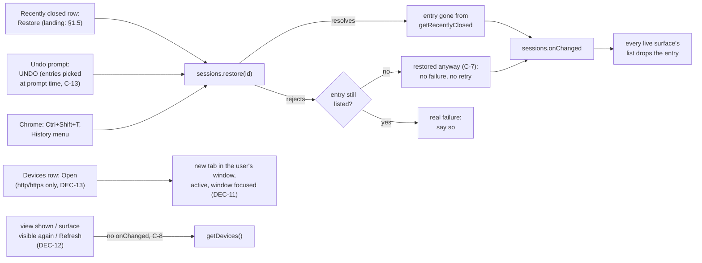
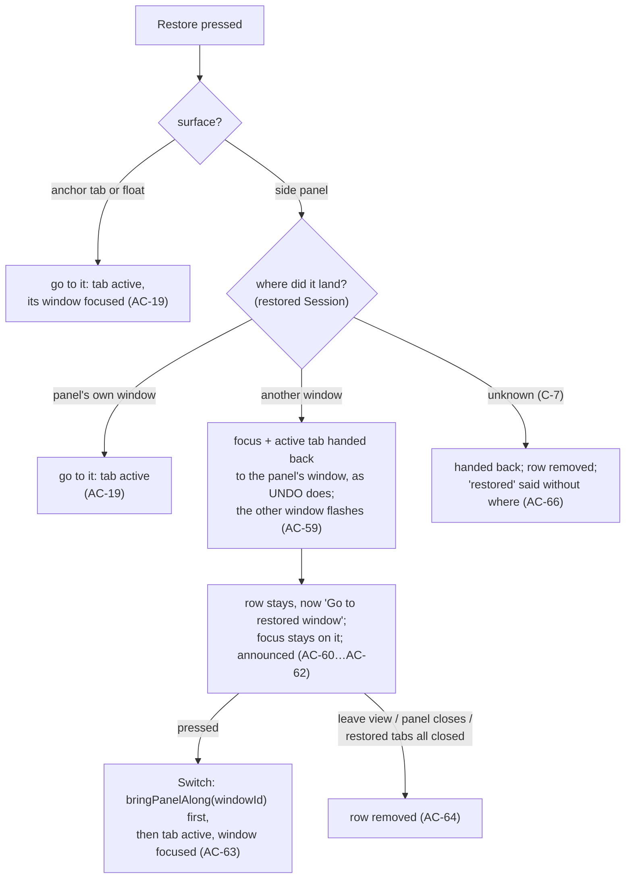

# SPEC-07 — Recently closed, and tabs on your other devices

|                |                                                                                                                                                                                                                                  |
| -------------- | -------------------------------------------------------------------------------------------------------------------------------------------------------------------------------------------------------------------------------- |
| **Spec ID**    | SPEC-07                                                                                                                                                                                                                          |
| **Date**       | 2026-10-14                                                                                                                                                                                                                       |
| **Module**     | `tab-list` (`src/lib/Tabs/undo/`, `src/lib/Tabs/actions.ts`, `src/lib/Tabs/elements/`) — with edges into `ui-shell` (`src/lib/surfaces.ts`, `src/lib/ControlBar/`, `src/App.tsx`) and `views` (`src/views/`)                    |
| **Status**     | **draft — ready for the user's approval.** All ten clarifications answered (DEC-8…DEC-17); the PI-1 probe ran on 2026-10-14 and its results are recorded (§13, §16, C-14…C-20); the user decided on them the same day (AM-2…AM-4, §17), after AM-1. Nothing blocks approval; only the user approves. Do not plan against it until they have. |
| **Supersedes** | —                                                                                                                                                                                                                                |
| **Evidence**   | `discovery/2026-10-14-keeping-tabs-for-later.md` (ideas 1 and 2, Q1–Q4, "Learned since, from SPEC-06"); `discovery/probes/sessions-probe.js`; `discovery/probes/spec-07-probe.js` (run 2026-10-14, §16); SPEC-06 C-10, C-12, P4, P5. |

---

## 1. Problem

### 1.1 What the extension keeps today

Nothing of its own, by design (SPEC-01 AC-23). The one way back from a close is the Undo prompt:
`SyncPrompt` (`src/lib/Tabs/undo/SyncPrompt.tsx`) counts a burst of `tabs.onRemoved`, reads
`chrome.sessions.getRecentlyClosed` at prompt time (`:63`), picks the newest entries that cover the
burst, and for `PROMPT_DURATION` (3 s) offers UNDO, which calls `restoreSessions`
(`src/lib/Tabs/undo/restore.ts:17-40`): `chrome.sessions.restore` per entry, oldest first, then
focus and activation handed back to `resolveUserWindow()` (`src/lib/surfaces.ts:87`). After three
seconds, the way back is Chrome's own History menu, which the manager does not show.

The discovery found that the one need the product leaves unmet is the one session savers are
installed for: **losing what was open**. Its demand evidence (§"What goes wrong") is that loss
runs through every product, and its first two ideas cost no permission at all:

1. **Recently closed** — the windows and tabs Chrome remembers closing, each restorable. It turns
   a three-second Undo into a short history, and Q2 found it survives quitting Chrome, so it is
   insurance as well as undo — up to Chrome's last 25 entries.
2. **On your other devices** — what is open on the phone or the laptop, each openable here.

This spec is that slice: the zero-permission insurance and undo. Keeping a window by name
(discovery idea 4, bookmarks) is the strongest demand signal and is **not** this spec (NG-2).

### 1.2 What Chrome gives, and what it does not

- `chrome.sessions.getRecentlyClosed()` → `Session[]`, newest first; each has `lastModified` and
  exactly one of `tab` or `window`. `chrome.sessions.restore(sessionId?)` reopens one entry and
  resolves with the restored `Session`.
- `chrome.sessions.getDevices()` → `Device[]` (`deviceName`, `sessions`), most recently modified
  device first; each session is a `window` of `tabs`.
- `chrome.sessions.onChanged` fires when recently-closed entries change. **It does not fire for
  synced-device changes** (`@types/chrome` 0.0.263, `onChanged` doc comment; Chrome's reference).
- No `chrome.sessions` member reports whether Sync is on, whether the user is signed in, or why
  `getDevices` is empty (typings 0.0.263, read in full — §16).

### 1.3 What is already measured

C-1…C-13 were known before this spec's probe; C-14…C-20 are its results (§16). The harness cannot answer any of this: `src/test/chromeStub.ts:163-171` answers
`getRecentlyClosed` with `[]` and has no `getDevices` and no `onChanged`; `harness/fakeChrome.ts:344-353`
returns one fake tab entry and no devices. Every **real Chrome only** criterion below exists because
of that.

| #    | Constraint                                                                                                                                                                                                                                                                                                                                          | Source                                                       |
| ---- | --------------------------------------------------------------------------------------------------------------------------------------------------------------------------------------------------------------------------------------------------------------------------------------------------------------------------------------------------- | ------------------------------------------------------------ |
| C-1  | **Restoring a closed window brings it back whole**: its pinned tab pinned, its group with title and colour.                                                                                                                                                                                                                                         | Discovery Q1 (Chrome 155); SPEC-06 C-3                       |
| C-2  | **Before restore, a closed window's record does not describe its groups.** Every tab reported `groupId: 0`, the pinned ungrouped one included. The list can show a closed window's tabs and count — **not** which tabs were grouped, nor a group's title or colour.                                                                                     | Discovery Q1, "the catch"                                    |
| C-3  | **Recently closed survives quitting and reopening Chrome.** One restart, one profile.                                                                                                                                                                                                                                                               | Discovery Q2                                                 |
| C-4  | **`getDevices` is populated on at least one ordinary profile**: 2 other devices, 3 windows, 71 tabs. One profile, so "usually" is not proven.                                                                                                                                                                                                       | Discovery Q4                                                 |
| C-5  | **A deleted group leaves one closed-*tab* entry per tab**, and restoring them oldest first brings the group back in its source window with title and colour. No phantom window.                                                                                                                                                                      | SPEC-06 P4, C-12                                             |
| C-6  | **Chrome keeps at most 25 entries** (`sessions.MAX_SESSION_RESULTS = 25`). A window counts as one entry; a group delete counts one per tab (C-5), so **one 24-tab group delete pushes out nearly everything else**.                                                                                                                                 | `@types/chrome` 0.0.263; `SyncPrompt.tsx:10`; SPEC-06 "Learned since" |
| C-7  | **`sessions.restore()` can reject and still restore.** A closed window's restore rejected with `Invalid session id`, the window came back anyway, and the entry vanished from `getRecentlyClosed`. The call's result cannot be trusted, and it does not hand back the window.                                                                       | SPEC-06 P5, C-10 (3) — seen for a window the extension had created; not yet seen for an ordinary one (SPEC-06 PI-6) |
| C-8  | **`sessions.onChanged` does not fire for synced-device changes.** The devices list goes stale unless it is re-read.                                                                                                                                                                                                                                 | `@types/chrome` 0.0.263; Chrome API reference                |
| C-9  | **`sessions.restore()` steals focus and activation.** `restore.ts` hands both back to `resolveUserWindow()` for UNDO.                                                                                                                                                                                                                              | `restore.ts:3-16`, `:33-39`                                  |
| C-10 | **A session id is spent once restored**; a second restore of it rejects. That is why `SyncPrompt`'s UNDO already catches and says "Couldn't restore those tabs" (`:105`).                                                                                                                                                                           | `SyncPrompt.tsx:101-110` comment                              |
| C-11 | **No new install warning.** `sessions` together with `tabs` already shows "Read your browsing history on all your signed-in devices". Both are held.                                                                                                                                                                                                | Discovery, API table; `manifest.json`                        |
| C-12 | **Sync off, signed out and "no other device" look the same**: an empty `getDevices` result, and no `chrome.sessions` member says which. Telling them apart would need another permission (NG-3).                                                                                                                                                    | §1.2; typings 0.0.263                                        |
| C-13 | **The Undo prompt picks its entries when it appears, not when UNDO is pressed** (`SyncPrompt.tsx:63-80`). An entry restored elsewhere in those three seconds is still in its `toRestore`, and UNDO would then reject on it (C-10) and stop the loop (`restore.ts:27-31`), leaving the later entries unrestored.                                      | `SyncPrompt.tsx`, `restore.ts`, read 2026-10-14              |
| C-14 | **`Session.lastModified` is in seconds**, at whole-second resolution: `1791970309` against `Date.now()` `1791970309624`. The typings' "milliseconds" is wrong.                                                                                                                                        | PI-1 probe, Q-A — §16                                         |
| C-15 | **No time threshold separates one action from two quick closes by hand.** A 24-tab group delete (`tabs.remove`, 428 ms) gave 24 entries spanning 1 s (2 distinct values); a 10-tab multi-select close, 10 entries spanning 0 s; two closes by hand, one after the other, 2 entries spanning 1 s. A ≤ 1 s rule merges the hand closes; an equal-seconds rule splits the group delete. | PI-1 probe, Q-B — §16                                         |
| C-16 | **Closed-tab entries carry no group information either**: every entry from a deleted group reported `groupId: 0`. C-2 holds for tab entries too.                                                                                                                                                | PI-1 probe, Q-C — §16                                         |
| C-17 | **A closed tab whose window has since closed is restored into a new window** (of 1 tab).                                                                                                                                                                                                       | PI-1 probe, Q-E — §16                                         |
| C-18 | **One tab of a closed window can be restored alone**, by its own `sessionId` inside the window entry; it came back as one tab in a new window. **Unmeasured:** whether the window entry then stays listed without it.                                                                              | PI-1 probe, Q-F — §16                                         |
| C-19 | **One tab of a deleted group, restored alone, comes back inside its group**, with title and colour, in its original window when that window is still open.                                                                                                                                        | PI-1 probe, Q-H — §16                                         |
| C-20 | **Restoring an ordinary closed window did not reject** in this run. One sample; C-7 still stands, so AC-14 and AC-17 handle both outcomes.                                                                                                                                                    | PI-1 probe, Q-J — §16                                         |

### 1.4 The restore path, and where it can double up

Three things can restore the same entry — this list, the Undo prompt, and Chrome itself — and two
of this extension's surfaces can be live at once (SPEC-01 AC-19, AC-42). The rule this spec adds is
that **an entry is restored at most once, and a failure is reported only when the entry is still
there afterwards** (AC-14…AC-17).

### 1.5 Where the user lands after a restore  *(AM-1, DEC-18)*

`chrome.sidePanel.open()` must be the first call in a live user gesture (SPEC-05 C-8;
`bringPanelAlong`, `surfaces.ts:17-42`). Switch can bring the panel along because its target window
is known before the click. **A restored item's window is known only after `sessions.restore()`
resolves**, when the gesture is spent — so a restore that lands in another window cannot bring the
panel along in the same press. The side panel therefore keeps its user in their window and offers a
second, ordinary press to go there.

---

## 2. Goals

- **G-1** Someone who closed the wrong window, or a group, or forty tabs, can see what Chrome
  remembers and put any of it back from the manager — after the Undo prompt is gone, and after a
  restart (C-3).
- **G-2** A restored window comes back as it was — pinned tab, groups, titles, colours — because
  Chrome restores it (C-1); the list never claims structure it cannot see (C-2).
- **G-3** The tabs open on the user's other signed-in devices are visible and openable here.
- **G-4** Restore never reports a failure that did not happen, and never restores twice (C-7, C-10,
  C-13).
- **G-5** No new permission, no new install warning, no storage, and nothing leaves the machine.
- **G-6** It meets the same accessibility bar as the open-tab list (SPEC-04, SPEC-05) on all three
  surfaces.

## 3. Non-goals

- **NG-1** Discovery ideas 3, 5, 6 and 7: sleeping a window (`tabs.discard`), the reading list,
  exporting a window, and keeping a window as a Chrome tab group.
- **NG-2** **Keeping windows by name** (discovery idea 4, bookmarks). The strongest demand signal,
  and the next spec — not this one. Nothing here names, saves or pins an entry, and no entry
  outlives Chrome's own 25 (C-6).
- **NG-3** Any new permission, required or optional, and any change to the install warning. The
  manifest's `permissions` stay exactly `["sidePanel", "tabs", "tabGroups", "sessions", "favicon"]`
  (SPEC-03 AC-6), with no `optional_permissions`, no `host_permissions`, no `content_scripts`
  (SPEC-01 NG-3). In particular no `history`, `identity` or `bookmarks`.
- **NG-4** Any storage: `chrome.storage`, `localStorage`, `sessionStorage`, IndexedDB, Cache
  Storage or cookies (SPEC-01 AC-23). No remembered expansion state, no remembered "seen" entries,
  no copy of an entry kept past Chrome's own list.
- **NG-5** Changing SPEC-06 — the group X, its names, its confirmation on search rows — or the Undo
  prompt's merge window, duration, or choice of surface (SPEC-01 AC-42). AC-18 changes only what
  UNDO does with an entry that is already spent.
- **NG-6** Removing or editing entries in Chrome's recently-closed list, or clearing it. There is
  no API for it.
- **NG-7** Acting on another device: closing, moving or sending tabs to it. `getDevices` is
  read-only.
- **NG-8** Showing, before a restore, which tabs of a closed window were grouped, or a group's
  title or colour (C-2). Not declined on taste; the record does not carry it.
- **NG-9** Selecting, multi-selecting, dragging or bulk-acting on closed or device entries.
- **NG-10** Incognito windows and tabs, open or closed. The manager does not list them (SPEC-03
  E-4).
- **NG-11** Chrome's saved tab groups (SPEC-06 NG-1). No API lists them.

## 4. User stories

- **US-1** As someone who closed the wrong window, I want to see it in the manager and restore it
  with its groups and pinned tab, so that I do not rebuild it by hand.
- **US-2** As someone who closed something an hour ago, or before quitting Chrome, I want to find
  and reopen it after the Undo prompt has gone.
- **US-3** As someone who deleted a large group by mistake, I want to restore the whole group in
  one action, not tab by tab.
- **US-4** As someone who left an article open on my phone, I want to see it here and open it on
  this computer.
- **US-5** As a screen-reader or keyboard user, I want these rows to work and to be named like the
  rest of the list, so that I learn nothing new to use them.
- **US-6** As someone careful about privacy, I want my other devices' names and pages to stay on
  this machine, as the rest of the extension's data does.

---

## 5. Acceptance criteria

Each is one testable statement. Ids are stable — never renumber; append `AC-N+1` for new ones.
Priority uses MoSCoW. **Real Chrome only** marks a criterion that no unit test, jsdom run or
harness pass can prove (§1.3). "The view" is the one view holding both lists (DEC-8); "the
open-tab list" is today's `TabsView` / `SearchView`; "an entry" is one item of Chrome's
recently-closed list; "a run" is entries shown as one row under AC-8; "a device tab" is one tab of
one window of one device. AC-57…AC-58 were added with the 2026-10-14 answers and are in §5.12; AC-59…AC-67 came with
AM-1 and are in §5.13; AC-68…AC-70 came with AM-2…AM-4 and are in §5.14.

### 5.1 Reaching it

- **AC-1** _(Must)_ The system SHALL offer one view holding both lists, Recently closed first and
  On your other devices second, which replaces the open-tab list while it is shown; it SHALL be
  reached, and left again for the open-tab list, by one labelled control that is present and works
  the same on all three surfaces — side panel, anchor tab and float (DEC-8).
  **Verify:** unit — under each `getHost()` value, activating the control replaces the open-tab
  list with the view (Recently closed before devices) and activating it again restores the
  open-tab list; manual — the AC-46 sweep on all three.
- **AC-2** _(Must)_ The way in SHALL be reachable by keyboard alone, and the open-tab list's
  Tab-stop budget SHALL NOT increase: the 20-plain-tab fixture SHALL still cost 20 stops.
  **Verify:** unit — SPEC-04 AC-9's test passes unmodified; a key walk from the search field
  reaches the way in.
- **AC-3** _(Must)_ WHEN the user goes to the view and back, the system SHALL keep the open-tab
  list's selection and its expanded or collapsed windows and groups as they were, and SHALL NOT
  clear or change the search text by itself. There is one search field and one search text; it
  filters whichever view is shown (DEC-9, AC-35), so text typed in the view is still there on
  return.
  **Verify:** unit — set a search, select two tabs, collapse a window, go to the view and back
  without typing; assert all three unchanged; type in the view, go back, assert the open-tab list
  is filtered by the new text. _(Confirmed by the user, 2026-10-14.)_

### 5.2 Recently closed — what is listed

- **AC-4** _(Must)_ WHEN the Recently closed list is shown, the system SHALL list the entries
  `chrome.sessions.getRecentlyClosed` returns, in Chrome's order (newest first), subject to AC-6
  and AC-8.
  **Verify:** unit (shim) — a fixture of 3 tab entries and 2 window entries renders 5 entries in
  fixture order.
- **AC-5** _(Must)_ A closed-window entry SHALL be shown as one entry carrying its tab count, with
  its tabs' titles available to the user in Chrome's order, and SHALL NOT show or name a group, a
  group title or a group colour for any of its tabs (C-2, NG-8).
  **Verify:** unit — a window fixture whose tabs all carry `groupId: 0` renders its tabs with no
  group chip, colour or group name, and the count matches the tabs shown.
- **AC-6** _(Must)_ The list SHALL NOT show this extension's own pages (`isOwnPage`,
  `surfaces.ts:14`): a closed-tab entry that is an own page SHALL NOT be listed; in a closed-window
  entry own pages SHALL be neither shown nor counted; and an entry whose every tab is an own page
  or `about:blank` SHALL NOT be listed.
  **Verify:** unit — a closed anchor tab (`index.html?host=anchor`), a window holding the anchor
  and two pages, and a window of only `about:blank`: the first and third are absent, the second
  shows "2 tabs".
- **AC-7** _(Must)_ WHEN the user stops floating, the Recently closed list SHALL NOT gain an entry
  for the float's own window or its `about:blank` tab.
  **Verify:** manual, **real Chrome only** — float, stop floating, open the view; no new entry.
  _(Unmeasured whether Chrome records one at all — A-6. AC-6's `about:blank` rule is what covers
  it if it does.)_
- **AC-8** _(Must — amended by AM-2)_ WHEN two or more consecutive entries are closed-**tab**
  entries and each one's `lastModified` is within **1 second** of its neighbour's (seconds, C-14),
  the list SHALL show them as one row labelled by count and close time — "24 tabs closed at 10:31"
  — with one Restore that restores every entry of the row oldest first (which regroups a deleted
  group, C-5); the row SHALL expand to show its tabs, each restorable alone (AC-12). A closed-window
  entry, or a gap of more than 1 s, ends the row. The label SHALL NOT say "together", and SHALL NOT
  say "group" nor show a group's name or colour (C-2, C-16). The time SHALL be the local clock time
  to the minute, in the browser's locale format; WHERE the row's oldest and newest entries fall in
  different minutes, the label SHALL give both — "24 tabs closed between 10:30 and 10:31"; WHERE
  they are not from today, the label SHALL carry the day as AC-10 does. There is no further cap on
  chaining: Chrome's 25-entry limit (C-6) bounds a row to 25 entries and 24 s. IF some entries of a
  row still fail after AC-14's check, THEN one message SHALL say how many could not be restored
  (DEC-19).
  **Verify:** unit — with a fixed clock and fixtures in seconds: 24 closed-tab entries at
  10:31:05–10:31:06, then 1 closed window, then 2 tab entries at 09:00:00 and 09:00:01, then 1 at
  08:00:00, render 4 rows — "24 tabs closed at 10:31", the window, "2 tabs closed at 09:00", one
  single tab; 3 entries at 10:30:59, 10:31:00, 10:31:01 render "3 tabs closed between 10:30 and
  10:31"; the 24-tab row's Restore calls `restore` 24 times in reverse fixture order; expanding it
  offers 24 single Restores; no text in any row contains "together" or "group". Manual, **real
  Chrome only** — delete a 24-tab group, open the view, restore the row; the group comes back titled
  and coloured. _(Measured, C-15: no time threshold separates one action from two quick closes by
  hand — a 24-tab delete spanned 1 s, two hand closes also 1 s. So the row is labelled by what is
  always true, the time, and a mismatch costs nothing: two quick hand closes may share a row, and
  it expands with per-tab Restore. Like the Undo prompt, which already merges a burst into one
  closure, one action reads as one row. The 25 cap still applies: what the delete pushed out cannot
  be shown.)_
- **AC-9** _(Must)_ WHILE the list is shown, WHEN `chrome.sessions.onChanged` fires, the system
  SHALL re-read and redraw it without the user acting — whether the change came from this list,
  the Undo prompt, another surface, or Chrome itself (Ctrl+Shift+T, the History menu, a new close).
  **Verify:** unit (shim) — fire `onChanged` with a changed fixture; the list follows. Manual —
  restore an entry with Ctrl+Shift+T while the view is open; it disappears.
- **AC-10** _(Should — amended by AM-2)_ Each entry SHALL show when it was closed, from
  `Session.lastModified` read as **seconds** since the epoch (C-14), as local clock time to the
  minute in the browser's locale format ("10:31"); WHERE it was not closed today, the day SHALL be
  shown too ("Yesterday, 10:31", or the date). Every entry, run and window uses this one form.
  **Verify:** unit — with a fixed clock: fixtures 30 s, 2 h, 1 day and 3 days old show the clock
  time, "Yesterday, …" and a date; a fixture value of `1791970309` is read as 2026-10-14, not as
  1970. _(Was a relative time. A list that says "5 min ago" on one row and "at 10:31" on the next
  reads as two clocks; the run label (AC-8) needs a clock time, so every row uses one.)_
- **AC-11** _(Should)_ The Recently closed list SHALL say, in fixed words, that Chrome keeps only
  its most recent entries, giving the number from `chrome.sessions.MAX_SESSION_RESULTS` rather
  than a literal.
  **Verify:** unit — with the stub's `MAX_SESSION_RESULTS` set to 25 and to 10, the text carries
  that number. _(C-6. Insurance that silently forgets is the failure the demand evidence is about;
  saying the limit is the honest form of this feature.)_

### 5.3 Restore

- **AC-12** _(Must)_ WHEN the user activates Restore on a closed-tab entry, the system SHALL ask
  Chrome to restore exactly that entry.
  **Verify:** unit (shim) — `sessions.restore` is called once, with that entry's `tab.sessionId`.
- **AC-13** _(Must — amended by AM-3)_ WHEN the user activates a closed-window entry's main
  Restore, the system SHALL restore the whole window as one entry. The row SHALL also expand to
  show its tabs, each with its own Restore, which SHALL restore that tab alone by its own session
  id (C-18) (DEC-20).
  **Verify:** unit (shim) — the main Restore calls `sessions.restore` once, with `window.sessionId`;
  a tab's Restore inside the expanded row calls it once with that tab's `sessionId`. Manual, **real
  Chrome only** — a closed window with a pinned tab and a titled, coloured group comes back with all
  three (C-1, on the build); one tab of a closed window comes back alone, in a new window (C-18).
- **AC-14** _(Must)_ IF Chrome rejects a restore, THEN the system SHALL report a failure only IF
  the entry is still among Chrome's recently-closed entries afterwards; IF it is not, THEN the
  system SHALL treat it as restored and SHALL NOT restore it again (C-7).
  **Verify:** unit (shim) — restore rejects and the next `getRecentlyClosed` lacks the entry: no
  error snackbar, one `restore` call; restore rejects and the entry is still listed: snackbar
  "Couldn't restore tab" / "Couldn't restore window", one `restore` call.
- **AC-15** _(Must)_ WHEN Restore is activated again on an entry whose restore is running or done —
  a double press, or the same entry pressed on a second live surface — the system SHALL restore it
  at most once and SHALL NOT report a failure for the later press.
  **Verify:** unit — two activations in one tick produce one `restore` call; a press on an entry
  whose id now rejects and which is no longer listed produces no error (AC-14). Manual — anchor tab
  and float both showing the view, press Restore on the same entry in each.
- **AC-16** _(Must)_ WHEN an entry is restored by any means, the system SHALL remove it from the
  list on every live surface. _(Amended by AM-1: on the side panel that restored it, a restore that
  landed in another window leaves a "Go to restored window" row in its place — AC-60. That row is
  not an entry and is not restorable.)_
  **Verify:** unit — via AC-9's `onChanged`; manual — the AC-15 two-surface case.
- **AC-17** _(Must)_ WHEN UNDO is pressed on a prompt some of whose entries are no longer in
  Chrome's recently-closed list (restored from this list, from another surface, or by Chrome), the
  system SHALL restore only the entries still listed, SHALL say nothing about the spent ones, SHALL
  restore no entry twice, and SHALL report a failure ("Couldn't restore those tabs", as today) only
  for an entry still listed after its restore rejected — AC-14's rule (DEC-14). The prompt's merge
  window, duration and choice of surface are unchanged (SPEC-01 AC-42, AC-18).
  **Verify:** unit — a prompt for 3 closed tabs; restore the newest from the list; press UNDO;
  assert `restore` is called for the other 2 only, no error snackbar, and never twice with one id;
  a second case where one remaining entry rejects and stays listed shows the snackbar, and the
  entry after it is still restored. Manual, **real Chrome only** — AC-46's Undo item.
- **AC-18** _(Must)_ Restoring from the list SHALL NOT raise the Undo prompt, and the prompt's
  merge window, duration and choice of surface SHALL be unchanged (NG-5).
  **Verify:** unit — `SyncPrompt.test.tsx`'s merge and surface tests pass unmodified; a restore from
  the list produces no snackbar other than AC-14's.
- **AC-19** _(Must — amended by AM-1)_ WHEN a restore or an open completes **on the anchor tab or
  the float**, or **on the side panel with the item in the panel's own window**, the system SHALL
  take the user to it, as a row's Switch does (`activateTab`): the restored or opened tab SHALL be
  active and its window focused — for a closed window or a run, the window Chrome restored into,
  with whichever tab Chrome made active — and the system SHALL NOT hand focus back to the window
  the user was in. WHEN it completes on the side panel with the item in **another** window, AC-59
  applies instead. No restore or open SHALL close the side panel or the float it was started from
  (DEC-11, DEC-18).
  **Verify:** unit (shim) — under `anchor` and `float`, and under `panel` with the restored
  `Session`'s window equal to the panel's: after a tab restore and after an Open, no
  `windows.update({ focused })` or `tabs.update({ active })` targets the previous window or tab;
  after an Open, the new tab is created active in `resolveUserWindow()`'s window and that window
  is focused; no `window.close()`. Manual, **real Chrome only** — the AC-46 sweep, from each
  surface. _(From the anchor tab, an item restored or opened into the anchor's own window hides the
  manager behind it, as Switch does today — accepted, E-28. From the side panel an Open always
  lands in the panel's own window, because `resolveUserWindow()` answers the panel's window there
  (`surfaces.ts:87-91`), so AC-59 concerns Restore only.)_
- **AC-20** _(Must)_ The system SHALL leave a restored tab in the window Chrome restores it into,
  and SHALL NOT move it afterwards.
  **Verify:** unit — no `tabs.move` after a restore. Manual, **real Chrome only** — a closed tab
  whose window is still open comes back there (C-5); one whose window has since closed comes back
  in a new window (C-17). _(`restore()` takes no window. Opening by URL instead would lose the
  group and the tab's history, which is why Chrome's restore is used at all.)_

### 5.4 On your other devices

- **AC-21** _(Must)_ WHEN the devices list is shown, the system SHALL list each device
  `chrome.sessions.getDevices` returns, by `deviceName`, in Chrome's order, and under each device
  its windows' tabs in Chrome's order; a device with no listable tab SHALL NOT be listed.
  **Verify:** unit (shim) — 2 devices, 3 windows, 71 tabs (C-4's shape) render 2 devices and 71
  tabs in fixture order; a third device with no sessions is absent.
- **AC-22** _(Must)_ A device tab whose URL is one of this extension's own pages (`isOwnPage`)
  SHALL NOT be listed.
  **Verify:** unit — a device tab at this extension's `index.html?host=anchor` is absent. _(A store
  install has one extension id on every device — A-1 — so the laptop's anchor tab would otherwise
  be offered for opening here, as a second anchor.)_
- **AC-23** _(Must)_ WHEN the user activates Open on a device tab, the system SHALL open that tab's
  URL in a new tab in this browser, once per activation, and SHALL change nothing on the other
  device.
  **Verify:** unit (shim) — one `tabs.create` with that URL; two activations in one tick produce
  one; no other `chrome.sessions` call than `getDevices`.
- **AC-24** _(Must)_ IF there is no browsing window to open into (`resolveUserWindow()` answers
  `undefined`), THEN Open SHALL open the tab in a new window.
  **Verify:** unit (shim) — with every window the extension's own, `windows.create` receives the URL.
- **AC-25** _(Must)_ WHERE a device tab's URL does not parse with the scheme `http:` or `https:`,
  the system SHALL list it with the fixed words "Can't be opened from here", SHALL give it no Open
  control, and SHALL NOT open it by any path (DEC-13).
  **Verify:** unit — fixtures at `javascript:alert(1)`, `data:text/html,…`, `file:///C:/x`,
  `chrome://settings`, `view-source:https://a.example`, `chrome-extension://<other id>/`,
  `HTTPS://Example.com` and `https://example.com`: only the last two get an Open control, the rest
  show the fixed words, and no `tabs.create` or `windows.create` is ever called with any of the
  others.
- **AC-26** _(Must)_ IF opening a device tab fails, THEN the system SHALL show "Couldn't open tab",
  as `run()` does for every other tab action (`actions.ts:9-15`), and SHALL NOT swallow it.
  **Verify:** unit — `tabs.create` rejects; assert the snackbar.
- **AC-27** _(Must)_ The system SHALL re-read the devices list WHEN the view is shown, WHEN the
  surface showing the view becomes visible or focused again, and WHEN the user activates an
  explicit Refresh control in the devices list; it SHALL NOT poll on a timer, and SHALL NOT rely on
  `sessions.onChanged` to learn of device changes (C-8, DEC-12).
  **Verify:** unit — `getDevices` is called once on showing the view, once on a `visibilitychange`
  to visible and once on window `focus` while the view is shown, once per Refresh press, never on
  those events while the open-tab list is shown, and not at all after 5 minutes of fake timers with
  no event.
- **AC-28** _(Should)_ Each device SHALL show how recently its tabs were last updated, from the
  newest `lastModified` among its sessions — read as **seconds** (C-14) — as a relative time
  ("updated 3 days ago").
  **Verify:** unit — against a fixed clock, with fixtures in seconds. _(Without it a device last seen a month ago reads as
  current; C-8 means the list can never be fresher than Chrome's last sync.)_
- **AC-29** _(Must)_ Device tabs SHALL be opened one at a time only: no control SHALL open a whole
  device window, or several device tabs, in one action (DEC-15). "Open all" is deferred until the
  PI-1 probe answers Q-G.
  **Verify:** unit — a device with 3 windows renders no control that calls `tabs.create` or
  `windows.create` more than once, or with more than one URL.

### 5.5 Empty, loading and failure states

- **AC-30** _(Must)_ WHILE the first read of either list has not resolved, the system SHALL NOT
  show that list's empty state.
  **Verify:** unit — with `getRecentlyClosed` and `getDevices` pending, neither empty text is in the
  document. _(`browserStore.ts` rule 2; `TabsView` once announced an empty browser on every open.)_
- **AC-31** _(Must)_ WHEN `getRecentlyClosed` resolves with no listable entry, the system SHALL say
  so in fixed words.
  **Verify:** unit — `[]`, and a list holding only a closed anchor tab (AC-6), both show the text.
- **AC-32** _(Must)_ WHEN `getDevices` resolves with no listable tab, the system SHALL show one
  empty state that names the conditions under which other devices appear — Chrome Sync on, open
  tabs synced, another device signed in to the same account — and SHALL NOT state which of them is
  unmet (C-12).
  **Verify:** unit — `[]` shows the text; the text contains none of "Sync is off", "not signed in",
  "no other devices" as a statement of fact.
- **AC-33** _(Must)_ IF a read rejects, THEN the last list shown SHALL stand; IF there is no
  earlier list, THEN the system SHALL show "Couldn't read recently closed tabs" or "Couldn't read
  your other devices" in place of an empty state.
  **Verify:** unit — reject the first read: the error text, no empty text; resolve, then reject: the
  resolved list stays.

### 5.6 Search

- **AC-34** _(Must)_ The open-tab search's results, its "N tabs match" announcement (`App.tsx`),
  and SPEC-05 AC-18's Ctrl/Cmd+A SHALL count and select open tabs only; no closed entry or device
  tab SHALL be counted as a match or become selected.
  **Verify:** unit — with 2 open tabs and 3 closed entries matching "doc", the announcement reads
  "2 tabs match" and Ctrl+A selects exactly the 2.
- **AC-35** _(Must — amended by AM-4)_ WHILE the view is shown, the search field SHALL filter both
  its lists by the rule `SearchView` uses for open tabs — a case-insensitive substring of a tab's
  title or URL — and WHILE the open-tab list is shown, search SHALL behave exactly as today
  (DEC-9). A closed window or a run SHALL be shown WHEN any of its tabs matches, **expanded**, with
  all its tabs in order and the matching ones highlighted (AC-70); its name SHALL still carry its
  **full** tab count, its main Restore SHALL still restore the whole item, and each matching tab
  SHALL be restorable alone (AC-8, AC-13). A device SHALL be shown WHEN any of its tabs matches,
  with only its matching tabs (device tabs are opened one at a time, AC-29) (DEC-21).
  **Verify:** unit — in the view, with "doc" typed: a single tab entry matching by title and one
  matching by URL are shown, a non-matching entry is not; a 5-tab closed window with 1 match is
  shown expanded, named with "5 tabs", its matching tab highlighted and the other 4 shown plain,
  its main Restore restores the window and the matching tab's Restore restores that tab only; a
  24-tab run with 2 matches is shown expanded the same way; a device with 3 tabs, 1 matching, shows
  that 1; a device with no match is absent; clearing the text collapses the expanded rows back to
  how they were; `SearchView`'s existing tests pass unmodified. _(SPEC-06 DEC-11 / E-4 is the
  lesson: a row that acts on what it does not show must say so. Here it shows it, and points at
  what matched.)_

### 5.7 Accessibility

- **AC-36** _(Must)_ Every entry, window entry, device and device tab SHALL be a row as SPEC-04
  defines one: a `listitem` holding one named `toolbar` (SPEC-04 AC-28, AC-29), in a flat list
  (AC-4 there); Tab SHALL move between rows, Left and Right between a row's controls without
  wrapping (SPEC-04 AC-34, AC-35); a plain Up SHALL go to the search field (SPEC-05 AC-40); and
  axe SHALL report zero `nested-interactive`, `button-name`, `aria-required-children` and
  `aria-required-parent` nodes.
  **Verify:** unit — the `rows.a11y.test.tsx` axe run over a fixture of each row kind; a
  `userEvent` walk asserting one Tab stop per row and Left/Right within one.
- **AC-37** _(Must)_ Every control SHALL have a non-empty name that identifies its subject, per
  SPEC-04 AC-6 and SPEC-06 AC-20. WHERE Restore or Open is its row's primary control, it SHALL be
  named "Restore" or "Open" and the row toolbar's name SHALL begin with the title (SPEC-04 AC-6,
  AM-3); WHERE it is not the primary control, it SHALL name its subject — "Restore window, N tabs",
  "Restore N tabs" (DEC-16). A window entry SHALL be named by its tab count (it has no title); an
  untitled tab by its host, or "tab" if it has none (SPEC-04 AC-29 item 1). The final wording is
  settled by ear in AC-42.
  **Verify:** unit — names for a titled tab entry, an untitled one, a window entry, a run, a tab
  inside an expanded run, a device and a device tab; none empty; a bare "Restore" or "Open" only on
  a row's primary control, inside a toolbar whose name begins with the title.
- **AC-38** _(Must)_ _(Amended by AM-1: does not apply where AC-60 keeps the row; AC-61 does.)_
  WHEN the focused row disappears because its entry was restored or vanished,
  keyboard focus SHALL land on the first control of the row that now follows; IF there is none,
  THEN on the previous row's first control; IF the list is empty, THEN on the way back to the open
  tabs, or the search field — never on `document.body` and never on a removed node (SPEC-06 AC-13,
  DEC-12).
  **Verify:** unit — restore the first, the last and the only entry with focus on its Restore;
  assert `document.activeElement` each time.
- **AC-39** _(Must)_ WHEN a restore or an open completes, the system SHALL announce it in the
  app's polite live region (`App.tsx:333`) in fixed words and counts only — "Tab restored",
  "Window restored, N tabs", "N tabs restored", "Tab opened" — without moving focus, and SHALL NOT
  interpolate a title, URL or device name (SPEC-05 AC-25).
  **Verify:** unit — a restore of a tab titled `">`: the region's text
  is exactly "Tab restored".
- **AC-40** _(Must)_ Closed entries and device tabs SHALL carry no select control and no drag
  handle; Shift+Up/Down (SPEC-05 AC-17) SHALL NOT select them; and dropping an open tab on them
  SHALL do nothing (NG-9).
  **Verify:** unit — no `Select …` or `Reorder …` control on any such row; a Shift+Down range over
  them leaves `selected` unchanged.
- **AC-41** _(Must)_ The keyboard model and names SHALL be identical in the side panel, the anchor
  tab and the float.
  **Verify:** unit — AC-36's walk under each host; manual — AC-42.
- **AC-42** _(Must)_ A manual **NVDA + Chrome** pass SHALL be recorded in this file before it may
  reach `implemented`, on all three surfaces, in focus mode and in browse mode, covering: a tab
  entry, a window entry and a tab inside it (AC-13), a run and a tab inside it, and how a run's
  time label is read (AC-8), a search with a highlighted match (AC-35, AC-70), a device and a device tab, including one
  that "Can't be opened from here" (AC-25); the Restore and Open names (AC-37, DEC-16); the AC-39
  and AC-58 announcements; AC-38's focus landing; the way in and out (AC-1, AC-57); on the side
  panel, a restore into another window — the "Go to restored window" control, its announcement
  (AC-60…AC-62) and where focus is after the flash (AC-61, Q-K); and both empty states. NVDA version,
  Chrome version, surface, date, tester, and what was said.
  **Verify:** a result block here, in the style of SPEC-04 AC-27. _(Memory: a wording fix that read
  well was removed after ten minutes with NVDA.)_

### 5.8 Favicons

- **AC-43** _(Must)_ Every icon in either list SHALL come from the extension's `_favicon` endpoint
  keyed on the entry's URL, at twice its drawn size (SPEC-03 AC-1, AC-2), with the globe where
  there is no URL or no stored icon (SPEC-03 AC-3, AC-9); the `favIconUrl` of a session's tab SHALL
  NOT be fetched or set as any element's source.
  **Verify:** unit — every `img` `src` in a rendered fixture starts with the extension origin; a
  fixture `favIconUrl` of `https://evil.example/x.ico` appears in no attribute.
- **AC-44** _(Must)_ WHEN the view is shown with both lists populated, the extension SHALL issue no
  network request to any origin other than its own.
  **Verify:** manual, **real Chrome only** — DevTools network panel filtered to non-extension
  origins, on a profile with other devices (C-4), in the style of SPEC-03 AC-4. _(A device tab's
  page is usually one this machine never visited; Chrome answers `_favicon` with its default icon
  — SPEC-03 E-3 — and must not fetch it.)_

### 5.9 Permissions, privacy, and the documents that must agree

- **AC-45** _(Must)_ The manifest's `permissions` SHALL remain exactly
  `["sidePanel", "tabs", "tabGroups", "sessions", "favicon"]`, and the manifest SHALL declare no
  `optional_permissions`, `host_permissions`, `optional_host_permissions` or `content_scripts`.
  **Verify:** unit — `src/test/manifest.test.ts` unmodified, plus an assertion that
  `optional_permissions` is absent (PI-6).
- **AC-46** _(Must)_ A manual pass in **real Chrome** SHALL be recorded in this file before it may
  reach `implemented`, covering: the install warning of the built package, compared with 0.2.0's
  (C-11); restore of a closed tab, of a closed window with a pinned tab and a titled coloured group
  (C-1), and of one tab of a closed window (C-18, AC-13, AC-68), and of a 24-tab group delete as
  one row and as one tab of it (C-5, C-6, C-19, AC-8); a restore
  after quitting and reopening Chrome (C-3); a restore while the Undo prompt is up for the same
  close (AC-17); the same entry restored from two live surfaces (AC-15); where the user lands from
  each surface, including a restore into the anchor tab's own window (AC-19); from the side panel,
  a closed window restored (AC-59…AC-63: the flash, focus back, the Go row, the panel opening in the
  restored window on Go) and the restored window closed before Go is pressed (AC-64, AC-65); stopping
  the float (AC-7); a device tab opened here; and the devices empty state on a profile without Sync.
  Each with Chrome version, OS, date and result.
  **Verify:** the result block.
- **AC-47** _(Must)_ The system SHALL write nothing from either list — titles, URLs, device names,
  session ids, times, counts — and no state of the view to `chrome.storage`, `localStorage`,
  `sessionStorage`, IndexedDB, Cache Storage or cookies.
  **Verify:** unit — `manifest.test.ts`'s source scan passes unmodified; manual — storage
  inspection after the AC-46 sweep.
- **AC-48** _(Must)_ The system SHALL send nothing from either list off the machine or to any other
  extension or page: no network request carries it, and no message carrying it leaves this
  extension's own documents.
  **Verify:** AC-44; static — no `fetch`, `XMLHttpRequest`, `sendBeacon`, `WebSocket`, external
  `runtime.sendMessage` or `postMessage` to a page on these paths; no `externally_connectable` in
  the manifest.
- **AC-49** _(Must)_ No title, URL, device name or session id from either list SHALL be written to
  the console or included in an error, a snackbar or an announcement.
  **Verify:** unit — spy on every `console` method through render, restore, a rejected restore, a
  rejected read and an open; assert no call argument contains the fixture's title, URL, device name
  or session id.
- **AC-50** _(Must)_ WHEN this feature ships, `PRIVACY.md`, `store-assets/privacy-policy.html`,
  `store-listing.md` ("Permission justifications", "Data usage", the detailed description) and
  `README.md` ("Features") SHALL say that the extension reads and shows, on this device, the user's
  open tabs, the tabs and windows Chrome remembers closing, and the tabs open on the user's other
  signed-in devices, and that it never transmits, stores or shares any of them; the `sessions`
  justification SHALL name both new uses; and the store's detailed description SHALL describe
  Recently closed and On your other devices as features the user sees (DEC-17).
  **Verify:** manual — read all four against the built behaviour; unit — `manifest.test.ts`'s
  "names every permission" test passes unmodified. _(Today `PRIVACY.md` and
  `privacy-policy.html:87` say `sessions` "restores a recently closed tab when you use the Undo
  action", and `store-listing.md`'s "Data usage" says only that nothing is collected or
  transmitted. SPEC-01 AC-23's "unedited" clause was that feature's; SPEC-03 AC-7 is the precedent
  for editing them. The description clause is what Limited Use asks of browsing-activity data: a
  prominently described, user-facing feature — DEC-17.)_
- **AC-51** _(Must)_ WHEN this feature ships, the Chrome Web Store dashboard's Privacy practices
  tab SHALL declare **"Web history"** as data the extension handles, on the device only, and SHALL
  certify compliance with the Limited Use policy; its answers SHALL agree with `PRIVACY.md` and
  `store-listing.md`, and no permission SHALL change for it (DEC-17).
  **Verify:** manual — the dashboard's answers, with the date and the submitted version, recorded
  in this file. _(Mapping these lists to the "Web history" category is an inference: the category's
  official definition could not be retrieved — DEC-17.)_

### 5.10 Untrusted text

- **AC-52** _(Must)_ Titles, URLs and device names SHALL be rendered and composed into names as
  text only, never as markup or as an attribute-value boundary (SPEC-04 AC-24, SPEC-01 AC-26).
  **Verify:** unit — a device named `<b>x</b>` and a tab titled `">`
  render literally, and no element is created from either.
- **AC-53** _(Must)_ Each title and device name SHALL be displayed direction-isolated, so that a
  right-to-left override or other bidi control inside it cannot reorder the host, count or time
  shown beside it; and the host shown SHALL be the one parsed from the URL, never text from the
  title.
  **Verify:** unit — a title containing U+202E: the host's element text equals the parsed host and
  the title sits in its own direction-isolated element.
- **AC-54** _(Must)_ WHEN a title, URL or device name is very long (2,000 characters), its row SHALL
  keep its height, and no control SHALL be clipped or pushed out of view at ~400 px (SPEC-04 AC-22).
  **Verify:** manual at the float's width, plus the layout harness.
- **AC-55** _(Must)_ A session id SHALL be passed only to `chrome.sessions`, and SHALL NOT be used
  as a DOM `id`, a selector, or part of a URL.
  **Verify:** unit/static — no rendered `id` or `data-*` attribute carries a fixture session id.

### 5.11 Nothing else regresses

- **AC-56** _(Must)_ SPEC-06's behaviour, the open-tab list and the Undo prompt's existing
  behaviour SHALL be unchanged, apart from AC-17.
  **Verify:** the existing `GroupDisplay`, `GroupListItem`, `SyncPrompt`, `restore`, `TabsView` and
  `rows.a11y` tests pass unmodified, except the `SyncPrompt` UNDO tests that AC-17's change to
  spent entries requires (DEC-14).

### 5.12 Added with the 2026-10-14 answers

- **AC-57** _(Must)_ WHILE the view is shown, a plain Down in the search field SHALL move focus to
  the view's first row, as it enters the open-tab list today (SPEC-05 AC-14); and WHEN the view is
  left by its control, focus SHALL stay on that control.
  **Verify:** unit — with the view shown, Down from the field focuses the first row of Recently
  closed (or of the devices list when Recently closed is empty); activating the control from the
  keyboard leaves `document.activeElement` on it in both directions. _(`App.tsx`'s Down handler
  looks for `[data-active-tab]` or `[data-tab-row]` inside `<main>`; the view's rows must be
  reachable the same way — a consequence of DEC-8. Confirmed by the user, 2026-10-14.)_
- **AC-58** _(Should)_ WHEN a Refresh the user asked for (AC-27) completes, the system SHALL
  announce it in the app's polite live region, in fixed words and counts only — the number of
  devices and tabs listed — and SHALL NOT name a device (SPEC-05 AC-25, AC-49).
  **Verify:** unit — a Refresh with 2 devices and 71 tabs: the region reads fixed words carrying
  "2" and "71" and no `deviceName`; a refresh caused by showing the view or by focus announces
  nothing. _(An explicit control that changes nothing visible near focus is otherwise silent —
  WCAG 4.1.3. Confirmed by the user, 2026-10-14.)_

### 5.13 The side panel keeps its user  *(AM-1, DEC-18 — AC-59…AC-67)*

"Another window" means: for a tab entry, the restored tab's window is not the panel's; for a closed
window, always (Chrome restores it as a new window, C-1), and for one tab of a closed window
restored alone, always (it comes back in a new window, C-18); for a tab entry or a run whose source
window has closed, always (C-17); for a run, any of its restored tabs outside the panel's window. "The restored item" is then that window, that tab, or the newest
restored tab of the run that is outside the panel's window. Where it landed is read from the
`Session` that `sessions.restore()` resolves with — discovery Q1 used `restored.window.id`
successfully (`sessions-probe.js`, `q1`).

- **AC-59** _(Must)_ WHERE the surface is the side panel, WHEN a restore completes with the item in
  another window, the system SHALL hand focus and the active tab back to the panel's window as
  UNDO does (`restore.ts:33-39`), and SHALL NOT open the side panel in the other window. The
  restored window coming to the front for a moment and then losing focus is the accepted cost, as
  it already is for UNDO (C-9).
  **Verify:** unit (shim) — host `panel`, panel window 1 with active tab 10; restore resolves with
  `window.id: 7`; assert `windows.update(1, { focused: true })` and `tabs.update(10, { active: true })`
  after the restore, and no `sidePanel.open`. Manual, **real Chrome only** — restore a closed window
  from the panel; it appears, focus returns to the panel's window, and the panel is still open there.
- **AC-60** _(Must)_ In the case of AC-59, the entry's row SHALL NOT disappear: it SHALL become a
  row for the restored item whose primary control is a "Go to restored window" control, and it
  SHALL have no Restore control. The wording is settled by ear in AC-42, per DEC-16 and SPEC-04
  AC-6 — the row's name leads with the item ("Window, 5 tabs", or the tab's title).
  **Verify:** unit — after AC-59's case, the row is still in the list, its toolbar name leads with
  the item, its primary control is the Go control, and no Restore control remains on it.
- **AC-61** _(Must)_ In the case of AC-59, keyboard focus SHALL stay on that row, on its Go
  control, if it was on the row's Restore when Restore was pressed; AC-38 SHALL NOT move it.
  **Verify:** unit — focus Restore, press it, resolve the restore into another window; assert
  `document.activeElement` is the Go control. Manual, **real Chrome only** — with NVDA, after the
  flash, the Go control is what is focused and heard (Q-K).
- **AC-62** _(Must)_ In the case of AC-59, the announcement (AC-39) SHALL also say that the item is
  in another window, in fixed words and counts only — "Window restored, N tabs, in another window",
  "Tab restored, in another window", "N tabs restored, in another window" — and SHALL NOT name the
  window, a title or a URL.
  **Verify:** unit — the live region's text for each of the three kinds, with a hostile title.
- **AC-63** _(Must)_ WHEN the user activates "Go to restored window", the system SHALL perform an
  ordinary Switch to the restored item: open the side panel in the item's window first, from that
  press's gesture, with no `await`, no `.then()` and no other `chrome.*` call before it
  (`bringPanelAlong`, SPEC-05 C-8, AC-36); then make the restored tab — for a window, its active
  tab — active and its window focused; and then remove the row (DEC-18).
  **Verify:** unit — `chrome.sidePanel.open`'s `mock.invocationCallOrder` is lower than every other
  `chrome.*` mock's in the handler, with the restored window's id; then `tabs.update(…, { active:
  true })` and `windows.update(…, { focused: true })`; the row is gone. Manual, **real Chrome only**
  — press it: the restored window comes to the front with the side panel open in it.
- **AC-64** _(Must)_ The "Go to restored window" row SHALL stay WHILE the view is shown in that
  panel and any of the restored item's tabs is still open, and SHALL be removed WHEN it is used,
  WHEN the user leaves the view, WHEN that panel document closes, or WHEN every restored tab of the
  item has closed; it SHALL have no timeout (DEC-18).
  **Verify:** unit (fake timers) — the row survives 10 minutes untouched; it is removed after use,
  after leaving and re-entering the view, and after `tabs.onRemoved` / `windows.onRemoved` for
  every restored tab; with focus on it when it is removed by an event, AC-38 places focus.
- **AC-65** _(Must)_ IF the restored item is gone, or the Switch rejects, when the user activates
  "Go to restored window", THEN the system SHALL show "Couldn't switch to tab", as `run()` does for
  Switch today (`actions.ts:36-41`), remove the row, and place focus per AC-38.
  **Verify:** unit — close the restored window in the shim, then press Go before the removal event
  lands; assert the snackbar, the row removed, and focus placed.
- **AC-66** _(Must)_ WHERE the surface is the side panel, IF the system cannot tell where a
  restored item landed — the restore rejected yet restored (C-7, AC-14), or the resolved `Session`
  carries no window — THEN it SHALL hand focus and the active tab back as AC-59 does, SHALL remove
  the row as for any restored entry (AC-16, AC-38), SHALL offer no Go control, and SHALL announce
  the restore without saying where ("Window restored, N tabs").
  **Verify:** unit — restore rejects and the entry is gone: no Go row, focus handed back, the
  announcement without "in another window"; restore resolves with no `window` and no `tab`: the
  same.
- **AC-67** _(Must)_ A "Go to restored window" row SHALL exist only in the panel document where
  Restore was pressed, in memory only: other live surfaces SHALL simply drop the entry (AC-16), and
  nothing about the row or the restored window SHALL be stored (AC-47).
  **Verify:** unit — two surfaces mounted, restore from the panel into another window: the Go row
  is in the panel only; `manifest.test.ts`'s source scan passes unmodified.

### 5.14 Probe results and the 2026-10-14 decisions  *(AM-2…AM-4 — AC-68…AC-70)*

- **AC-68** _(Must)_ WHEN one tab of a closed-window entry or of a run has been restored alone,
  the system SHALL re-read Chrome's recently-closed list and show the window or run as Chrome then
  lists it — with its remaining tabs and count if Chrome keeps the entry, or not at all if Chrome
  no longer lists it — and SHALL NOT offer the restored tab for restoring again (AM-3).
  **Verify:** unit (shim) — two cases after restoring tab 2 of a 3-tab closed window: the next
  `getRecentlyClosed` returns the window with tabs 1 and 3, and the row shows "2 tabs" with those
  two; it returns no such window, and the row is gone (focus per AC-38, or AC-69). The same for a
  run. _(Q-F measured that one tab can be restored alone; it did not measure what Chrome's window
  entry looks like afterwards, so the list shows whatever Chrome holds — C-18.)_
- **AC-69** _(Must)_ WHERE the surface is the side panel, WHEN a tab restored alone from inside an
  expanded window or run lands in another window (§5.13 — always for a closed window's tab, C-18;
  for a run's tab, when its source window has closed, C-17), the "Go to restored window" row of
  AC-60 SHALL take that tab's place inside the expanded row while the parent is still listed, and
  SHALL stand alone where the parent was IF the parent is no longer listed (AC-68); AC-59…AC-67
  apply to it unchanged.
  **Verify:** unit — panel host; restore tab 2 of an expanded 3-tab closed window, landing in
  window 7: a Go row sits where tab 2 was, between tabs 1 and 3; with the parent gone after the
  re-read, the Go row is at the parent's position; focus is on the Go control both times.
- **AC-70** _(Must)_ A tab highlighted as a search match (AC-35) SHALL be marked by more than
  colour — a visible mark or weight that survives forced colours — and its row toolbar's name SHALL
  say that it matches, in fixed words; the parent row's name SHALL carry how many of its tabs match
  ("5 tabs, 1 matches search" — wording settled by ear in AC-42).
  **Verify:** unit — the matching tab's toolbar name contains the fixed "matches" words and the
  others' do not; the parent's name carries the match count; the mark is present in a
  `forced-colors: active` render (harness). _(WCAG 1.4.1 Use of Colour, 4.1.2.)_

---

## 6. Edge cases

| #        | Case                                                                                                                 | Expected                                                                                                                                                                                                                                                                                   |
| -------- | -------------------------------------------------------------------------------------------------------------------- | ------------------------------------------------------------------------------------------------------------------------------------------------------------------------------------------------------------------------------------------------------------------------------------------- |
| **E-1** | A 24-tab group was just deleted (SPEC-06's X) | 24 of 25 entries are its tabs (C-5, C-6). Shown as one row, "24 tabs closed at 10:31" (AC-8, DEC-19) — never "group" (C-16); its Restore regroups them (C-5). Whatever else was there has been pushed out by Chrome and cannot be shown. |
| **E-2**  | A closed window held a group                                                                                         | Listed as a window of N tabs, no group shown (AC-5, C-2). Restored whole, with the group (C-1, AC-13).                                                                                                                                                                                       |
| **E-3**  | The anchor tab was closed with Ctrl+W                                                                                | Its entry is not listed (AC-6), so it cannot be restored as a second anchor from here. Chrome's Ctrl+Shift+T still can — not this spec's.                                                                                                                                                   |
| **E-4**  | A closed window contained the anchor tab                                                                             | Listed without it (AC-6). Restoring the window brings Chrome's whole window back, anchor page included, because restore is whole (DEC-2). **Accepted**: if an anchor already exists the restored page is a second one; `openAnchorTab` prefers one of them. PI-4.                            |
| **E-5**  | The float is stopped                                                                                                  | No entry for it (AC-7). Unmeasured whether Chrome records one (A-6).                                                                                                                                                                                                                         |
| **E-6**  | The user presses UNDO on the prompt, then looks at the list                                                          | The entries UNDO restored are gone (AC-9, AC-16).                                                                                                                                                                                                                                            |
| **E-7**  | The user restores from the list while the prompt for the same close is still up                                      | UNDO restores the entries still listed and says nothing about the spent one (AC-17, DEC-14). Before this spec it would reject on the spent entry and stop, leaving later entries unrestored and saying "Couldn't restore those tabs" (C-13). |
| **E-8**  | Restore rejects and the entry is gone                                                                                | Treated as restored, no message, no retry (AC-14, C-7).                                                                                                                                                                                                                                     |
| **E-9**  | Restore rejects and the entry is still there                                                                         | "Couldn't restore tab/window" (AC-14). The entry stays restorable.                                                                                                                                                                                                                          |
| **E-10** | The anchor tab and the float both show the view                                                                      | Both lists follow `onChanged` (AC-9). The same entry pressed in both restores once (AC-15).                                                                                                                                                                                                  |
| **E-11** | A closed tab's original window has since closed | Chrome restores it into a new window (C-17); the system does not move it (AC-20). On the side panel that is an "another window" landing (AC-59). |
| **E-12** | Chrome restarted since the close                                                                                     | Entries are still there (C-3), restorable as before.                                                                                                                                                                                                                                         |
| **E-13** | The user cleared browsing history                                                                                    | Chrome's list empties; `onChanged` is expected to fire and the list follows (AC-9); if it does not, the next read shows the truth.                                                                                                                                                         |
| **E-14** | Sync is off, signed out, paused, or there is no other device                                                         | One empty state naming the conditions, asserting none (AC-32, C-12). Sync paused may still return devices Chrome last saw (A-9) — AC-28's "updated" time is what tells the user.                                                                                                          |
| **E-15** | A device with no open tabs, or whose every tab is an own page or a disallowed URL                                    | A device with no tabs, or only own pages: not listed (AC-21, AC-22). A device whose every tab is a non-web URL: listed, every tab marked "Can't be opened from here" (AC-25, DEC-13), so its count stays honest. |
| **E-16** | A device tab at `javascript:`, `data:`, `file:`, `chrome:`, `chrome-extension:` or `view-source:`                     | Listed with "Can't be opened from here" and no Open control; never passed to `tabs.create` or `windows.create` (AC-25, DEC-13).                                                                                                                                                               |
| **E-17** | A device tab with no URL, or an unparseable one                                                                       | Listed by title if it has one, with no Open control and the globe for an icon (AC-43).                                                                                                                                                                                                       |
| **E-18** | Two devices with the same name (two "Chrome on Windows")                                                              | Both listed; names may repeat (SPEC-04 AC-29 permits equal names for equal subjects). AC-28's time is the only distinguishing text. PI-5.                                                                                                                                                  |
| **E-19** | The device tab is already open here                                                                                   | Open opens another copy, as Chrome's own History does. PI-2.                                                                                                                                                                                                                                 |
| **E-20** | Hundreds of device tabs                                                                                               | NFR-2; rows keep the SPEC-04 walk, one stop per row.                                                                                                                                                                                                                                         |
| **E-21** | A title, URL or device name with markup, a bidi override, or 2,000 characters                                        | AC-52, AC-53, AC-54.                                                                                                                                                                                                                                                                        |
| **E-22** | Every browsing window is the extension's own                                                                          | Open opens a new window (AC-24). Restore: Chrome's choice (AC-20).                                                                                                                                                                                                                           |
| **E-23** | An entry is restored while it holds focus                                                                            | AC-38.                                                                                                                                                                                                                                                                                      |
| **E-24** | A dev build loaded unpacked on one device and the store build on another                                             | Extension ids differ (A-1): the other device's pages are `chrome-extension://<other id>` and are not own pages here; they are not `http(s)`, so they are listed and not openable (AC-25).                                                                                                 |
| **E-26** | One tab of a run is restored alone | It comes back inside its group, with title and colour, in its original window if that is still open (C-19). The row is redrawn from Chrome's list: its count drops by one, and a row of one becomes a single entry (AC-68, AC-16). |
| **E-27** | The search text matches one tab of a closed window or a run | The window or run is shown expanded, all its tabs in order, the matching ones highlighted, with its full count; the main Restore restores all of it and the matching tab can be restored alone (AC-35, AC-70, DEC-21). |
| **E-28** | A restore or open from the anchor tab lands in the anchor's own window                                               | The restored tab becomes active and the manager is hidden behind it, as Switch does (AC-19, DEC-11). Accepted.                                                                                                                                                                               |
| **E-29** | From the side panel, a closed window is restored                                                                     | Chrome restores it as a new window, which comes to the front; focus and the active tab go back to the panel's window; the row becomes "Go to restored window", focused, and the restore is announced as in another window (AC-59…AC-62). Accepted cost: the flash (C-9), as UNDO. |
| **E-30** | From the side panel, a closed tab or run comes back in another window — its source window (C-5, C-19), or a new window when that has closed (C-17) | As E-29. A run's Go goes to the newest of its restored tabs outside the panel's window (§5.13). |
| **E-31** | From the side panel, the item comes back in the panel's own window                                                   | Go to it, as on the other surfaces (AC-19). No Go row.                                                                                                                                                                                                                                      |
| **E-32** | The restored window is closed before "Go to restored window" is pressed                                             | The row is removed when its last restored tab closes (AC-64), focus per AC-38; Chrome adds a new recently-closed entry, which appears in the list (AC-9). A press that races the close says "Couldn't switch to tab" (AC-65).                                                                                 |
| **E-33** | The side panel is closed, or its window closes, while a Go row is shown                                              | The row goes with that document; nothing was stored (AC-64, AC-67). The restored window stays open; reopening the panel shows the view without the row.                                                                                                                                |
| **E-34** | The user leaves the view, or goes to the restored window by other means, before pressing Go                          | Leaving the view removes the row (AC-64). Going there by Chrome's own UI does not: the row stays in the panel left behind until it is used, the view is left, or the item's tabs close — pressing it then is a harmless Switch.                                                                   |
| **E-35** | A restored tab is moved to yet another window before Go is pressed                                                   | Go switches to the tab where it is now, opening the panel in that window (AC-63).                                                                                                                                                                                                          |
| **E-36** | Several items restored from the panel into other windows, one after another                                          | Each leaves its own Go row (AC-60); each behaves independently.                                                                                                                                                                                                                             |
| **E-37** | Search text is typed while a Go row is shown                                                                          | The row stays visible whatever the filter: it is the result of the user's last action, not an entry (AC-64).                                                                                                                                                                              |
| **E-38** | From the side panel, the restore rejects yet restores (C-7)                                                          | Where it landed is unknown: focus handed back, the row removed, no Go control, "Window restored, N tabs" said without where (AC-66).                                                                                                                                                       |
| **E-39** | Two tabs closed by hand within a second of each other | They share a row, "2 tabs closed at 10:31" (C-15, AC-8). Accepted: the label is true, and the row expands with per-tab Restore (DEC-19). |
| **E-40** | A row's entries cross a minute boundary (10:30:59–10:31:01) | "3 tabs closed between 10:30 and 10:31" (AC-8). |
| **E-41** | Entries from before a restart, or from another day | Clock time with the day, "Yesterday, 10:31" or the date (AC-10, C-3). |
| **E-42** | One tab of a closed window is restored alone | It comes back alone in a new window (C-18). The window row is redrawn from Chrome's list — with the remaining tabs, or gone (AC-68; unmeasured which, C-18). On the side panel, a Go row takes the tab's place (AC-69). |
| **E-43** | A window or run expanded by a search, then the search is cleared | It goes back to collapsed, as it was before the search; an expansion the user made themselves is kept (AC-35). |
| **E-25** | A closed tab was in a now-shared group, or the group was shared                                                       | Restore is Chrome's; nothing here reads `shared`. Not a requirement either way.                                                                                                                                                                                                              |

---

## 7. Assumptions and dependencies

- **A-1** A Web Store install has the same extension id on every device, so `isOwnPage` recognises
  the manager's own pages in another device's tabs (AC-22). An unpacked build does not (E-24).
- **A-2** _Resolved 2026-10-14: seconds (C-14). The typings' "milliseconds" is wrong; AC-8,
  AC-10 and AC-28 read seconds._
- **A-3** `getDevices`' tabs are "sorted by recency" within a window (typings). Whether that is the
  tab-strip order is unmeasured; AC-21 shows Chrome's order whichever it is.
- **A-4** C-3 and C-4 are one restart and one profile. Recently closed may be empty after Chrome
  exits with "clear on exit" settings; that is Chrome's, and AC-31 covers it.
- **A-5** _Resolved 2026-10-14: closed-tab entries carry `groupId: 0` too (C-16). No group is
  shown for any entry (AC-5, NG-8)._
- **A-6** Whether stopping the float leaves a recently-closed entry is unmeasured (AC-7).
- **A-7** _Resolved 2026-10-14: into a new window (C-17)._
- **A-10** One probe run, one Chrome (155), one OS (Windows), one tester. C-15's spacings are
  machine- and load-dependent, which is why AC-8's label is a time, not a claim about an action.
- **A-8** A spent session id rejects on a second restore (C-10), and an entry restored by any path
  leaves `getRecentlyClosed` (C-7) and fires `onChanged` (AC-9).
- **A-9** With Sync paused or after sign-out, `getDevices` may still return the last devices Chrome
  saw. Unmeasured.
- **D-1** Depends on SPEC-01 (surfaces; AC-19, AC-23, AC-26, AC-42), SPEC-03 (AC-1…AC-4, AC-6,
  AC-7), SPEC-04 (AC-6, AC-22, AC-24, AC-27…AC-29, AC-34, AC-35), SPEC-05 (AC-17, AC-18, AC-25,
  AC-30, AC-40) and SPEC-06 (C-10, C-12, AC-13, DEC-12).

## 8. Non-functional requirements

- **NFR-1 Accessibility.** WCAG 2.1 **4.1.2 Name, Role, Value** (AC-36, AC-37), **2.4.3 Focus
  Order** (AC-38), **4.1.3 Status Messages** (AC-39), **1.3.2 Meaningful Sequence** for bidi text
  (AC-53). Heard, not only tested (AC-42).
- **NFR-2 Performance.** With 25 entries and 500 device tabs, showing the view and walking it by
  keyboard SHALL be no slower than the open-tab list with the same number of rows, measured on the
  same machine; and a `sessions.onChanged` burst (24 events from one group delete) SHALL be
  coalesced into one re-read, as `browserStore.ts` coalesces browser events today (`debounce`,
  10 ms, `:122-124`), rather than one read per event.
- **NFR-3 Privacy.** Nothing stored (AC-47), nothing sent (AC-44, AC-48), nothing logged (AC-49).
  Device names and other devices' URLs are the user's own data and stay in memory only while a
  surface shows them.
- **NFR-4 Permissions.** None added; the install warning unchanged (AC-45, AC-46, C-11).
- **NFR-5 Internationalisation.** Fixed strings stay English templates built as text (SPEC-04
  NFR-5). Relative times (AC-10, AC-28) use the browser's locale formatting rather than hand-built
  English where the platform offers it.

## 9. Cross-module impact

| Area                                                  | Impact                                                                                                                                                                                                                                                     |
| ----------------------------------------------------- | ---------------------------------------------------------------------------------------------------------------------------------------------------------------------------------------------------------------------------------------------------------- |
| `tab-list` — `undo/restore.ts`                        | The restore rule of AC-14 and AC-15 (report only a real failure; restore once) applies to the list's Restore and, through AC-17, to UNDO (DEC-14). Its focus hand-back stays UNDO's alone; the list's Restore goes to the item instead (DEC-11).                                                              |
| `tab-list` — `undo/SyncPrompt.tsx`                    | AC-17 / DEC-14 changes what UNDO does with spent entries (C-13). Merge window, duration and surface choice untouched (AC-18, NG-5).                                                                                                                         |
| `tab-list` — `actions.ts`                             | `run()` is the failure path for Open (AC-26) and the model for "Couldn't restore …" (AC-14).                                                                                                                                                              |
| `tab-list` — `elements/` (`TabFavicon`, `favicon.ts`, `rowControls.ts`, `RowList`) | Reused for the new rows: icons (AC-43), the row walk (AC-36), the list (SPEC-04 AC-3).                                                                                                                                         |
| `tab-list` — `useTabsStructure.ts`                    | Unchanged; AC-34 keeps the open-tab counts free of closed and device rows.                                                                                                                                                                                 |
| `ui-shell` — `surfaces.ts`                            | `isOwnPage` filters both lists (AC-6, AC-22); `resolveUserWindow` decides where Open lands (AC-23, AC-24, DEC-11). `bringPanelAlong` is the first call of "Go to restored window" (AC-63), never of Restore itself (AC-59, DEC-18).                                                     |
| `ui-shell` — `ControlBar/`, `App.tsx`                 | The one labelled control that shows and leaves the view (AC-1, DEC-8); the live region for AC-39 and AC-58; the one search field that filters whichever view is shown (AC-35, DEC-9), SPEC-05 AC-40's Up and AC-57's Down.                                                                                                                                                             |
| shared — `src/lib/browserStore.ts`                    | Its four rules (generation counter, `undefined` before first load, failed read changes nothing, listeners only while subscribed) are what AC-9, AC-30 and AC-33 ask of the new lists.                                                                       |
| `views` — `TabsView`, `SearchView`                    | The view replaces them while shown (DEC-8); `SearchView` is unchanged (DEC-9, AC-34), and the view applies the same match rule (AC-35).                                                                                                                           |
| SPEC-01                                               | AC-23 (no storage) and AC-42 (one prompt, no double restore) carried (AC-47, AC-15, AC-18). AC-26 holds: Open creates a browser tab, it does not navigate any surface.                                                                                     |
| SPEC-03                                               | AC-1…AC-4 extend to closed and device rows (AC-43, AC-44); AC-6 is AC-45; AC-7's "files that agree" is AC-50.                                                                                                                                              |
| SPEC-04 / SPEC-05                                     | Row structure, names, walk, Up, announcements and the Tab-stop budget apply as written (AC-2, AC-36…AC-41). Nothing superseded.                                                                                                                            |
| SPEC-06                                               | Unchanged (NG-5). Its X is now the commonest producer of runs (E-1, AC-8); its C-10 (3) is AC-14's reason.                                                                                                                                                 |
| Test suite                                            | `chromeStub.ts` needs `getDevices`, `onChanged`, and `restore` that can reject-yet-consume; `harness/fakeChrome.ts` needs devices and closed windows to lay out against. `manifest.test.ts` gains an `optional_permissions` assertion (AC-45, PI-6).         |
| `PRIVACY.md`, `store-assets/privacy-policy.html`, `store-listing.md`, `README.md` | Reworded per AC-50; the Web Store dashboard declares "Web history", on-device only, with Limited Use certified (AC-51, DEC-17).                                                                                                                                                              |

## 10. Inputs

| Input                                                                                     | Provenance                                                                                      |
| ----------------------------------------------------------------------------------------- | ----------------------------------------------------------------------------------------------- |
| `chrome.sessions.getRecentlyClosed`, `.restore`, `.MAX_SESSION_RESULTS`                   | [reused] — today's Undo (`SyncPrompt.tsx`, `restore.ts`).                                        |
| `chrome.sessions.onChanged`                                                               | [new use of a held API] — keeps the list current (AC-9).                                         |
| `chrome.sessions.getDevices`                                                              | [new use of a held API] — the devices list (AC-21). No new warning (C-11).                       |
| `Session.lastModified`, `.tab`, `.window`; `Device.deviceName`, `.sessions`               | [new] — read only; `lastModified` is seconds (C-14).                                          |
| `chrome.tabs.create`, `chrome.windows.create`                                             | [reused API, new caller] — Open (AC-23, AC-24).                                                   |
| `isOwnPage`, `resolveUserWindow` (`surfaces.ts`)                                          | [reused].                                                                                        |
| `_favicon` endpoint (`favicon.ts`)                                                        | [reused] — SPEC-03.                                                                              |
| Discovery Q1–Q4, the API table, ideas 1–2, demand evidence                                | [external, recorded] — `discovery/2026-10-14-keeping-tabs-for-later.md`, `discovery/probes/sessions-probe.js`. |
| SPEC-06 P4, P5, C-10, C-12                                                                | [external, recorded] — SPEC-06 §1.3, §1.6, §15.                                                  |

## 11. Untrusted inputs

- **Titles and URLs of closed tabs** were set by the pages; **titles, URLs and names from other
  devices** arrive by Sync and were set by pages, or by the user, on a machine this extension does
  not control. All are data, never markup, never instructions (AC-52), never a selector or id
  (AC-55), and bidi-isolated where shown (AC-53).
- **A device tab's URL is what Open would load here.** Only an `http:` or `https:` URL, as
  parsed, is ever opened (AC-25, DEC-13); every other scheme is shown and never opened. Its host
  is parsed, not taken from text (AC-53).
- **A device tab's URL decides whether it is an own page** (AC-22). It cannot make itself one:
  this extension's origin is not something a page or another device can claim, except a real copy
  of this extension (A-1).
- **`favIconUrl` from a session is never fetched** (AC-43) — it would contact the site, and from a
  device tab, a site this machine never visited.
- **Session ids** go only to `chrome.sessions` (AC-55).
- Nothing here evaluates a title, URL or device name.

## 12. Proposed improvements (not required)

- **PI-1** _Done 2026-10-14._ The probe (`discovery/probes/spec-07-probe.js`) ran; results in §16,
  what they settled in §13. Q-D, Q-G and Q-I remain as opt-in functions in it; Q-K is a by-ear
  check (AC-42).
- **PI-2** For a device tab already open here, offer "Switch to it" instead of opening a copy (E-19).
- **PI-3** _Taken by DEC-14 (2026-10-14): UNDO now shares AC-14's rule (AC-17), which also covers
  SPEC-06 PI-6's doubt about a window Undo that rejects yet restores._
- **PI-4** After restoring a closed window that held an anchor tab, while another anchor exists,
  close the restored copy (E-4).
- **PI-5** Distinguish two devices with the same name by their last update and window count in the
  name (E-18), heard with NVDA.
- **PI-6** Add `optional_permissions` to `manifest.test.ts`'s absent-keys assertions. Today it checks
  `host_permissions` and `optional_host_permissions` only (`:52-53`), so an optional permission —
  the route the discovery names for idea 4 — would pass unnoticed.
- **PI-7** This view is where idea 4's kept windows would naturally appear, by name, beside
  Recently closed; worth keeping its structure open to a third section.

---

## 13. The PI-1 probe — settled

All ten clarifications were answered by the user on 2026-10-14 (DEC-8…DEC-17), and no
`[NEEDS CLARIFICATION]` remains. As SPEC-06 did with its probe, this spec stayed `draft` until the
measurements that decide its criteria were recorded. **They are**: the probe,
`discovery/probes/spec-07-probe.js` (commit `a4332b5`), ran in real Chrome on 2026-10-14 (§16), and
the user decided on its results the same day (AM-2…AM-4). **Nothing blocks approval now; the spec
is ready for the user to approve.**

| Q       | Question                                                                                                           | Result (§16)                                                                                | Decided                                                                            |
| ------- | ------------------------------------------------------------------------------------------------------------------ | ------------------------------------------------------------------------------------------- | ---------------------------------------------------------------------------------- |
| **Q-A** | What unit is `Session.lastModified` in?                                                                           | **Seconds**, whole-second resolution (C-14).                                                | AC-8, AC-10, AC-28 read seconds.                                                   |
| **Q-B** | Does a time threshold separate one action's closes from two quick closes by hand?                                 | **No** (C-15): group delete spread 1 s, multi-select 0 s, two hand closes 1 s.              | DEC-10's premise fails → **AM-2, DEC-19**: rows by close time, labelled by time.   |
| Q-C     | Does a closed-tab entry carry a usable `groupId`?                                                                 | **No** — `groupId: 0` on every entry of a deleted group (C-16).                             | NG-8 and AC-8's "never say group" stand.                                           |
| Q-D     | Does stopping the float leave an entry?                                                                           | Not run (opt-in).                                                                           | Non-blocking; AC-6 covers either answer, AC-7 checks it.                           |
| Q-E     | Where does a closed tab land when its window has closed?                                                          | **A new window**, 1 tab (C-17).                                                             | AC-20 records it; on the side panel, an "another window" landing (AC-59).          |
| Q-F     | Can one tab of a closed window be restored alone?                                                                 | **Yes**, into a new window (C-18). What the window entry looks like afterwards: unmeasured. | **AM-3, DEC-20**: per-tab Restore in window rows; AC-68 re-reads the list.         |
| Q-G     | Does `sessions.restore` accept a device session?                                                                  | Not run (opt-in; touches the user's devices).                                               | Non-blocking; DEC-15's "Open all" stays deferred until it is run.                   |
| Q-H     | Restored alone, does one tab of a deleted group come back in its group?                                           | **Yes**, with title and colour, in its original window (C-19).                              | E-26 records it.                                                                   |
| Q-I     | Is `getDevices`' tab order the tab-strip order?                                                                   | Not run (opt-in).                                                                           | Non-blocking; AC-21 shows Chrome's order either way.                               |
| Q-J     | Does restoring an ordinary closed window reject yet restore?                                                      | **Did not reject**, one sample (C-20).                                                      | AC-14 and AC-17 keep handling both outcomes (C-7).                                 |
| Q-K     | After a panel restore into another window and the hand-back, does keyboard focus return to the panel's Go control? | Not run (NVDA-only; not in the probe, which predates AM-1).                                 | Non-blocking for approval; checked in AC-42 before `implemented`. A "page" answer reopens DEC-18. |

**Still owed, none of it blocking approval:** Q-D, Q-G, Q-I and Q-K; and what Chrome's window entry
looks like after one of its tabs is restored (C-18), which AC-68 handles either way.

## 14. Decided here, and why

| #         | Decision                                                                                                                                                                                                                                                                                                               |
| --------- | ---------------------------------------------------------------------------------------------------------------------------------------------------------------------------------------------------------------------------------------------------------------------------------------------------------------------- |
| **DEC-1** | **Chrome restores; the extension does not rebuild.** Restore goes through `sessions.restore` so a window comes back whole (C-1) and a deleted group regroups (C-5). Opening closed tabs by URL would lose both. The list therefore shows only what the record carries (AC-5).                                               |
| ~~**DEC-2**~~ | _Superseded by DEC-20 (AM-3) on Q-F's result._ **A closed window is restored whole only** (AC-13). The only measured window restore is whole (C-1); per-tab restore from a window entry is unmeasured (PI-1), and restoring one tab of a window would leave a partial entry whose shape is unknown. Revisit after PI-1.                                                 |
| **DEC-3** | **A failure is what is still there afterwards** (AC-14). C-7 shows a rejection can mean success; the entry's absence is the only evidence the API gives.                                                                                                                                                                   |
| **DEC-4** | **Own pages and `about:blank`-only entries are not listed** (AC-6, AC-22). The open-tab list already hides own pages (`useTabsStructure.ts:165`); a restorable anchor tab would make a second one (SPEC-05 C-5).                                                                                                          |
| **DEC-5** | **The devices empty state names conditions, not causes** (AC-32). C-12: the API cannot tell Sync off from no other device, and asking would need a permission (NG-3).                                                                                                                                                      |
| **DEC-6** | **The SPEC-04 / SPEC-05 row model applies unchanged** (AC-36). Nothing new to learn (US-5); the Tab-stop budget holds (AC-2).                                                                                                                                                                                              |
| **DEC-7** | **Focus after a row disappears follows SPEC-06 DEC-12** (AC-38): next row, previous row, then the way back. One rule for every row that vanishes.                                                                                                                                                                         |
| **DEC-8** (was NC-1) | **One view holds both lists, Recently closed first, and replaces the open-tab list while shown; one labelled control, present on all three surfaces, shows it and leaves it** (AC-1). It keeps closed and device rows out of the open list's counts, selection, ranges and drag (AC-34, AC-40), and leaves room for idea 4 (PI-7). Consequence: Down from the search field must enter the view as it enters the list (AC-57). Answered by the user, 2026-10-14. AC-57 confirmed by the user, 2026-10-14. |
| **DEC-9** (was NC-2) | **The one search field filters whichever view is shown; open-tab search is unchanged** (AC-35, AC-34). Read as one field with one text, so text typed in the view is still there on return (AC-3). A closed window or a run matched by one of its tabs shows, and restores, its full count — SPEC-06 DEC-11's lesson. Answered 2026-10-14. The one-shared-text reading (AC-3) was confirmed by the user, 2026-10-14; AM-4 / DEC-21 refines how a matching window or run is shown. |
| ~~**DEC-10**~~ (was NC-3) | _Superseded by DEC-19 (AM-2): Q-B found no threshold that separates one action from two hand closes, so "closed together" could not be kept true._ **Consecutive closed-tab entries closed together are one row, "N tabs, closed together", with one Restore (oldest first, which regroups a deleted group — C-5), expandable so each tab can be restored alone** (AC-8). Never "group", never a group's name (C-2, A-5). It matches how the Undo prompt already treats a burst of closes as one closure. **The 1 s "together" threshold is provisional: Q-B of the PI-1 probe confirms or replaces it, and approval waits on it** (§13). Answered 2026-10-14. |
| **DEC-11** (was NC-4; refined by DEC-18, AM-1) | **Restore and Open take the user to the item**, as a row's Switch does: the tab active, its window focused (AC-19). Open lands in `resolveUserWindow()`'s window (AC-23), or a new window if there is none (AC-24). UNDO keeps handing focus back (`restore.ts`), unchanged. Two consequences recorded rather than asked: from the anchor tab, an item landing in the anchor's window hides the manager, as Switch does (E-28); and the side panel is not brought along, because the restore's window is known only after the gesture is spent (AC-19's note). Answered 2026-10-14. |
| **DEC-12** (was NC-5) | **Devices refresh when the view is shown, when its surface becomes visible or focused again while showing it, and on an explicit Refresh control; no polling** (AC-27). An explicit Refresh is announced (AC-58), added so the control is not silent. Answered 2026-10-14. AC-58 confirmed by the user, 2026-10-14. |
| **DEC-13** (was NC-6) | **Only `http:` and `https:` device tabs can be opened; every other tab is listed with "Can't be opened from here" and no Open control** (AC-25). A web page is what "the tab on my phone" means; `file:` names another machine's disk; `chrome://` differs per device; listing them keeps the device's count honest. Answered 2026-10-14. |
| **DEC-14** (was NC-7) | **UNDO restores only the entries still in Chrome's list, says nothing about spent ones, and reports a failure only for an entry still listed after a rejection** (AC-17). The merge window, duration and surface choice are untouched (SPEC-01 AC-42, NG-5). Takes PI-3. Answered 2026-10-14. |
| **DEC-15** (was NC-8) | **Device tabs open one at a time in this spec; "Open all" is deferred** (AC-29), to be revisited after Q-G of the PI-1 probe says whether `sessions.restore` accepts device sessions. Answered 2026-10-14. |
| **DEC-16** (was NC-9) | **SPEC-04 AC-6's rule names Restore and Open**: a bare "Restore" / "Open" where it is the row's primary control, the title leading the row's name; a subject where it is not — "Restore window, N tabs", "Restore N tabs" (AC-37). The final wording is settled by ear in the NVDA pass (AC-42). The brief's "Restore <title>" wording is dropped. Answered 2026-10-14. |
| **DEC-17** (was NC-10) | **The Web Store's Privacy practices tab declares "Web history", handled on the device only, with Limited Use certified; no permission changes** (AC-51). `PRIVACY.md`, `store-assets/privacy-policy.html` and `store-listing.md` (including "Data usage") say that the extension reads and shows the user's open tabs, recently closed tabs and windows, and other devices' tabs on this device, and never transmits, stores or shares them (AC-50). **Evidence**, from Google's [User Data FAQ](https://developer.chrome.com/docs/webstore/program-policies/user-data-faq): FAQ 3 — disclosure is required "even when data is processed or stored locally on a user's device and is not transmitted"; FAQ 2 — "handle" means "collecting, transmitting, using, or sharing user data", with web browsing activity as an example; FAQ 14 — a privacy policy is required even for local-only products. [Limited Use](https://developer.chrome.com/docs/webstore/program-policies/limited-use) permits web browsing activity only for a prominently described, user-facing feature, so the listing describes the feature (AC-50). **Inference, not a citation:** that these lists fall under the "Web history" category; the category's official definition could not be retrieved. **Finding, not widened into scope:** by FAQ 3 the existing open-tab list, which reads every open tab's title and URL on the device, arguably already required this disclosure; this spec makes the declaration and the wording changes, nothing more. Answered 2026-10-14. |
| **DEC-18** (AM-1) | **On the side panel, a restore that lands in another window keeps the user in the panel's window, and offers "Go to restored window" as a second, ordinary press** (AC-59…AC-67). On the anchor tab and the float, and on the panel when the item lands in the panel's own window, DEC-11 stands unchanged (AC-19). Why: `sidePanel.open()` must be the first call in a live gesture (SPEC-05 C-8), and a restore's landing window is known only after `sessions.restore()` resolves, when the gesture is spent — so the press that restores cannot also bring the panel along, and going to the window without it would leave the user in a window with no manager. The Go press knows the window id before it starts, so it is an ordinary Switch with `bringPanelAlong` first (AC-63). **Chosen here, not asked:** the Go row lasts while the view is shown and the item's tabs are open, with **no timeout** — a timer would remove a control from under a keyboard or screen-reader user who is still reading (WCAG 2.2.1), and leaving the view is a clear, user-made end (AC-64); a press on a vanished item fails out loud and removes the row (AC-65); where the landing window cannot be known (C-7), the panel keeps its user and offers no Go control (AC-66). Decided by the user, 2026-10-14. |
| **DEC-19** (AM-2) | **Consecutive closed-tab entries whose `lastModified` values are each within 1 s of their neighbour's form one row, labelled by count and local clock time — "24 tabs closed at 10:31"** (AC-8). Never "together", never "group" (C-16). Replaces DEC-10: Q-B showed no threshold tells one action from two quick hand closes (C-15), so the label claims only what is always true, the time; a mismatch costs nothing, because the row expands with per-tab Restore. **Chosen here, not asked:** the time is to the minute, in the browser's locale; a row whose oldest and newest entries fall in different minutes says "between 10:30 and 10:31", so the label is never false; a row not from today carries the day; no cap on chaining, because Chrome's 25 entries bound a row to 25 entries and 24 s (C-6); and every entry, not only rows of several, shows clock time (AC-10, was relative) so the list reads one clock. Decided by the user, 2026-10-14. |
| **DEC-20** (AM-3) | **A closed window's row expands with per-tab Restore, as runs do; its main Restore still brings the whole window back** (AC-13). Replaces DEC-2 on Q-F's result (C-18). A single tab comes back in a new window, so on the side panel it takes the AM-1 Go row (AC-69); naming follows DEC-16. After a single-tab restore the row shows what Chrome's list then holds (AC-68), because what Chrome keeps of the window entry is unmeasured. Decided by the user, 2026-10-14. |
| **DEC-21** (AM-4) | **A closed window or run matched by one of its tabs is shown expanded, all its tabs in order, the matching ones highlighted, with its full count; the main Restore restores the whole item and each matching tab can be restored alone** (AC-35, AC-70). Refines DEC-9's "whole matches", which the user did not accept: showing the whole item hid what matched. **Chosen here, not asked:** "expanded to the matching tabs" is read as all tabs shown with the matches highlighted (a highlight among only matches would mark nothing); the highlight is more than colour and is in the row's name (AC-70, WCAG 1.4.1); a device keeps showing only its matching tabs, since device tabs are opened one at a time; clearing the search collapses what the search expanded and keeps what the user expanded (E-43). Decided by the user, 2026-10-14. |

## 15. Traceability

| AC                         | Where it lands                                                                                                  |
| -------------------------- | --------------------------------------------------------------------------------------------------------------- |
| AC-1 … AC-3, AC-57         | `ControlBar/`, `App.tsx` (the view switch, the search field's Down), `views/`                                    |
| AC-4 … AC-11, AC-68        | A recently-closed store (on `browserStore.ts`'s rules) and its rows                                              |
| AC-12 … AC-16, AC-19, AC-20 | The restore action; `restore.ts`, `surfaces.ts`                                                                 |
| AC-17, AC-18               | `undo/SyncPrompt.tsx`, `undo/restore.ts`                                                                         |
| AC-21 … AC-29              | A devices store and its rows; `actions.ts` (`run`), `surfaces.ts` (`resolveUserWindow`, `isOwnPage`)              |
| AC-30 … AC-33              | Both stores and the view's empty and error states                                                                |
| AC-34, AC-35, AC-70        | `App.tsx` (match count), `views/SearchView`, selection (`SelectionContext`), the view's match rule and highlight |
| AC-36 … AC-42, AC-58       | `elements/rowControls.ts`, `RowList`, `rows.a11y.test.tsx`, `App.tsx` (live region); result block here           |
| AC-43, AC-44               | `elements/favicon.ts`, `TabFavicon.tsx`; result block here                                                       |
| AC-45 … AC-51              | `manifest.json`, `src/test/manifest.test.ts`, `PRIVACY.md`, `store-assets/privacy-policy.html`, `store-listing.md`, `README.md`; result block here |
| AC-52 … AC-55              | The new rows' rendering and names                                                                                |
| AC-56                      | Existing test suites                                                                                             |
| AC-59 … AC-67, AC-69       | The restore action's side-panel branch; `restore.ts` (hand-back), `surfaces.ts` (`bringPanelAlong`), `actions.ts` (`activateTab`, `run`); the view's row list; result blocks here |

## 16. Measurement log

Read on **2026-10-14** on branch `specs/recently-closed-and-devices` at `39161d2`:

- `discovery/2026-10-14-keeping-tabs-for-later.md` (ideas 1–7, the API table, Q1–Q4, demand
  evidence, "Learned since, from SPEC-06"); `discovery/probes/sessions-probe.js` (`q1` records
  `pinned` and `groupId` before restoring and restores with `window.sessionId`; `q2PartB`; `q4`
  withholds device names).
- SPEC-06 §1.3 (C-1…C-12), §1.6 (P1–P6), §15.
- `src/lib/Tabs/undo/restore.ts:17-40` (loop `:27-31`, focus hand-back `:33-39`);
  `SyncPrompt.tsx:10` (`MAX_RESTORE`), `:63-80` (entries picked at prompt time), `:100-111` (UNDO,
  its catch and "Couldn't restore those tabs"), `:135` (`wasListedTab`); `shouldPrompt.ts`.
- `src/lib/surfaces.ts:14` (`isOwnPage`), `:37` (`bringPanelAlong`), `:87` (`resolveUserWindow`);
  `src/lib/Tabs/actions.ts:9-15` (`run`), `:36-41` (`activateTab`).
- `src/lib/anchorTab.ts` (`ANCHOR_URL` is `index.html?host=anchor`; `openAnchorTab` prefers an
  existing anchor); `src/lib/host.ts`.
- `src/App.tsx:281` (`data-search-field`), `:333` (live region), `:336-337` (TabsView / SearchView
  switch); `src/views/TabsView/index.tsx`, `src/views/SearchView/index.tsx`; `src/lib/ControlBar/index.tsx`.
- `src/lib/Tabs/elements/favicon.ts`, `TabFavicon.tsx`; `src/lib/browserStore.ts` (its four rules).
- `src/test/chromeStub.ts:163-171` (sessions: `MAX_SESSION_RESULTS`, `getRecentlyClosed → []`,
  `restore`; no `getDevices`, no `onChanged`); `harness/fakeChrome.ts:344-353` (one fake tab entry);
  `src/test/manifest.test.ts:52-53` (no `optional_permissions` check).
- `@types/chrome` 0.0.263, `chrome.sessions`: `Session`, `Device`, `MAX_SESSION_RESULTS`,
  `getRecentlyClosed`, `getDevices` (devices most recent first; tabs "sorted by recency"),
  `restore` (resolves with the restored `Session`), `onChanged` ("does not monitor synced sessions
  changes"); `lastModified` documented as milliseconds (A-2) — wrong; seconds (C-14).
- `manifest.json` (`permissions` as NG-3); `PRIVACY.md` and `store-assets/privacy-policy.html:87`
  (`sessions` described as Undo only); `store-listing.md` (justification: "restore recently closed
  tabs via the Undo action").

**2026-10-14, later the same day:** the user answered NC-1…NC-10; they are DEC-8…DEC-17 (§14). The
Web Store policy text quoted in DEC-17 was read by the coordinator's research, not in this repo.

**PI-1 probe run** — `discovery/probes/spec-07-probe.js` as committed in `a4332b5`. Chrome/155.0.0.0,
Windows, 2026-10-14T09:31:48Z, run by the author. Raw results:

- **Q-A**: `lastModified` `1791970309` against `Date.now()` `1791970309624` → seconds, whole-second
  resolution (C-14).
- **Q-B**: a 24-tab group delete (`tabs.remove`, 428 ms) → 24 entries, `lastModified` spread 1 s,
  2 distinct values (it crossed a second boundary). A 10-tab multi-select close → 10 entries,
  spread 0, 1 distinct value. Two closes by hand, one after the other → 2 entries, spread 1 s,
  2 distinct values. No threshold separates one action from two quick hand closes: ≤ 1 s merges
  the hand closes; equal seconds splits the group delete (C-15).
- **Q-C**: every closed-tab entry from the deleted group had `groupId: 0`; `windowEntries: 0` (C-16).
- **Q-E**: a closed tab whose window had since closed came back in a new window, 1 tab (C-17).
- **Q-F**: one tab's `sessionId` inside a closed window entry was accepted; it came back as one tab
  in a new window of 1 tab. Whether the window entry stayed listed without it was not measured
  (C-18).
- **Q-H**: one tab of a deleted group, restored alone, came back inside its group, "CT07 B", red, in
  its original window, which was still open (C-19).
- **Q-J**: restoring an ordinary closed window did not reject; one sample (C-20).
- **Q-D, Q-G, Q-I**: not run (opt-in functions in the probe). **Q-K**: not run (NVDA-only).

C-1…C-7 are cited from the discovery and SPEC-06; C-14…C-20 are this run.

## 17. Amendments

| #        | Date       | Change |
| -------- | ---------- | ------ |
| **AM-1** | 2026-10-14 | **The side panel keeps its user after a restore into another window** (DEC-18), from the user. Refines DEC-11 (was NC-4 A, "go to it") without replacing it: the anchor tab, the float, and the side panel when the item lands in the panel's own window still go to it. AC-19 narrowed to those cases; AC-16 and AC-38 carry notes on the Go row; AC-59…AC-67 added (§5.13); §1.5 and its diagram added; E-29…E-38 added; AC-42 and AC-46 cover the new behaviour; Q-K added to §13 (non-blocking). Status unchanged: `draft`, approval waiting on Q-A and Q-B. |
| **AM-2** | 2026-10-14 | **Runs are grouped by close time**, from the user, on Q-A and Q-B (C-14, C-15). DEC-19 replaces DEC-10: one row per chain of closed-tab entries each within 1 s of the next, labelled "N tabs closed at 10:31" (or "between 10:30 and 10:31"), never "together", never "group". AC-8 rewritten; AC-10 changed from relative to clock time, read in seconds (DEC-19); AC-28 reads seconds. E-1 updated; E-39…E-41 added. |
| **AM-3** | 2026-10-14 | **A closed window's row expands with per-tab Restore**, from the user, on Q-F (C-18). DEC-20 replaces DEC-2. AC-13 rewritten; AC-68 (re-read after a single-tab restore) and AC-69 (its Go row on the side panel) added; §5.13's "another window" covers a window's single tab and a tab whose window has closed (C-17). E-11, E-26, E-30 updated; E-42 added. |
| **AM-4** | 2026-10-14 | **A search match inside a window or run is shown expanded and highlighted**, from the user, refining AC-35's "whole matches" (DEC-21). AC-35 rewritten; AC-70 (highlight beyond colour, in the name) added; E-27 updated; E-43 added. The user also confirmed AC-3's one shared search text, AC-57 and AC-58. §13 settled; C-14…C-20 and the probe run (§16) recorded; A-2, A-5, A-7 resolved. Status: ready for the user's approval. |
